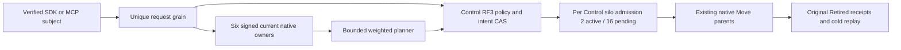

# Capacity-aware tenant placement

Status: authored source N for original KL-070/KL-071; no compiler, execution, Linux qualification, fault or performance pass. Owner: ClusterRouting. Decision: [ADR-129](../../ADR/ADR-129-capacity-aware-tenant-placement.md).

| Requirement | Acceptance and evidence |
|---|---|
| REQ-CAPPLACE-001: server-authenticated capacity from every actual voter of the two registered RF3 owners. | AC-CAPPLACE-001: six unique original query IDs/nonces, native silo generations and physical/incarnation tuples; original cohort, sample time and expiry remain unchanged. Missing member, stale sample, unknown container limit or host domain refuses before a new placement effect. |
| REQ-CAPPLACE-002: deterministic bounded tenant classification and capacity/failure-domain eligibility. | AC-CAPPLACE-002: versioned policy CAS, 64 whole-partition ceiling, key+value byte accounting under native charged reads, integer weighted rendezvous, fixed promotion/demotion hysteresis; no partial atomic partition or storage-handle migration. |
| REQ-CAPPLACE-003: authoritative policy/intent records use existing Control RF3, native serialization and full-scope outcomes. | AC-CAPPLACE-003: native ZoneTree complete image, original outcome bytes, stale CAS refusal, same-GUID replay after repair and two real cold opens; fresh persisted administrator authorization precedes effects. |
| REQ-CAPPLACE-004: apply is a bounded per-Control-owner service using existing native Move parents. | AC-CAPPLACE-004: two active and sixteen pending per Control silo (actual RF3 ceilings six/48), durable same-intent revision/claim CAS, immutable original Move IDs and Retired receipts, no whole-tenant atomic claim. |
| REQ-CAPPLACE-005: cancellation, resource closure and uncertainty preserve original operation semantics. | AC-CAPPLACE-005: original CQRS request token/progress backpressure, native work leases, grant settlement, retained shutdown tasks and all primary/cleanup failures; missing phase/pause ACK leaves pending original Move unknown, never a new GUID. |
| REQ-CAPPLACE-006: actual public interoperability preserves scope, ownership and cold replay. | AC-CAPPLACE-006: genuine six-owner Aspire with .NET SDK and official MCP; unavailable policy then CAS repair, administrator denial retained after permission repair, healthy distinct GUID, signed plan/persist/native transfer, same Apply GUID replay, changed request Conflict, two dirty and two healthy cold cuts, exact complete raw bytes on successive real offline opens, original canonical policy/intent/outcome/header bytes after native runtime restart, and all-model continuation. |

Policy defaults are promotion 64 MiB and demotion 32 MiB of bounded committed partition key+value bytes, reserve 256 MiB and 20% disk, at most 80% finite container memory and 85% finite CPU quota, weights 1..16. Sampling uses an owned 5-second PeriodicTimer; original samples expire after 15 seconds. Private admission shares existing routing/read limits and never resets the public request expiry. Unknown resources are unavailable, not host-memory substitutions.

Policies and intents commit through native generated Orleans records and existing ZoneTree transactions. Keys are existing KeyCodec string namespaces tenant-placement-policy-v1 / tenant-placement-intent-v1; capacity observations are disposable and never authoritative. Additive aliases use keyload.cluster-routing.; Root reserves operations 46..49 and reads 81..84. OwnerCapacity81 and PlacementIntentPhase49 remain private and excluded from generic public issue/catalog paths.

Persist47 has a native server-derived admission record: original public request plus fresh complete signed capacity. Its canonical fingerprint remains original GUID/kind/principal/public request, excluding refreshed observations. A retained outcome still traverses ordinary verified submit and original RF3 acknowledgement; it is never returned early. New permission denial stays an ordinary retained database outcome. New authorized persistence verifies the original plan's expiry/nonces/generations and current complete cohort without refreshing its original witnesses. Apply preserves the original typed public request once and uses internal current revision CAS for later phases.

Plans retain the complete original tenant/database partition set and stable ControlPartition. Current roster, registered physical owner, incarnation, global directory revision and destination exclusivity are checked before each new Move; existing parent header/terminal receipt is replayed with the original Move ID. This does not reserve an owner against future tenant enrollment. Implicit first writes do not advance PMAP directory revision. Automatic future enrollment/exclusive-tenant reservation remains a separate unqualified authority requirement; this bounded current-set intent must not be advertised as whole KL-070 acceptance.

Public read/configure/plan/persist/apply APIs expose existing SDK Result and official MCP canonical schemas. Public admission requires the actual configured Control role; Destination silos expose only private capacity. Each real database operation retains the separate native request grain and fresh persisted subject. No caller-supplied role, new transport, compatibility parser, scalar profile, blanket scheduling attribute or physical file migration is introduced.

Automated authored whole flows:
- TenantPlacementPolicyOutcomeTests.OriginalStalePolicyCasRetainsFullScopeOutcomeAcrossRepairReplayAndTwoColdCuts (real store Unit).
- TenantCapacityPlacementRf3Tests.OriginalSignedCapacityPlanPersistsAppliesReplaysAndSurvivesTwoColdOwnerCuts (six-owner SDK/official MCP).
Original deadlines and cleanup ownership are reused. Fresh native census must supply actual UIDs; none are inferred. Local RF3 requires the genuine verified-image session and exactly the new whole-class selector, with every existing receipt/hash/container/environment guard unchanged. The guarded closed-selector N is included for Root review; no local admission exists until it is integrated. Linux qualification remains separate. Source N and native checkOnly do not imply compiler/discovery/runtime PASS.

Frontend: N/A, administrator routing has no separate UI. Server/Core/Orleans/Abstractions/SDK/MCP/AppHost/tests apply. Required remaining gates: coherent native compiler/analyzers, canonical formatter, Release, complete native census, Unit/process/RF3, exact-source Linux fault/resource/endurance and measured performance. Required interruption/claim-ACK-loss and missing-member cohorts remain qualification flows rather than inferred healthy evidence.

## Persisted capacity enrollment binding

REQ-CAPPLACE-001 / AC-CAPPLACE-001 require the signed live owner cohort to agree with the current Control physical-owner directory before issuing a plan, before a new intent persistence effect, and before each new Move. The existing directory ceiling is two owners; equality covers physical ID, incarnation, placement epoch and ordered voter IDs, not merely destination ID presence. Original signed query IDs/nonces, native generations and sample expiry remain unchanged. Fresh persisted administrator authorization precedes these reads; charged native views and existing budgets remain authoritative.

The enrollment check uses the existing native directory decoder. Missing or changed enrolled membership refuses OwnershipLost with the original complete-cohort detail; malformed committed directory/control authority remains Corruption. No record, operation kind, alias, public wire, transport, registration-update API or lifetime is added. Retained persistence outcomes still use ordinary verified submit/RF3 acknowledgement. Apply has already crossed its durable claim boundary when later validation runs; a refusal must not be described as removing that claim or refreshing its original Apply/Move IDs.

PlacementCapacityEnrollmentTests.OriginalPersistedEnrollmentFencesOwnerTupleAcrossRepairReplayAndTwoColdCuts is a real-store Unit control: missing directory, native registration repair, changed incarnation/epoch/ordered voters and incomplete enrolled selection, original registration replay, exact complete raw image/position and two genuine cold opens. It supplies native owner tuples as bounded validator inputs; it does not claim a signed-capacity or six-silo trust proof. TenantCapacityPlacementRf3Tests retains the original SDK/MCP signed plan/persist/native Move/replay/cold/healthy whole flow on the affected product path. Exact-source Linux execution, actual missing-member/signed-metadata refusal and claim-ACK-loss flows remain qualification gates.

## Original single-member capacity refusal

REQ-CAPPLACE-001 / AC-CAPPLACE-001 and REQ-CAPPLACE-006 / AC-CAPPLACE-006 extend the original TenantCapacityPlacementRf3Tests.OriginalSignedCapacityPlanPersistsAppliesReplaysAndSurvivesTwoColdOwnerCuts operation. First verify all six native membership health snapshots against the actual returned fingerprint, then inspect and SIGKILL only the owned node6 container. Retain its original running/exited ID, image and completed kill receipt. Await the existing Aspire membership health event and require actual node1 membership HTTP 503; the current readiness contract returns six or unavailable, never a manufactured five-member snapshot.

While both physical groups retain a majority, the original SDK and official MCP placement-plan calls must refuse OwnershipLost with the unchanged complete-cohort detail. No new placement effect is admitted. Compare original canonical policy/outcome bytes, parent absence, exact outstanding grants and complete all-model receipts, then join all original owners, verify exact native offline images, perform two real cold owner opens/replays and restore genuine six-member health before continuing the original healthy policy CAS, signed plan, intent persistence, transfer, Apply receipt replay and healthy cold flow. Original test declaration, GUIDs, parent deadline, cleanup bounds, native SIMD and native50 scheduling remain unchanged. This source/test addition is not Linux qualification, power-loss durability or complete KL-070 acceptance; exact-source Linux execution, signed metadata refusal and claim-ACK-loss gates remain open.
