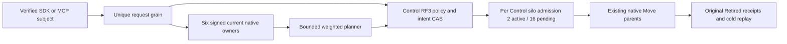

# Capacity-aware tenant placement

Status: authored source N for original KL-070/KL-071; no compiler, execution, Linux qualification, fault or performance pass. Owner: ClusterRouting. Decision: [ADR-129](../../ADR/ADR-129-capacity-aware-tenant-placement.md).

| Requirement | Acceptance and evidence |
|---|---|
| REQ-CAPPLACE-001: server-authenticated capacity from every actual voter of the two registered RF3 owners. | AC-CAPPLACE-001: six unique original query IDs/nonces, native silo generations and physical/incarnation tuples; original cohort, sample time and expiry remain unchanged. Missing member, stale sample, unknown container limit or host domain refuses before a new placement effect. |
| REQ-CAPPLACE-002: deterministic bounded tenant classification and capacity/failure-domain eligibility. | AC-CAPPLACE-002: versioned policy CAS, 64 whole-partition ceiling, key+value byte accounting under native charged reads, integer weighted rendezvous, fixed promotion/demotion hysteresis; no partial atomic partition or storage-handle migration. |
| REQ-CAPPLACE-003: authoritative policy/intent records use existing Control RF3, native serialization and full-scope outcomes. | AC-CAPPLACE-003: native ZoneTree complete image, original outcome bytes, stale CAS refusal, same-GUID replay after repair and two real cold opens; fresh persisted administrator authorization precedes effects. |
| REQ-CAPPLACE-004: apply is a bounded per-Control-owner service using existing native Move parents. | AC-CAPPLACE-004: two active and sixteen pending per Control silo (actual RF3 ceilings six/48), durable same-intent revision/claim CAS, immutable original Move IDs and Retired receipts, no whole-tenant atomic claim. |
| REQ-CAPPLACE-005: cancellation, resource closure and uncertainty preserve original operation semantics. | AC-CAPPLACE-005: original CQRS request token/progress backpressure, native work leases, grant settlement, retained shutdown tasks and all primary/cleanup failures; missing phase/pause ACK leaves pending original Move unknown, never a new GUID. |
| REQ-CAPPLACE-006: actual public interoperability preserves scope, ownership and cold replay. | AC-CAPPLACE-006: genuine six-owner Aspire with .NET SDK and official MCP; unavailable policy then CAS repair, administrator denial retained after permission repair, healthy distinct GUID, signed plan/persist/native transfer, same Apply GUID replay, changed request Conflict, two dirty and two healthy cold cuts, exact complete raw bytes on successive real offline opens, original canonical policy/intent/outcome/header bytes after native runtime restart, and all-model continuation. |

Policy defaults are promotion 64 MiB and demotion 32 MiB of bounded committed partition key+value bytes, reserve 256 MiB and 20% disk, at most 80% finite container memory and 85% finite CPU quota, weights 1..16. Sampling uses an owned 5-second PeriodicTimer; original samples expire after 15 seconds. Private admission shares existing routing/read limits and never resets the public request expiry. Unknown resources are unavailable, not host-memory substitutions.

Policies and intents commit through native generated Orleans records and existing ZoneTree transactions. Keys are existing KeyCodec string namespaces tenant-placement-policy-v1 / tenant-placement-intent-v1; capacity observations are disposable and never authoritative. Additive aliases use keyload.cluster-routing.; Root reserves operations 46..49 and reads 81..84. OwnerCapacity81 and PlacementIntentPhase49 remain private and excluded from generic public issue/catalog paths.

Persist47 has a native server-derived admission record: original public request plus fresh complete signed capacity. Its canonical fingerprint remains original GUID/kind/principal/public request, excluding refreshed observations. A retained outcome still traverses ordinary verified submit and original RF3 acknowledgement; it is never returned early. New permission denial stays an ordinary retained database outcome. New authorized persistence verifies the original plan's expiry/nonces/generations and current complete cohort without refreshing its original witnesses. Apply preserves the original typed public request once and uses internal current revision CAS for later phases.

Plans retain the complete original tenant/database partition set and stable ControlPartition. Current roster, registered physical owner, incarnation, global directory revision and destination exclusivity are checked before each new Move; existing parent header/terminal receipt is replayed with the original Move ID. This does not reserve an owner against future tenant enrollment. Implicit first writes do not advance PMAP directory revision. Automatic future enrollment/exclusive-tenant reservation remains a separate unqualified authority requirement; this bounded current-set intent must not be advertised as whole KL-070 acceptance.

Public read/configure/plan/persist/apply APIs expose existing SDK Result and official MCP canonical schemas. Public admission requires the actual configured Control role; Destination silos expose only private capacity. Each real database operation retains the separate native request grain and fresh persisted subject. No caller-supplied role, new transport, compatibility parser, scalar profile, blanket scheduling attribute or physical file migration is introduced.

Automated authored whole flows:
- TenantPlacementPolicyOutcomeTests.OriginalStalePolicyCasRetainsFullScopeOutcomeAcrossRepairReplayAndTwoColdCuts (real store Unit).
- TenantCapacityPlacementRf3Tests.OriginalSignedCapacityPlanPersistsAppliesReplaysAndSurvivesTwoColdOwnerCuts (six-owner SDK/official MCP).
Original deadlines and cleanup ownership are reused. Fresh native census must supply actual UIDs; none are inferred. Local RF3 requires the genuine verified-image session and exactly the new whole-class selector, with every existing receipt/hash/container/environment guard unchanged. The guarded closed-selector N is included for Root review; no local admission exists until it is integrated. Linux qualification remains separate. Source N and native checkOnly do not imply compiler/discovery/runtime PASS.

Frontend: N/A, administrator routing has no separate UI. Server/Core/Orleans/Abstractions/SDK/MCP/AppHost/tests apply. Required remaining gates: coherent native compiler/analyzers, canonical formatter, Release, complete native census, Unit/process/RF3, exact-source Linux fault/resource/endurance and measured performance. Required interruption/claim-ACK-loss and missing-member cohorts remain qualification flows rather than inferred healthy evidence.

## Persisted capacity enrollment binding

REQ-CAPPLACE-001 / AC-CAPPLACE-001 require the signed live owner cohort to agree with the current Control physical-owner directory before issuing a plan, before a new intent persistence effect, and before each new Move. The existing directory ceiling is two owners; equality covers physical ID, incarnation, placement epoch and ordered voter IDs, not merely destination ID presence. Original signed query IDs/nonces, native generations and sample expiry remain unchanged. Fresh persisted administrator authorization precedes these reads; charged native views and existing budgets remain authoritative.

The enrollment check uses the existing native directory decoder. Missing or changed enrolled membership refuses OwnershipLost with the original complete-cohort detail; malformed committed directory/control authority remains Corruption. No record, operation kind, alias, public wire, transport, registration-update API or lifetime is added. Retained persistence outcomes still use ordinary verified submit/RF3 acknowledgement. Apply has already crossed its durable claim boundary when later validation runs; a refusal must not be described as removing that claim or refreshing its original Apply/Move IDs.

PlacementCapacityEnrollmentTests.OriginalPersistedEnrollmentFencesOwnerTupleAcrossRepairReplayAndTwoColdCuts is a real-store Unit control: missing directory, native registration repair, changed incarnation/epoch/ordered voters and incomplete enrolled selection, original registration replay, exact complete raw image/position and two genuine cold opens. It supplies native owner tuples as bounded validator inputs; it does not claim a signed-capacity or six-silo trust proof. TenantCapacityPlacementRf3Tests retains the original SDK/MCP signed plan/persist/native Move/replay/cold/healthy whole flow on the affected product path. Exact-source Linux execution, actual missing-member/signed-metadata refusal and claim-ACK-loss flows remain qualification gates.

## Original single-member capacity refusal

REQ-CAPPLACE-001 / AC-CAPPLACE-001 and REQ-CAPPLACE-006 / AC-CAPPLACE-006 extend the original TenantCapacityPlacementRf3Tests.OriginalSignedCapacityPlanPersistsAppliesReplaysAndSurvivesTwoColdOwnerCuts operation. First verify all six native membership health snapshots against the actual returned fingerprint, then inspect and SIGKILL only the owned node6 container. Retain its original running/exited ID, image and completed kill receipt. Await the existing Aspire membership health event and require actual node1 membership HTTP 503; the current readiness contract returns six or unavailable, never a manufactured five-member snapshot.

While both physical groups retain a majority, the original SDK and official MCP placement-plan calls must refuse OwnershipLost with the unchanged complete-cohort detail. No new placement effect is admitted. Compare original canonical policy/outcome bytes, parent absence, exact outstanding grants and complete all-model receipts, then join all original owners, verify exact native offline images, perform two real cold owner opens/replays and restore genuine six-member health before continuing the original healthy policy CAS, signed plan, intent persistence, transfer, Apply receipt replay and healthy cold flow. Original test declaration, GUIDs, parent deadline, cleanup bounds, native SIMD and native50 scheduling remain unchanged. This source/test addition is not Linux qualification, power-loss durability or complete KL-070 acceptance; exact-source Linux execution, signed metadata refusal and claim-ACK-loss gates remain open.

### Same-tenant partial publication and original receipts

REQ-CAPPLACE-002/003/004/006 and AC-CAPPLACE-002/003/004/006 additionally require TenantCapacityPlacementRf3Tests.SameTenantTwoMovesRetainRowCasAndOriginalReceiptsAcrossPartialPublicationAndTwoColdCuts. Two genuinely seeded partitions share the original persisted tenant/database/schema and borrowed verified administrator credential; the sibling does not reconfigure policies or create another principal epoch. The original class and preceding operation remain unchanged, with the original parent deadline and native50 scheduling.

An SDK/official-MCP Control bind produces literal directory one with both target rows still fallback zero. The original signed two-Move plan retains directory one and two separate native row CAS zero values. The real existing ControlPrepare SubmitReturned hold for the second immutable Move proves its committed original journal receipt on the actual Control voter/incarnation while an authenticated intent read retains Applying, exactly one original Retired receipt, original Apply GUID/body and original complete plan/claim. Literal first-row two/global two, second fallback zero/global two and unchanged Control-row one/global two distinguish the completed-publication count from per-row CAS. Release and join the same original caller, native marker/producer/settlement/retirement resources; completion must retain both original Retired receipts, with second row three/global three. No product observer, callback, wire or signing contract is added.

The original unavailable policy refusal and genuine policy-CAS repair precede the operation. Same original Apply and individual Move GUIDs replay through both SDK and official MCP; changed Apply content refuses Conflict while the complete retained outcome and model images remain unchanged. Two dirty and two healthy six-owner stopped cuts independently reopen each native full raw image, preserve canonical policy/outcome/intent/parent rows and exact outstanding grants, then reacquire both official clients and verify complete literal all-model data/receipts. Distinct-GUID healthy writes on both moved partitions finish the operation. This NEXT source-only test requires the reviewed per-row/global CAS product correction and original committed-claim lifetime packet; it is not an executed Linux/RF3 gate, private phase ACK-loss proof, physical anti-affinity proof or complete KL-070/KL-076 qualification.

## Committed Applying claim race

REQ-CAPPLACE-004 / AC-CAPPLACE-004 and REQ-CAPPLACE-005 / AC-CAPPLACE-005 extend the existing TenantCapacityPlacementRf3Tests.OriginalSignedCapacityPlanPersistsAppliesReplaysAndSurvivesTwoColdOwnerCuts declaration without a new test argument or scheduling attribute. Arm the existing private SubmitReturned hold for the deterministic ControlPrepare command of the actual signed plan Move. A successful original journal record binds that exact command, Move, partition, principal, original physical owner/incarnation and positive applied position. The source commits Applying before executing that Move; an authenticated SDK read while the original producer is held must expose the original public Apply GUID/request, complete plan, policy epoch, Control owner, revision step, no completed moves or receipts and a live original claim nonce.

Read the genuine signed discovery of all six current native owners through the existing AppHost-owned credentials and generated serializer, zero temporary peer keys, and verify every actual membership health fingerprint. Match claim voter/silo and journal voter/silo separately against this complete cohort and the original Control owner; different native child and parent activations need not choose the same voter. The journal position belongs to committed Prepare, not an invented claim journal position.

The official MCP same-GUID/same-request Apply while that claim remains live must refuse dispatched Conflict with the original stale-authority detail. Its ordinary private failure outcome is legitimate; do not assert that the entire physical image stayed byte-identical. Instead compare the complete authoritative Applying intent and exact observed Prepare witness before/after that competing request, with the first producer still held and no additional completed Move/receipt. Release and join the original SDK producer, original marker reader, settlement and ProducerDisposed observation, then retire the arm before cold restart. On any failure retain roots and the original primary plus every cancellation/output/cleanup failure using the existing sixty-second cleanup contract.

Continue the original unchanged completed receipt, SDK/MCP same-Apply replay, changed-content refusal, original Move receipt replay, all models and two healthy offline cold owner cuts. Existing dirty cold cuts and unavailable/repair controls remain unchanged. This is a test-owned committed-cut witness, not a new production callback, wire schema, duplicate dispatcher, throughput assertion or Linux acceptance. Lost-ACK and active-owner loss qualification remain distinct outstanding gates.

### Row CAS and global directory fences

REQ-CAPPLACE-002 / AC-CAPPLACE-002 and REQ-CAPPLACE-006 / AC-CAPPLACE-006 distinguish the selected partition row revision from the global PMAP directory revision. An original signed plan retains its same-view global DirectoryRevision. Each immutable native Move request carries that partition's actual row Revision as ExpectedPlacementRevision; a fallback retains row zero even after another assignment advanced the global directory. Before a new parent exists, apply requires both the original row CAS and the global plan revision plus the number of completed native publications. Existing retained parent replay, physical owner/lineage validation, current persisted authorization, policy/cohort/enrollment/eligibility and original receipts remain unchanged.

The original TenantCapacityPlacementRf3Tests.OriginalSignedCapacityPlanPersistsAppliesReplaysAndSurvivesTwoColdOwnerCuts operation first binds its existing ControlPartition through SDK and official MCP under the original stable command GUID. Literal Control row/directory one and primary fallback row zero/directory one witnesses discriminate the two authorities. The fresh signed capacity plan must retain directory one and native Move row CAS zero, then execute the unchanged original persist/apply/changed-content refusal/receipt replay/all-model and two healthy cold flows. Replay the original Control bind through SDK and MCP after those real cold cuts. All preceding unavailable-policy, dirty cold, persisted authorization and genuine single-owned membership-loss controls remain mandatory. This NEXT N regression has not executed and does not close Linux RF3, power-loss, overload or complete KL-070/KL-076 gates.

The native plan shape validator retains nonnegative per-row CAS values and the checked complete publication count while keeping every existing scope, mode, identity and bounded-plan check. A newly persisted signed intent compares both actual same-view row revision and original global directory revision; a global equality alone cannot admit a stale row. The already-read native resolution supplies both fields, so no metadata read is skipped, added or granted a larger budget. Existing immutable retained scopes are not rewritten.

### Committed ControlPrepare response loss and original intent recovery

REQ-CAPPLACE-004..006 / AC-CAPPLACE-004..006 require the original public Apply GUID and typed body to survive loss of its owner after a genuinely observed committed ControlPrepare. TenantCapacityPlacementRf3Tests.OriginalCapacityApplyResumesSameGuidAfterObservedCommittedPrepareOwnerLossAndTwoColdCuts reuses the complete original six-owner unavailable-policy, dirty-cold, membership-refusal, fresh persisted authorization, policy repair, signed-plan and SDK/MCP persist flow. Its exact existing SubmitReturned Hold is armed on the deterministic native Prepare phase ID. Before any kill it requires the actual successful journal receipt, matching principal/partition/request/native voter/silo/control incarnation and unexpired authoritative Applying intent with no completed Move receipts; same-GUID concurrent Apply remains Conflict without changing the witness or intent.

Kill the actual original SDK HTTP owner node1 first through the existing full-container-ID inspected fault path, then join all six original owners, original response/marker tasks, AppHost and exclusive storage locks. The native write transport must return the literal UnknownWriteOutcome problem for an unavailable write response; unexpected original results remain failures. Joined-killed-owner gate settlement uses the observed original journal/marker/producer and does not fabricate ProducerDisposed. Two independent offline opens compare each owner's complete raw rows/cut/grants and the unchanged Applying intent on all three Control replicas; the actual scoped Prepare outcome must retain its original receipt and physical owner.

Restart the same owned six resources, preserve physical owner incarnations and voters, verify genuinely different native silo addresses and full cohort fingerprint, and require the original claim still unexpired. Official MCP reuses the exact original Apply GUID/body to reclaim after the actual old canonical silo is absent; no synthetic generation or elapsed-time fallback is admitted. The completed intent retains principal/policy/plan/control and original Move ID, a fresh actual claim, exact retired receipt, SDK/MCP replay and changed-content Conflict. Two healthy offline cold cuts, original all-model/Control receipts and a distinct healthy document operation complete the flow.

This test uses unchanged native50/SIMD and parent/cleanup deadlines and introduces no product observer, wire or serializer. It proves external original response loss at committed ControlPrepare and actual owner-loss reclaim only after genuine execution. Private Claim/Paused/Completed phase acknowledgement loss, continuously serving five-node capacity, physical anti-affinity, overload/endurance/performance and Linux qualification remain separate open gates.
