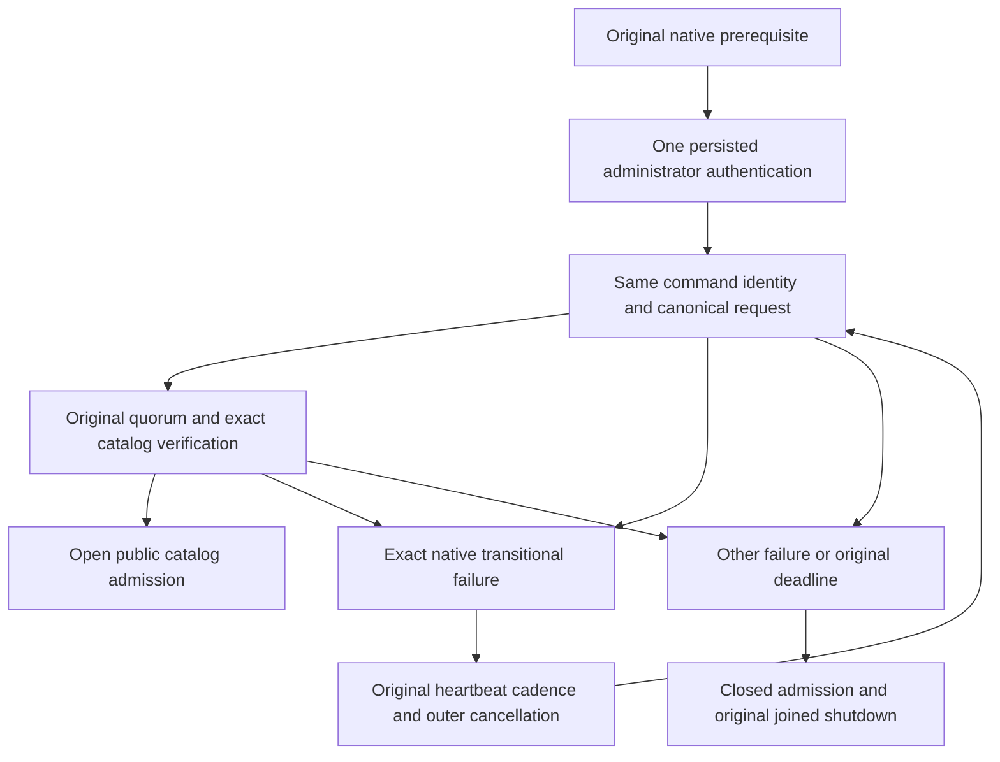

# Bounded physical catalog bootstrap settlement

REQ-SCAT-003 / AC-SCAT-003 and ADR-099 require current quorum-committed catalog authority before public readiness. Original R151 source 924e782f retained an independent graph-operation cold-start failure: node2's catalog BootstrapPhysicalShardCatalog returned UnknownWriteOutcome with ReplicaProtocol.InterruptedWrite; node3's same startup command failed OwnershipLost with ReplicaProtocol.NoLeader; node1 later cancelled its native prerequisite. These are original observed failures, not proof of which original bootstrap entry committed. Docker Running alone does not prove that a server survived its logged fatal startup exception.

The original sampled native prerequisite does not reserve a leader across the subsequent authentication, signed command and quorum verification awaits. The existing startup method performed only one bootstrap attempt and treated both documented transitional results as fatal process startup failures, despite the existing same-command uncertain-retry contract. A failed startup can therefore remove a needed voter while its peers are still establishing the real quorum. Source inspection and these original logs justify completing bounded same-identity settlement; they do not establish that every startup/fault case will pass.

REQ-SCAT-SETTLEMENT-001: authenticate the persisted administrator exactly once after the unchanged native replica prerequisite. Under the SAME original linked InitializeAsync ExecutionLifetime and TimeProvider, submit the original physical-shard-derived command ID and byte-identical native request serialized ONCE before the settlement loop, then perform the original quorum barrier and exact catalog verification. Each request GUID remains fresh. Public catalog admission stays closed until both operations succeed.

REQ-SCAT-SETTLEMENT-002: only the exact native pair UnknownWriteOutcome/ReplicaProtocol.InterruptedWrite or OwnershipLost/ReplicaProtocol.NoLeader may repeat bootstrap settlement. Use the original configured replica HeartbeatInterval and original cancellation for the delay. Never renew a deadline, alter a signed purpose, change command identity/payload, bypass current persisted authorization, directly write catalog data, restart a server, or retry the initial authentication. Existing native command idempotency resolves uncertain delivery; no transport-delivery certainty is inferred.

REQ-SCAT-SETTLEMENT-003: mismatched catalog/placement, incompatible cohort, authentication/permission denial, malformed/corrupt data, arbitrary OwnershipLost or other UnknownWriteOutcome detail, and cancellation remain terminal through the unchanged startup owner and joined cleanup. The repeated bootstrap and VerifyCatalogAsync each keep their existing fresh native authority checks. Returning from the sampled prerequisite alone never opens public readiness.

AC-SCAT-SETTLEMENT-001: rerun the original R151 GraphSearchLineageRf3Tests complete four argument variants, preserving all real SDK/official MCP operations, native current authorization, corrupt-row refusal/repair, complete result/receipt/state oracles and both genuine original-volume three-node cold cycles. Retain the original failing True/True evidence alongside later results; a passing subset cannot count the complete selection.

AC-SCAT-SETTLEMENT-002: retain the original physical-catalog mismatch, denied-effect, corrected healthy-wave, same-command replay, metadata bootstrap and native startup cancellation operations. Invalid configured identities must remain denied. Verify the exact retained native bootstrap entry/witness identity and payload with unchanged business effects across native restart; this does not add raw payload, credential or private voter-inventory logging; legitimate repeated startup entries remain classified only by the existing strict original identity oracle. No mock retry helper or getter/setter test substitutes for these operations.

AC-SCAT-SETTLEMENT-003: complete current native diagnostics, canonical formatter, Release build, focused native/RF3 checks and exact-source Linux qualification. Unknown outcome, cancelled startup, fault/resource/endurance and complete task acceptance remain open until original artifacts prove them. This amendment changes internal bounded startup settlement only; no public or persisted contract, Orleans execution owner, RF3 topology, provider, format or product deadline changes.

