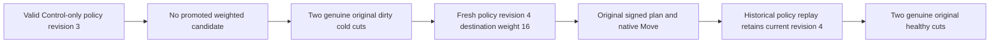

# KL-070 configured owner eligibility

SOURCE_N only; compiler, native admission, six-owner runtime and Linux qualification OPEN.

REQ-KL070-WEIGHT-001 / AC-KL070-WEIGHT-001: a persisted valid policy may contain one or two positive owner weights. Only listed owners participate in weighted selection. A hysteresis-required destination lacking a weight is unavailable, producing existing ResourceExhausted/ScopeMismatch, not malformed-policy Validation. Fresh administrator/cohort/roster/capacity/failure-domain checks remain unchanged.

REQ-KL070-WEIGHT-002 / AC-KL070-WEIGHT-002: strengthen OriginalInvalidOwnerWeightsRetainValidationOutcomesAcrossPolicyRepairNativeMoveAndColdReplay without a new Case/Args/deadline. Preserve original weights zero/seventeen failures. Configure real revision-three Control-only policy; SDK and official MCP Plan independently refuse with full canonical problems and complete current policy/model receipts after each. Preserve absent Move/grants and original failed outcomes through the same two dirty cold cuts. Repair distinct Configure at revision four with destination weight sixteen, execute the original real Move/Persist/Apply and two healthy cuts. Historical successful revision-three Configure replay must not restore policy three; verify current four after each replay.

REQ-KL070-WEIGHT-003: original six native owners, physical/atomic identity, policy epoch, full business image/receipts, cancellation, cleanup error ledger, read budgets, capacities, default weights, original request IDs and failed outcome bytes are conserved. This does not implement future-enrollment exclusive reservation, claim performance, or prove complete KL-070.

Canonical slice ClusterRouting. Applicable ADR-129 and ADR-030/117/125. UI N/A; no new public API, serializer or package.

