# Native caller factory registration before task creation

Applies to [ClusterRouting](../ClusterRouting.md), the readonly NativeConnectionIdentityCollision helper roles, [ADR-125](../../ADR/ADR-125-connection-owned-execution.md), [ADR-035](../../ADR/ADR-035-memory-performance.md) and [ADR-117](../../ADR/ADR-117-native-tunit-ci-entry.md).

REQ-CONNECTION-CALLER-FACTORY-001 / AC-CONNECTION-CALLER-FACTORY-001: ConnectionCallerFactoryTests.DuplicateRegistrationDoesNotStartLosingNativeCallerAndBothOriginalAndFreshFactoriesSettle uses Root selected two-file factory-first repair as an explicit future dependency. A new outer ConnectionNativeCalls owns registration metadata but only borrows the SAME actual Task returned by scenario.CommandAsync; scenario remains the native producer/connection cleanup owner. First inline factory creates the real original signed Orleans command and returns that SAME Task by reference. It is held at actual RequestStarted. The losing duplicate registration uses the first outer GUID; its factory WOULD create a genuine native second-principal/different-command task with a separate fresh actual request GUID. Therefore the inner scenario dictionary cannot hide an eager-start defect. The duplicate registration must throw its independently fixed local duplicate detail BEFORE that factory is invoked: zero invocation count, null created Task and no observation for that fresh native GUID. No canned/native replacement Task, callback failure or provider is introduced.

REQ-CONNECTION-CALLER-FACTORY-002 / AC-CONNECTION-CALLER-FACTORY-002: While the first actual native producer is still held, preserve the same observation object and full first probe identity, pending caller, complete canonical image/position/journal, missing outcomes/documents and full empty outbox. Release the first only afterward and independently require its complete expected ACK/document/outbox via the reviewed generic original oracle. A fresh outer registration plus fresh actual native request GUID then executes the SAME second CommandRequest intended by the losing factory. Independently require complete second ACK, different literal document and two full native outbox entries with Before null/independent After/time/token/sequence/ordinal/receipt/head/no-consumers. Both original command IDs replay through fresh outer registrations on the same original actual activation, preserving full canonical image/position/journal/outbox and original outcome bytes. Exact future collision State/Cut/Assertions/Second/Protocol and EOF R5 helpers are reused without fake endpoints or duplicate oracles.

REQ-CONNECTION-CALLER-FACTORY-003 / AC-CONNECTION-CALLER-FACTORY-003: Observe original whole body before registry Stop/Join and actual scenario signed Close. The registry is disposed only after the same Close Task succeeds and all separately captured actual borrowed Tasks are terminal. No Task wrapper may replace the registered native Task. Stop/Join affects this outer registration owner; it is not represented as the native producer cancellation owner. On uncertainty preserve the registry rather than falsely claiming disposal. The existing outer scenario still owns its original native shutdown/error ledger and cleanup. No deadline reset/increase, alternate native dispatcher, new transport or fake failure is allowed.

```mermaid
flowchart LR
 A[Inline original factory returns SAME actual task] --> B[Actual native producer held]
 B --> C[Duplicate registration rejected before factory]
 C --> D[No second task or observation and full no-effects]
 D --> E[First native ACK and independent full outbox]
 E --> F[Fresh outer registration creates actual second task]
 F --> G[Full second ACK and both original receipt replays]
 G --> H[Outer Stop and actual tasks joined]
 H --> I[Original scenario close succeeds]
 I --> J[Only then registry dispose]
```

Qualification: conditional new-only SourceN requiring exact selected Root factory-first Calls/Scenario posts plus explicitly pinned readonly future oracle roles. Current tracked old Calls/Scenario guards remain history and may not be blindly repinned. Compiler/API/native operation/whole original completion/shutdown/Linux gates remain OPEN; this one native Orleans test silo with real journal/materializer/storage does not qualify Docker/Aspire RF3, process/cold/power-loss or production readiness. No SDK/build/test/parser/analyzer/style/preflight/Git/SourceY execution occurred.

Minimal integration: this packet adopts only the five required collision helper/oracle images. The independent native collision Case, Flow, Healthy continuation and its child document remain in their separate reviewed family; they are not part of this fixture-factory repair. The complete factory regression and required original ACK/outbox/replay assertions are included here.

R310 compiler/analyzer closure preserves AC-CONNECTION-CALLER-FACTORY-001/003.
The null losing-task oracle uses a boolean null predicate, avoiding TUnit's Task
assertion overload. The outer registry now has an awaited IAsyncDisposable owner
scope: the body records its original failure before owner disposal releases the
same hold, stops and joins the same borrowed tasks and awaits the same scenario
close. Disposal records each cleanup failure into the same ordered ledger; only
successful close plus terminal borrowed tasks permits registry disposal. An
uncertain close retains the original registry and the existing Unjoined error.
The caller throws the complete ledger after the asynchronous scope ends. No
deadline, native task, assertion, provider or operation identity is replaced.
Original R310 diagnostics remain failure evidence; corrected compilation and the
whole existing native operation remain unexecuted by this source-only repair.
