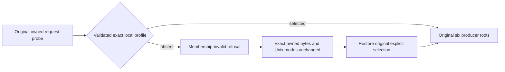

# Exact local diagnostic enrollment after original refusal

This intent-preserving repair implements existing REQ-CRS-LOCAL-ENROLLMENT-001
and AC-CRS-LOCAL-ENROLLMENT-001, ADR-106 private probes and ADR-125 original
producer ownership. The two original local-profile cases remain unchanged.

| Requirement | Complete acceptance flow |
|---|---|
| REQ-CRS-LOCAL-ENROLLMENT-001 | AC-CRS-LOCAL-ENROLLMENT-001: a local image with both remote selectors and a request probe enrolls six producers only after the original validated NativeDiscoveryOmission or EventVectorReservedProbe selection. Missing, false, foreign or nested selection retains its exact original refusal before any owned bytes/modes change. Restore the same owned selection and require its original complete six-member profile. |

The original authenticated Linux failures at prior source a2cfd462 observe no
InvalidOperationException for missing explicit selection. Current native
TwoRf3QueryProbe.Create evaluates the two explicit local-profile branches
first. Its ordinary fallback accepts a sole local image via the exclusive-image
null check, thereby admitting the forbidden missing-selection path. Restore
ordinary fallback rejection for a local image, while preserving that existing
exclusive-image check, remote-selector checks, explicit branches and final
original membership-invalid detail. No profile validation is bypassed.

Automated owners remain NativeCapabilityLocalProfileTests.
ExactLocalCapabilityProfileRejectsMissingEnrollmentWithoutChangingOwnedFilesThenAdmitsRepair
and EventVectorReservedLocalProfileTests.
ExactEventVectorReservedProfileRefusesForeignEnrollmentWithoutEffectsThenAdmitsSameOwnedProfile.
Preserve their noArgs declarations, execution cancellation, original entire
owned-file capture, Unix modes, missing/false/foreign/nested refusals, positive
six-member enrollment and joined RequestCqrsProbeAppHostFileFixture disposal.
These original infrastructure controls use genuine Aspire builder/native
profile APIs; they neither launch a custom network nor qualify public RF3.
No new Case, UID, selector, permission, configuration, file mutation, clock,
retry, timeout, fixture or callback is introduced.

Canonical source map: src/KeyLoad.AppHost/Features/ClusterRouting/Helpers/
TwoRf3QueryProbe.cs owns the existing admission predicate; tests/KeyLoad.UnitTests/
Features/ClusterRouting/Cases/ owns the original two complete controls.
UI/public SDK/MCP/benchmarks are N/A: this repair is private AppHost profile
admission only. Compiler, original complete executions and exact-source Linux
qualification remain OPEN; historical failures are retained. A source review
cannot establish runtime success or strengthen a storage/durability claim.
