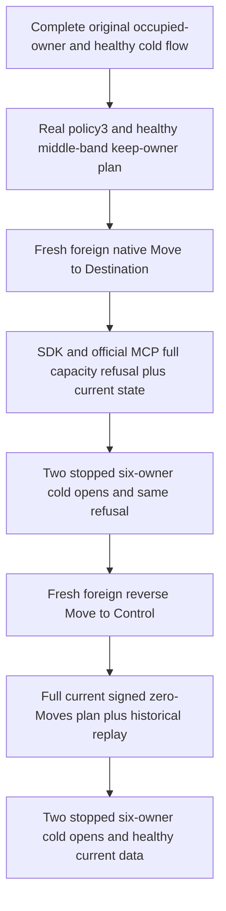

# Dedicated current owner exclusivity inside hysteresis

Canonical ClusterRouting; KL070 source-only correction. Compiler, whole-operation duration, native RF3/Linux/fault/endurance qualification OPEN.

| Requirement | Acceptance |
|---|---|
| REQ-CAPEXCLUSIVE-001 | AC-CAPEXCLUSIVE-001: both promotion and current-owner hysteresis retention require the existing complete-roster exclusivity check for every non-Control candidate. Control small-tenant sharing remains permitted. |
| REQ-CAPEXCLUSIVE-002 | AC-CAPEXCLUSIVE-002: after the entire original occupied-owner case and healthy/cold sequence, unchanged primary row6 stays on Destination. Native foreign Move publishes row/global7/epoch4; policy2→3 retains actual capacity floors/weights, uses promotion long.MaxValue/demotion0. Full SDK Problem and official five-field fixed capacity Problem refuse the old-code empty-Moves plan, with complete current state after each. |
| REQ-CAPEXCLUSIVE-003 | AC-CAPEXCLUSIVE-003: two real six-node stopped/reopened cold cuts preserve the refusal and original policy/Move/model receipts. Genuine foreign reverse Move publishes row/global8/epoch5, primary row6/epoch2 unchanged. Both clients now return complete fresh signed zero-Moves plans, never persisted as an empty intent. Original historical receipts cannot restore prior placement. Two further real cold opens preserve current policy3/full literal placement and all-model/healthy records and complete original scoped outcomes/header bytes. |
| REQ-CAPEXCLUSIVE-004 | AC-CAPEXCLUSIVE-004: same original Case/UID/Args/deadline, original unavailable/foreign-authority/forward/reverse/full apply/cold operation untouched. No fake telemetry, new public operation, provider, payload, quota or permission bypass. |

Existing regression selector: `TenantCapacityPlacementRf3Tests.OriginalOccupiedDedicatedOwnerRefusesCapacityPlanThenSiblingRepairRestoresSameTenantPlacementAndColdReplay`; its unchanged operation appends `TenantPlacementHysteresisExclusiveRf3Flow.RunAsync` only after its final original healthy two-cold helper. Current product returned an empty-Moves signed plan in the hysteresis band without inspecting foreign occupancy; new source checks that dedicated candidate with the same predicate already used by promotion and apply.

Promotion long.MaxValue is a real validated persisted policy, not an observed-value-derived threshold. The bounded original nonempty corpus is positive and cannot approach long.MaxValue under existing native read/batch limits. First fresh keep-owner plans prove actual same-cohort capacity eligibility before foreign occupancy; full read refusals are not relabelled startup errors.

This is current-set isolation, not a future enrollment reservation. Automatic dedicated-tenant isolation and whole KL070 remain open. SDK/official MCP are applicable; frontend N/A. See [capacity placement](CapacityAwarePlacement.md), [ADR129](../../ADR/ADR-129-capacity-aware-tenant-placement.md) and [ADR117](../../ADR/ADR-117-native-tunit-ci-entry.md).

Historical receipt and current minimum are distinct: the sibling healthy receipt was originally committed on Control epoch3. Preserve exact original command/receipt replay after both new Moves, but read current sibling documents without that obsolete minimum. The old minimum must refuse exact TokenInvalidated/incarnation detail at Target epoch4, and exact placement detail at Control epoch5; native validation checks incarnation before placement. Each refusal is followed by full independently literal original and healthy sibling rows. Original pre-extension helper/oracles remain unchanged.
