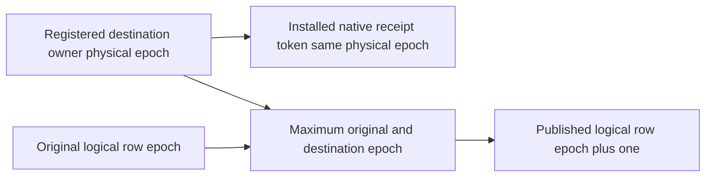

# Native installation ownership versus published placement epoch

REQ/AC-KL071-INSTALLATION-EPOCH-001: compare every installed native token against exact registered destination physical owner incarnation, atomic partition and PlacementEpoch; the actual native position remains opaque and positive. REQ/AC-KL071-PUBLICATION-EPOCH-002: independently compare complete published/current placement DTOs at max(original logical placement epoch, registered destination physical epoch)+1, with exact original partition/owner/voters/directory and publication revisions. Installation owner epoch and publication epoch are distinct domains and must not be equated.

Confirmed source oracle defect: existing PhysicalShardPartitionMovementRf3Placement expected installed token at original logical epoch+1 and assumed destination physical epoch<=source logical epoch. Exact CompleteMoveInstall builds a native token from the destination store, ControlAdvance requires its OwnershipEpoch==DestinationOwner.PlacementEpoch, and ControlFinalize separately computes the next published max+1. This correction preserves all complete DTO/receipt/position/source-cut and ownership assertions; it does not modify product tokens or relax authority. Real native six-owner split/resume/merge and committed-cleanup continuation use this shared existing oracle. Parent/ordinary command cache policy laws remain separate.

SourceN only; peer/native/compiler/runtime/UID/deadline/Linux qualification OPEN. Existing Cases, source corpus, command IDs, token fields, private callers, actual topology and lifecycle deadlines unchanged. Frontend N/A; no new API, product writer, provider or compatibility path.

