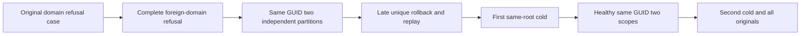

# KL069 logical atomic scope lifecycle

Parent: [ClusterRouting](../ClusterRouting.md); [ADR001](../../ADR/ADR-001-partition-identity-affinity.md), [ADR016](../../ADR/ADR-016-atomic-physical-placement.md), [ADR024](../../ADR/ADR-024-transaction-domain-binding.md).

REQ-KL069-SCOPE-LIFECYCLE-001: full four-field partition identity controls catalog batch admission, partition-local unique indexes and durable command outcome identity, independently of physical owner.

AC001: preserve original SameLiteralPartitionKeyCannotCrossTransactionDomains declaration, UID/args/statements first. Its additive actual ZoneTree flow separately proves two same-domain partitions accept identical IDs/GUID/unique value, with independent full mutation vectors, scope/incarnation/epoch and original complete receipt replay.
AC002: configured foreign-domain queue refuses exact Conflict with full absent document/event/queue/current outbox. A same-partition late unique refusal rolls back preceding staged event/enqueue; original error replays across both cold cycles, full current observation follows every operation/replay.
AC003: same-root two genuine ZoneTree reopen cycles, the canonical fixture JoinOwnedResources barrier precedes the first reopen, complete original StoreIdentity and Incarnation are independently checked at each actual existing open, each original operation Task observed directly and each actual Dispose joined into the same failure ledger after primary faults, retain complete originals and healthy number2 command in both scopes; no new timeout, Test, wire, provider, field IDs, product dispatch or limit. Event RecordedAt is original producer data, checked nonempty, captured once per known acknowledged event and retained exactly across every subsequent current observation and both cold cycles; no guessed wall-clock equality. First outbox record/tail counts are independently3 then6 per partition; full head/consumer golden is captured only after real acknowledged producers, never after refusal/replay/cold.

Whole KL069 mapping: stable AtomicPartitionId source has no node membership input; the full logical scope/unique/dedup flow above is additional test source. Actual movement and node membership qualification require existing six-owner original movement consumers; this local reopen is NOT physical migration. Unsupported fragment/atomic split has no admitted operation shape and remains explicitly unqualified; whole-partition duplicate admission is a different contract, owned by existing KL071 orchestration. No new split endpoint or rejection is invented.

N/A: UI/new public API/schema/provider migration. Native admission/compiler/runtime/deadline fit/Linux/RF3 and whole KL069 remain OPEN. SourceN only, Main freeze respected.
