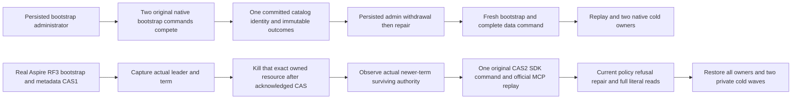

# Metadata bootstrap operation (KL-018)

This child contract freezes the additive operation before its test bodies. ADR-007/036/117/125, ClusterRouting and ClusterReplication remain authoritative. The task's historical status paths ReplicaMembershipTable/ReplicaMembershipStore are retired; the actual implementation uses the configured native Orleans membership provider. No second membership authority, custom RPC, historical provider, configuration fallback or global status edit is introduced.

| Requirement | Frozen acceptance and evidence boundary |
|---|---|
| REQ-META-BOOTSTRAP-001 Competing bootstrap cannot create two identities | AC-META-BOOTSTRAP-001: both original Task producers meet a bounded readiness barrier before submitting separately identified current native signed bootstrap payloads through the actual ordered apply gate. Equivalent requests must both succeed; conflicting physical shard identities must yield exactly one success and one complete native Conflict. Select the winner from actual complete admitted operation/results; independently author its full catalog version/revision/shard/incarnation/ordered voters/placement epoch from that literal caller recipe. Store identity remains unchanged. No scheduler winner is promised. |
| REQ-META-BOOTSTRAP-002 Restart and current authority preserve immutable metadata results | AC-META-BOOTSTRAP-002: retain both original global outcome bytes before policy change. Persist administrator withdrawal and require old GUID refusals without overwriting either result or catalog. Persist higher-epoch repair; original results remain fenced by their old policy epoch and unchanged bytes. A fresh bootstrap identity succeeds against the same exact committed catalog, followed by actual complete document/event/queue effects and full receipt/native hidden references, replay and two joined same-root cold owners. Native embedded positions are compared only within that store. |
| REQ-META-BOOTSTRAP-003 Metadata CAS remains functional after actual elected-leader loss | AC-META-BOOTSTRAP-003: own a fresh real Aspire RF3 fixture and discover current readiness/complete ordered voters/incarnation/physical owner through actual SDK/MCP. Acknowledge directory CAS1 before capturing the actual leader resource and consensus term. The only fault is killing that exact owned current leader after the acknowledged CAS and before CAS2; no synthetic endpoint or guessed leader. Await original kill ownership. Observe sequential authenticated native Status on the two actual survivors under the original deadline; only the official no-current-majority pending refusal is tolerated, and require a surviving actual leader and strictly newer term before submitting exactly one immutable CAS2. Do not retry a mutation to manufacture authority. |
| REQ-META-BOOTSTRAP-004 Public authorization, data and metadata remain consistent | AC-META-BOOTSTRAP-004: compare all placement fields, exact directory/row revisions and public full mutation receipt/token fields via real .NET SDK and official MCP. Verify literal document state at its acknowledged minimum token. Current persisted nonadministrator must refuse metadata administration; repair its persisted principal at a higher epoch before a fresh GUID succeeds. Secrets and private values must not leak in errors. Public JSON cannot prove the native hidden CompositionReferences field; that is covered by native receipts. Logical replica tokens are never numerically compared with node-local query cuts. |
| REQ-META-BOOTSTRAP-005 All fault and cold ownership settles | AC-META-BOOTSTRAP-005: retain all original killed/restarted resource ownership and join restart attempts with original readers. Allocate unique canonical cold scenarios; retain every successful bounded original receipt hash before disposal/aggregate errors, reread after later waves and final cleanup. Kill all intended cold owners and attempt all starts before health observation. Both cold waves execute independently even after the first failure. Complete metadata/data/original receipt replay and policy assertions remain mandatory. |

No test-only production phase hook is added. Native concurrency barriers exist only between genuine original Task producers. Source/bootstrap traces alone do not prove absence of every Orleans call before full database readiness; that startup-order gate remains explicit. Native unit state-machine concurrency does not substitute for real RF3 leader loss. No new public SQL syntax or protocol is introduced; existing complete SQL/current-image/recovery/RF3 gates remain required. Compiler, actual native UID census, Unit/process/RF3/Linux, endurance and full KL-018 acceptance remain OPEN until exact-source execution. Process kill is not power-loss evidence, and no performance claim follows from source review.

## Prepared operation and qualification inventory

The additive implementation is 8 native Unit roles and 13 real RF3 roles. The Unit class keeps equivalent and conflicting bootstrap recipes as separate argument cases. Its complete native oracles cover all eleven StoredOutcome fields, the full store identity (including signing-key content), literal document/event/queue records, outbox rows/head, and native receipt composition references. Outcome preservation compares the original stored bytes; value equality uses complete structural values rather than independently serialized Orleans reference graphs.

The RF3 case owns a fresh AppHost fixture. It captures every node status before the fault, proves a stale expected-revision refusal after actual leader loss, then performs one fresh CAS2. Current persisted administrator repair precedes CAS3. Every metadata command replays with its original caller credential. Public receipt positions remain opaque positive logical positions, witnessed by native status/applied and actual minimum-token reads; no equality to a local storage cut is inferred. Four public mutation fields and the full public token are observable; native hidden receipt references are proved only in the Unit owner. Outbox status is conserved across public replay/read checks.

Original authority observations are bounded in the test state, not claimed as durable election telemetry. Every private restart receipt is read with an explicit byte bound, retained before disposal errors, and reread after subsequent waves. Kill/start tasks settle before readiness checks; each later cold wave is independently attempted.

The whole-task census must also retain the actual existing NativeClusterStartupEvidenceTests, NativeSixSiloMembershipReadinessTests, RuntimeJournalBootstrapAdmissionTests, PhysicalShardCatalog bootstrap/authorization/policy/conflict/validation/fence/voter classes, AtomicPartitionPlacement whole-operation classes, ColdBootstrapSdkTests and PhysicalShardCatalog RF3 classes. These source class names are an inventory, not discovered native UIDs or counts. All native counts/UIDs remain UNKNOWN until Root performs fresh discovery. Existing startup-order, recovery, membership, broader metadata and Linux acceptance gates remain OPEN; these new operations do not replace them.
