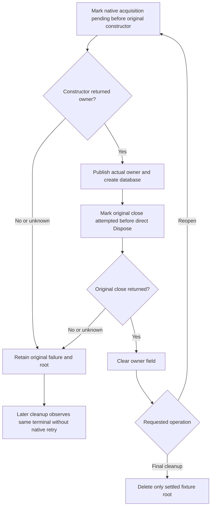

# Metadata bootstrap fixture original native owner settlement

This KL018 fixture-lifetime correction preserves the actual native catalog,
persisted authority and complete metadata operations. It changes no product
store, public API, provider, clock, constructor recipe, test declaration or bound.

AC-META-OWNER-001: Reopen and final Cleanup use one original native close outcome
per acquired owner. The owning class calls its literal store.Dispose directly;
only its actual successful return clears the owner field. A failed first close
retains its original ExceptionDispatchInfo and root. Later Dispose/Cleanup must
rethrow that original exception rather than call native Dispose again and treat
a disposed-flag no-op as a new successful join. Attempted close without a known
return remains unknown and retains the root. Final successful Dispose still prevents Reopen from recreating the deleted root.
Successful live-owner cycles open a new actual
owner and reset the per-owner terminal only after constructor success.

AC-META-OWNER-002: mark acquisition pending immediately before the actual native
ZoneTree constructor, after preparing unchanged option values. If it throws
before publication, retain the original acquisition failure and root even though
no owner object was returned. No null field or assumed internal constructor
rollback authorizes deletion. A successful constructor publishes the original
owner before database construction; a later database-construction failure can
therefore close that known owner through the same original-close boundary.

Primary initialization/reopen failures and actual cleanup failures remain joined.
When constructor cleanup observes the same original exception a second time,
its local ledger records that object once; independent exception objects remain
preserved. This is a conservative test-owner retention rule, not a retry helper,
operator repair API or a claim that native resources leaked.

Existing PhysicalShardCatalog, MetadataBootstrapWholeOperationTests and
MetadataBootstrapPersistedCorruptionTests whole native refusal/repair/replay/cold
operations remain the real success regressions. There is no fake Dispose failure,
replacement store, test counter or synthetic terminal proof. Compiler/native
operation and genuine failed-close/failed-construction execution evidence remain
OPEN until original qualification; source review alone does not execute faults.
