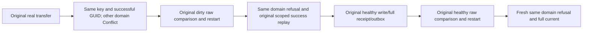

# Migrated atomic domain identity and original successful command scope

Canonical [ClusterRouting](../ClusterRouting.md); KL069 architecture28.2; ADR001/016/024/101/106/117/125/128. Requirements-first source preview; compiler/admission/runtime/deadline-fit/Linux gates OPEN. UI N/A.

REQ-KL069-MIGRATED-DOMAIN-001: after the ORIGINAL real physical transfer, retain the same tenant/database/PartitionKey and originally successful first CommandId, change only the domain in PartitionRef, and submit its original first PutDocument mutation. The original mixed command remains untouched and is separately replayed in its original scope. Using a single original Put avoids embedded graph EntityRefs becoming an unrelated cross-reference structural failure. The new full four-field identity must differ despite the same literal key/GUID. Core's persisted Resource domain check must return exact Conflict, never the success cached for another atomic scope. SDK complete detail is The resource belongs to a different transaction domain.; official MCP current closed selector yields exact GenericFailure. No invented grant, fragment API or forged token.

AC001: each of source SDK, destination SDK, official MCP refusal immediately checks full migrated original models, late-unique refusal absences, healthy document when present, strict retained original-scope outbox, full independently constructed foreign fallback PMAP (original control tuple, current known publication directory revision, row0/fallbacktrue), and independent foreign OutboxStatus tail0/firstAvailable1/records0/bytes0/emptyConsumers. No inaccessible foreign document read is falsely asserted absent: wrong resource-domain reads intentionally reject. Original successful scoped receipts are independently retained via existing full RequireModels after the refusal group and another current observation. No success/current state is copied from the refusal.

REQ/AC002: preserve original Case/Test/name/Args/linked deadline and all FOUR original restart calls. Initial domain refusal occurs after migration; repeated same ID/first mutation occurs after original dirty comparison+restart, after genuine healthy receipt/current/outbox publication, and after original healthy comparison+restart. No new cold cut/timeouts/roles. IMPORTANT: domain rejection occurs before outcome cache lookup in native authorization; repeated evaluations may legitimately persist clocks/error outcomes. Therefore no new failure is inserted BETWEEN either original before/after complete raw-cut comparison. New current claims only public logical data/outbox/placement, never journal/store-byte invariance for failed commands. Original raw comparisons and original failure checks are unchanged.

Source nonduplicate: current RF3 movement controls have no domain-mutated command; Unit LogicalAtomicScopeLifecycle exercises resource-domain mismatch before movement only. Existing repeated whole-partition MoveID/plan checks are not duplicated. This adds no bucket format, directory reconfiguration, membership count or physical ownership operation. Parent transferred R2 is actually adopted by Root; its full images/strict unique lifecycle remain the unchanged current prerequisite.

