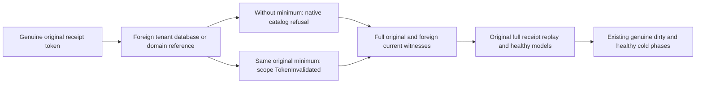

# Migrated foreign reference / genuine minimum token boundary

Canonical ClusterRouting KL069; architecture28.1–28.3; ADR001/005/016/017/101/117/125.

REQ-READ-SCOPE-001: a genuine acknowledged token is scoped to its complete original atomic identity, even when another full four-field identity resolves to the same physical control owner/incarnation/epoch. Preserve persisted caller authorization before minimum-token checks.

AC-READ-SCOPE-001: reuse the SAME original successful pre-transfer token untouched and the SAME persisted parent administrator/key. Validate its original control incarnation/epoch/fullAtomicPartitionId and positive native position; no field is rewritten, recomputed from a new response or re-signed. Three foreign EntityRefs keep the original collection/document ID but select the already-existing other-domain scope or the new tenant/database scope of the predecessor. Their control fallback incarnation/epoch equal that genuine token, while their full atomic IDs differ.

AC-READ-SCOPE-002: on source SDK, target SDK and official MCP, each foreign read WITHOUT minimum must retain exact NotFound/resource-not-configured (tenant/database) or Conflict/different-transaction-domain (domain). The SAME read WITH the untouched original genuine minimum must instead retain full TokenInvalidated/another-atomic-partition-or-placement detail. This follows actual ReadDocumentAtCut ordering: persisted authorization, placement, minimum validation, then Resource. Thus this is not the existing original-reference/old-incarnation case. Exact complete SDK Problems and official five-field safe Problems/request IDs are required. No role or trusted metadata is introduced.

AC-READ-SCOPE-003: EACH original read refusal immediately runs the full original migrated models, strict original outbox snapshot and all three foreign fallback/empty-outbox witnesses. The original full mixed-command success replays through genuine SDK and official MCP after the group; each is compared with the retained original complete receipt and immediately followed by that same full current observer. No refusal/replay/cold refreshes any golden.

AC-READ-SCOPE-004: append this continuation to the predecessor catalog scope helper in all four existing phase positions; preserve original Case/UID/Args/deadline and four genuine restart calls/caller joins/raw paired cut equality. All new work is after existing phase checks outside paired image capture comparisons. No fake token, bucket format/API, new Case, cap, retry, timeout or physical owner is added. Compiler, runtime, original deadline fit, exact-source Linux RF3 and whole KL069 remain OPEN.

N/A: ordinary nonadministrator tenant authorization qualification, token signing changes, public fragment operations and new storage/routing formats. Source law is standard current source inspection, not native execution. These foreign reads do not expose returned documents; all expected full error literals come from current owners and closed official MCP safe-detail mapping.
