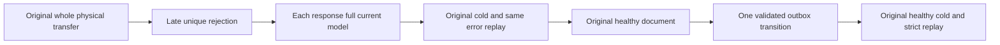

# Migrated atomic scope and late unique refusal

Parent: [ClusterRouting](../ClusterRouting.md), [LogicalAtomicScopeLifecycle](LogicalAtomicScopeLifecycle.md); ADR001/016/024/106. REQ-KL069-TRANSFERRED-SCOPE-001 preserves the original whole physical transfer case and all original operation statements/deadline/owners/cold flows.

AC001: after real published owner transfer, submit AppendEvents on original stream revision1, actual Enqueue and new typed-row identity key=kl069-transfer-refused/title=alpha/count3. Original title unique constraint rejects exact Conflict AFTER earlier staged effects. The new row ID equals its JSON primary key, so this is not primary-key validation.
AC002: each original SDK ingress and official MCP result has null success value and the whole owned Conflict Problem. Current native MCP mapping preserves exactly the owned unique-index detail. Immediately require every original logical model field through SDK/official MCP, absent refused row/message and exact retained outbox/consumer image. The original stream complete record/head golden excludes any failed event.
AC003: before admitting the healthy outbox transition, assert the complete independent one-item putDocument mutation vector and full command/destination incarnation/atomic partition/ownership epoch/quorum receipt; its arbitrary native position is strictly positive, not fabricated. Retain same failed CommandId across original dirty/healthy cold windows, full failed outcome/current state and all original success receipts. Before the unchanged healthy document, old outbox is strict; only its actual accepted publication admits one tail/record increment, unchanged firstavailable/consumers and positive bytes increment, then freeze that complete producer-derived head once. Refusal/replay/cold never refresh it.

No new grants/resources/model corpus, topology, split endpoint, clock, timeout, provider, Product API or persistence format. This is batch/partition-unique acceptance coverage after movement, not node-count performance or power-loss evidence. Shared Seed/Models/Cut and all original Case declarations remain unchanged. Compiler/native admission/runtime/deadline-fit/Linux RF3 remain OPEN; SourceN preview only.
