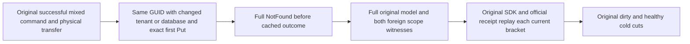

# Migrated catalog tenant/database outcome scope

Canonical ClusterRouting/KL069, architecture28.1–28.3; ADR001/005/016/101/117/125.

REQ-CATALOG-SCOPE-001: successful original command identity and literal PartitionKey do not collapse a different TenantId or DatabaseId after whole-partition transfer. Reuse the SAME persisted parent administrator/key/epoch; no principal, resource or grants are configured by this continuation.

AC-CATALOG-SCOPE-001: create two requests from the complete first successful original command. Keep its CommandId, PartitionKey and TransactionDomainId, and its exact first PutDocument only; change (a) TenantId to originalTenant+'-kl069-other', (b) DatabaseId to originalDatabase+'-kl069-other'. No graph/entity reference rewriting is involved. Full current native scope law is NotFound / 'The resource is not configured.': persisted ClusterAdministrator bypasses ordinary tenant grants, but Resource reads the changed full catalog key before cached outcome selection. Do not weaken this into PermissionDenied or generic acceptance. Official MCP uses current fixed safe GenericFailure detail.

AC-CATALOG-SCOPE-002: for each changed scope, source SDK, target SDK and official MCP individually require null value/full fixed error and immediate full original migrated models, placement, strict outbox, same other-domain full witness and both independently empty foreign scope outboxes/fallback tuples. Source complete original mixed-command receipt replay and official MCP replay each retain the original full returned receipt and separately run the same complete current observer. Native physical position is not compared with logical receipt position.

AC-CATALOG-SCOPE-003: run in all four existing domain phase positions outside original paired raw cut comparisons. Preserve all original Case/Test/Args/deadline/four restarts and genuine RF3/caller joins. After original healthy write use the existing admitted-once full outbox snapshot; refusals/replays/cold never refresh golden. Failed command outcome/clock metadata may legitimately commit: no raw journal/store immutability claimed for the newly inserted refusal positions.

N/A: cross-tenant authorization of ordinary callers, new trusted roles, resource creation, cross-partition atomic effects, new routing/bucket format or API. Scope is full catalog identity before cached command outcome. Whole KL069 and compiler/runtime/original deadline fit/Linux RF3 qualification stay OPEN.

