# Native activation migration preserves running physical owners

This KL019 refinement retains the original NativeDatabaseMigrationRf3Tests
actual RF3 SDK/official MCP operation and REQ/AC-KL019-NATIVE-MIGRATION-001.
It adds no declaration, product hook, provider, role, clock, endpoint or timeout.

```mermaid
flowchart LR
 A[Original authenticated source-three native discovery] --> B[Physical six-owner status and placement]
 B --> C[Foreign-target refusal]
 C --> D[Unchanged running-owner check]
 D --> E[Original cancelled migration]
 E --> F[Unchanged running-owner check]
 F --> G[Actual selected activation migration]
 G --> H[New activation with unchanged native silo generations]
 H --> I[Intentional cold restart]
 I --> J[Original persisted-owner replay and healthy continuation]
```

AC-KL019-LIVE-OWNER-001: after foreign-target refusal, original cancellation and
successful actual migration, preserve every existing literal document, placement,
NodeId, Incarnation and Voters oracle. From the same actual status collection,
require a positive original ProcessId and equal current ProcessId/ReadGeneration
for all six physical nodes. ProcessId alone is not sufficient in Docker PID
namespaces and does not prove unchanged native runtime ownership.

For the original authenticated source-three discovery inventory, obtain fresh
bounded signed observations through the unchanged native helper and original
profile/token. Require exact complete ReplicaSiloDiscovery equality, including
actual SiloAddress runtime generation and protocol/reader identities. This checks
that activation movement did not depend on restarting those native silo owners.
No unsigned address, caller identity or requested migration target substitutes
for the actual signed current observation. It is a boundary observation, not an
endurance guarantee against every possible intermediate event.

AC-KL019-LIVE-OWNER-002: these live-generation assertions stop before the existing
intentional cold phase. After actual cold restart, retain the unchanged persisted
NodeId/Incarnation/Voters and placement/document/replay oracles; a cold runtime
is expected to acquire a new native generation. No actual value is normalized
into an expected value and no baseline is refreshed to conceal a change.

The same original declaration and full foreign/cancel/migrate/authorization/
original-session/receipt/cold/healthy operation remain required. Source inspection
identified an oracle gap, not an observed runtime restart or product defect.
Compiler, native discovery, current-image RF3/Linux execution and whole KL019
acceptance remain OPEN. There is no performance or metrics claim.
