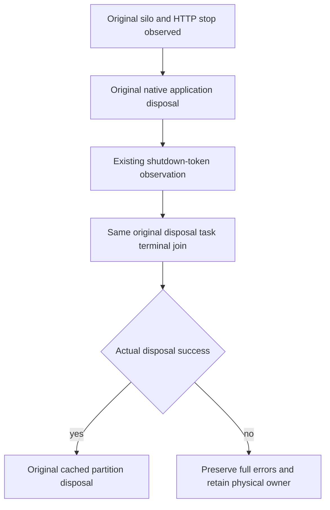

# Native application disposal before physical store release

Parent: [ClusterRouting](../ClusterRouting.md). Applicable ADRs: [ADR-117](../../ADR/ADR-117-native-tunit-ci-entry.md), [ADR-125](../../ADR/ADR-125-connection-owned-execution.md).

REQ-NATIVE-NODE-DISPOSE-001: Completion of HTTP StopAsync alone must not authorize explicit physical PartitionHost disposal while the original native application DI disposal still owns store borrowers. Preserve the actual original disposal task, observe the existing shutdown-token deadline, then join that SAME original before subordinate release. No timeout reset/increase or abandoned original task.

Source law: NodeAdministration ordinary BackupAsync retains native Task.Run(CreateBackup) but exposes operation.WaitAsync(callerToken). The native CreateBackup can continue Store.CreateBackup after the caller canceled. Its actual DisposeAsync joins the accepted producer. Native DI disposes in reverse acquisition order, awaiting each service; a borrower depending on PartitionHost is captured after that host and disposed before it. Therefore application Stop and silo request-work completion do not themselves prove all DI-owned borrowers finished. Native DI may also terminate its sequence on a disposer fault: faulted application disposal is not proof that every later service joined.

AC-NATIVE-NODE-DISPOSE-001: Keep original node construction, native six-owner topology, Start/Silo join/application Stop, token provenance, original thirty-second shutdown policy and actual cached PartitionHost disposal unchanged. Only after actual application-disposal success may explicit cached partition disposal begin. On invocation/terminal failure, preserve errors and retain the physical owner/root; no fabricated release.

AC-NATIVE-NODE-DISPOSE-002: Observe cancellation of the original WaitAsync shutdown projection without counting its copied fault again; preserve the complete exposed original application-task terminal vector through existing ServerFailureObserver. Original caller-token and independently canceled native disposal remain distinct. If disposal cannot settle, final join can remain pending: this is an OPEN gate, never successful cleanup.

Qualification: source-backed ownership repair only. Existing real six-host/native public operation flows remain required; no real long-running backup/elapsed shutdown cancellation or dual native disposal failure has been reproduced. No fake provider/TCS disposal, new platform or global fault policy. Compiler/runtime, real resource release, operation/deadline fit and Linux Docker/Aspire RF3 qualification remain OPEN. No observed corruption/data-loss or speed claim follows from the source window. Native DI-internal failure cleanup remains framework-owned; this patch conservatively retains storage instead of assuming it joined.

Native storage counterevidence: CreateBackup holds the actual ZoneTree runtime write gate; runtime Dispose acquires the SAME gate before closing native handles. No closing-under-an-entered-backup critical-section/data-loss claim is made. The repair concerns the outer original-task/DI ownership ordering, including a scheduled producer before entering that gate. Cached PartitionHost.Dispose is idempotent when DI has already reached it; that does not prove every earlier DI borrower has settled.

Projection/native cancellation are kept distinct: no duplicate observation when WaitAsync returns the original task itself; a distinct canceled projection contributes its actual caller-token cancellation only. A projection copying a native cancellation/fault is observed through the SAME original terminal task, not treated as a second independent native failure.

Exact error multiplicity: preserve a distinct caller-deadline projection before the original terminal vector, but never re-observe a faulted projection copying that vector or the same original Task instance. If original terminal cancellation already carries the caller token, that cancellation is retained once via its original task; a projection of it is not counted as an independent second failure. No original terminal exception is removed or flattened by the helper.

The original Application.StopAsync receives the same original token at the same stage; its actual native Task is now passed directly to the existing observer instead of the obsolete local/status wrapper. No second Stop invocation or new shutdown operation is added.
