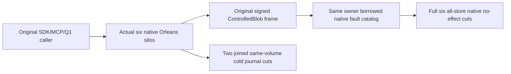

# Native BlobWire original-case successor

REQ-W27-BLOB-001 maps to AC-W27-BLOB-001: preserve the exact original ActualSignedSixKindBlobWireFaultsDenyWithoutEffectsThenOriginalSendAndColdSdkMcpQ1AreHealthy case UID. The genuine six-silo two-RF3 Aspire wave owns actual current native generations, readiness, public callers and joined shutdown. Retain original eight-byte blob/document/moved-parent seed, full authorized SDK/official MCP/Q1 receipts and original mutation/read outputs.

REQ-W27-BLOB-002 maps to AC-W27-BLOB-002: independently preserve actual secondary eight-byte abort/reclaim and publish/delete/reclaim mutation flow with exact original returned metadata, upload state, revisions, part counts, integrity and cleanup receipts. Reuse the existing actual native administrator/public seed adapters; this helper owns no fake cluster/client/context and does not qualify missing wire fault coverage.

REQ-W27-BLOB-003 maps to AC-W27-BLOB-003: observe real signed ControlledBlob frames for SIX outcome operation kinds (BeginBlobUpload/WriteBlobPart/CompleteBlobUpload/AbortBlobUpload/DeleteBlob/ReclaimBlob) and FOUR read purposes (Metadata/UploadInfo/Range/List). Apply each original common nonce/request/source/destination-incarnation/envelope/principal-epoch/query/resource/expiry/purpose/native-body fault plus original optional outcome/operation-ID faults WITHOUT resigning the original inner body. Every actual native addressed reply must authenticate and refuse with complete all-store six-owner state unchanged apart from journal-proven membership effects.

REQ-W27-BLOB-004 maps to AC-W27-BLOB-004: preserve TWO actual owned same-volume cold stops, all18 lock checks, complete six original store rows and native journal proof, current native generation change, original SDK/MCP/Q1 replay and healthy final outputs. Never substitute two-partition Messaging scope for original all-store cut, read active disk files, apply fake membership, assume absent compacted journal entries or fabricate owner-disposal flags.

The preserved original case `KeyLoad.IntegrationTests.Features.ClusterRouting.PartitionMovementBlobWireNativeTests.ActualSignedSixKindBlobWireFaultsDenyWithoutEffectsThenOriginalSendAndColdSdkMcpQ1AreHealthy` now invokes the existing `NativeBlobWholeParentTrial.RunAsync`. Its class, method, `[Test]` and `[NotInParallel]` declarations remain. The independently declared `NativeBlobWholeParentQualificationCases.ActualSdkMcpAndQ1OriginalBlobFaultFlowPreservesAllSixStoresAcrossTwoColdReopens` also remains; no additional case or selector is introduced. Main owns any later qualification-inventory consolidation.

The successor uses `NativeBlobWireWaveStartup` and the existing six-silo `TwoRf3MembershipWave`, persisted public administrator, original eight-byte `0x47` blob/document seed and eight-byte `0x48` secondary effects, SDK/official MCP/Q1 replay, six-owner native signed mutation evidence and two joined same-volume cold cycles with all eighteen locks. `INativeControlledBlobBorrowObserver` remains the native diagnostic boundary: Outcome6 uses channel5/full V2 wrapper and thirteen original-MAC mutations; DATA4 uses channel3 and eleven original-MAC mutations. Native envelope signatures, current generations, original task settlement, full six-store conservation and native journal history remain mandatory.

The obsolete `IControlledBlobWireBorrowObserver` and its optional DI/runtime/client plumbing are removed. Its old supporting HTTP posts targeted the unmapped `/internal/documents/owned-read/v1`; HTTP404 cannot prove a signed native refusal. The old direct-host HTTP trial and its exclusive callers, seed/effect/fault/HTTP/cold helpers are superseded rather than restored, renamed as native proof or admitted as a successful gate. Shared native-cut assertions and the separate late-native HTTP owner used by other operations remain.

This source successor preserves the required operations and both declared UIDs; it does not assert runtime success. Original-case admission, exact compiled source and all semantic build, real SDK/MCP/Q1, native mutation, full-store, joined-shutdown and two-cold Aspire qualification gates remain OPEN until Main executes the coherent source stage. The thirteen old-inner-MAC mutation refusals do not by themselves prove correctly re-signed invalid-lifetime semantic refusal; the separate mandatory V2 coverage tests remain required.
