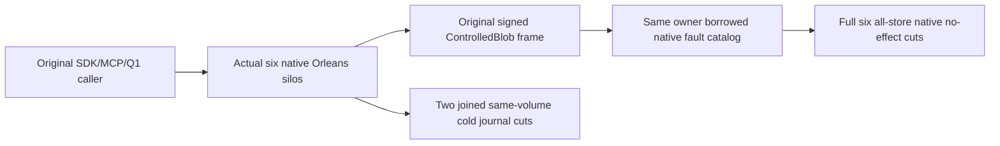

# Native BlobWire original-case successor

REQ-W27-BLOB-001 maps to AC-W27-BLOB-001: preserve the exact original ActualSignedSixKindBlobWireFaultsDenyWithoutEffectsThenOriginalSendAndColdSdkMcpQ1AreHealthy case UID. The genuine six-silo two-RF3 Aspire wave owns actual current native generations, readiness, public callers and joined shutdown. Retain original eight-byte blob/document/moved-parent seed, full authorized SDK/official MCP/Q1 receipts and original mutation/read outputs.

REQ-W27-BLOB-002 maps to AC-W27-BLOB-002: independently preserve actual secondary eight-byte abort/reclaim and publish/delete/reclaim mutation flow with exact original returned metadata, upload state, revisions, part counts, integrity and cleanup receipts. Reuse the existing actual native administrator/public seed adapters; this helper owns no fake cluster/client/context and does not qualify missing wire fault coverage.

REQ-W27-BLOB-003 maps to AC-W27-BLOB-003: observe real signed ControlledBlob frames for SIX outcome operation kinds (BeginBlobUpload/WriteBlobPart/CompleteBlobUpload/AbortBlobUpload/DeleteBlob/ReclaimBlob) and FOUR read purposes (Metadata/UploadInfo/Range/List). Apply each original common nonce/request/source/destination-incarnation/envelope/principal-epoch/query/resource/expiry/purpose/native-body fault plus original optional outcome/operation-ID faults WITHOUT resigning the original inner body. Every actual native addressed reply must authenticate and refuse with complete all-store six-owner state unchanged apart from journal-proven membership effects.

REQ-W27-BLOB-004 maps to AC-W27-BLOB-004: preserve TWO actual owned same-volume cold stops, all18 lock checks, complete six original store rows and native journal proof, current native generation change, original SDK/MCP/Q1 replay and healthy final outputs. Never substitute two-partition Messaging scope for original all-store cut, read active disk files, apply fake membership, assume absent compacted journal entries or fabricate owner-disposal flags.

Public effects are independently source-complete. Original Trial remains active until Root freezes the actual node-local file-armed ControlledBlob observer/native same-owner client capability and full all-store live/stopped journal cut seam. Existing Queue Accept-only replay plan/witness and two-partition canonical model cut cannot satisfy those contracts. Original manual fixture is not reinstated or relabelled native; no source-only success removes any old test/oracle. Compiler/RF3/SDK/MCP/native/join gates remain OPEN.
