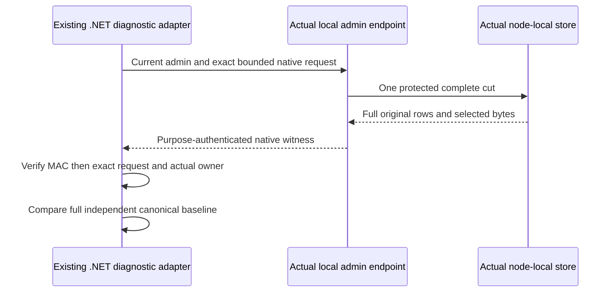

# Native canonical cut client

Root owns the fixture-enabled local administrator endpoint, lifecycle and response authentication. This supplement owns the actual six-node .NET diagnostic caller and returned-witness checks. It does not own a cluster, peer transport, storage handle or alternative sender. Existing PostAwait/original-nonce/wire-fault SDK/official MCP foreground workflows and cold Source2 remain mandatory independent scopes.

REQ-NATIVE-CUT-CLIENT-001 maps to AC-NATIVE-CUT-CLIENT-001: use six actual Aspire endpoints through existing McpCallerHttp and current persisted administrator authentication. The frozen POST local diagnostic body is generated NativeCanonicalModelCutRequest, maximum8192bytes; a distinct actual new request nonce binds each node observation in the six-node call. Verify each complete native response using Root's frozen purpose-specific protocol and existing MAC owner before accepting a witness. Root freezes NativeCanonicalModelCutDiagnosticProtocol and NativeCanonicalModelCutSignatureFrame.Create over exact original response bytes. Use ReplicaMessageMac.Discovery with actual group clusterId, incarnation, voter and request nonce; require exactly one fixed-size hex signature header. No inferred SDK signing API or fabricated response is implemented.

REQ-NATIVE-CUT-CLIENT-002 maps to AC-NATIVE-CUT-CLIENT-002: require native-byte-exact request and retained authenticated node owner, including every field, SessionId/ArmId/nonce, physical incarnation and full actual silo generation. Preserve complete source/destination raw rows and separate full selected nullable outcome/receipt/counter/intent bytes. Refuse duplicate row keys and any selected field inconsistent with its actual canonical row. An authenticated bounded complete enumeration is supplied by the owner; unrelated omitted rows can be detected only against an independent complete baseline, never inferred from counters/digests.

REQ-NATIVE-CUT-CLIENT-003 maps to AC-NATIVE-CUT-CLIENT-003: exact unchanged-state comparison uses every original row key/value and all six selected nullable byte fields. Missing and present values remain distinct. A changed row, missing row or selected byte mismatch refuses; no normalization or hashes replace original bytes. Actual independent observations may have different store positions/generations; each owner is authenticated against its current retained stamp, while the state comparison excludes those metadata fields deliberately.

Focused real-data tests will use the existing genuine fixture/owner and its canonical operation results; no mock handler, fake discovery owner or invented service API. Endpoint signature/client transport source and whole public execution await Root freeze. Source-only review does not establish runtime qualification; Main owns SDK/compiler/format/native discovery and exact-source Linux gates. No existing test, negative oracle or failure is removed.
