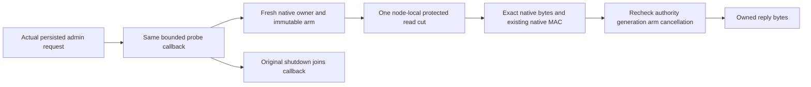

# Native canonical model cut local diagnostic route

Private source proposal during Main SDK barrier. Requires canonical capture Source7 and the native model observer adjunct r2. No shared code, Git or SDK writer. Source-only acceptance remains open.

REQ-CANONICAL-CUT-001 maps AC-CANONICAL-CUT-001: POST `/api/admin/native-canonical-model-cut` is mapped only in the existing private request probe profile. Its generated native request and exact response are independently capped at8192 bytes, with no query, content-encoding, truncation or JSON fallback. Actual current persisted administrator authority is reloaded before and after one local protected Store.Read. Original session, retained immutable arm, command and original logical principal must match; no forged grain identity or result. The original strict owner inventory and RequireActiveArm run before/after capture. An ordinary Released/Cancelled settlement retains the exact original arm for post-settlement and cold-restart comparisons until its owner retires it; release alone does not invalidate diagnostic reads. Missing, retired or changed arm bytes refuse. No marker history is cleared, new hold is claimed or killed-owner guard is weakened.

REQ-CANONICAL-CUT-002 maps AC-CANONICAL-CUT-002: capture and exact encoding/signing/revalidation borrow the SAME existing Probe observer callback and finite gate. Caller cancellation, original60-second maximum, actual ApplicationStopping and observer stopping are linked. Original observer shutdown must join the callback before silo cryptography or storage disposal. Fresh semantic audit confirms OrleansNodeHostShutdown.JoinAsync drains native request work, awaits the same observer DisposeAsync, then stops/disposes the silo; DisposeAsync stops admission and joins original callbacks. This requires no additional shutdown owner. No additional lifetime owner or cluster transport is introduced.

REQ-CANONICAL-CUT-003 maps AC-CANONICAL-CUT-003: original native discovery, joined silo, active native membership and full generation are checked before/after. The existing native ReplicaEnvelopeAuthenticator.SignDiscovery signs UTF8 `keyload.probe.native-canonical-model-cut.v1` plus one NUL followed by exact response bytes, using the exact request nonce. Header `X-KeyLoad-Native-Canonical-Cut-Signature`. Client uses the same shared frame and existing ReplicaMessageMac.Discovery with actual RF3 cluster/key/voter/incarnation. No new MAC or guessed silo address.

REQ-CANONICAL-CUT-004 maps AC-CANONICAL-CUT-004: the witness includes full canonical source/destination raw rows and independently selected native outcomes/receipt/intent/counters in the same node-local cut. Six separate cuts never imply cluster atomicity. Actual six-node SDK/MCP held-operation, shutdown and two cold replay regressions remain mandatory. Root owns endpoint/lifetime, Ann owns extra-three same-session controls, Queue owns six-client assertions, Producer owns actual native replay.

Positive native capture and bounded refusal tests already exist as separate source packets. New transport/lifetime/authority/bounds tests and real RF3/fullflow are OPEN explicit automated evidence exceptions until Main integrates and qualifies this coherent source wave.

## Selected native fault/replay closure

REQ-NATIVE-REPLAY-001 maps AC-NATIVE-REPLAY-001: Source35 → AllSix10 → foreground Source1 uses the SAME existing enabled ProbeObserver, original request lease and current native generation/MAC/expiry. Source20r2 canonicalCuts/OpenCanonicalCut joins this same callback lifetime. Preserve original Arm13 and ReplayPlan7; AllWireFaults6 is plan-only, with exactly six individually named variations under ONE actual held Accept. Actual original encoded request bytes are captured before mutation, each outer request has a fresh nonce/current authenticated owner, and unchanged original inner MAC remains mandatory. Marker publication follows all authenticated witnesses under the original owner lock/budgets; destination mirrors receive only original arm bytes.

REQ-NATIVE-REPLAY-002 maps AC-NATIVE-REPLAY-002: Original2's actual prior effects remain a private call-local tuple alongside the unchanged real foreground reply. After original AfterDispatch/full reply nonce/MAC/expiry/current-owner validation, a verified foreground refusal becomes UnknownWriteOutcome with that original refusal retained as the local cause. No wire effect flag, new trusted role or replacement dispatcher. AllSix original-MAC faults have no effect credit and require each actual signed refusal plus complete unchanged six local cuts and one healthy unchanged original foreground receipt. SDK/official MCP same-ID reconciliation and two original owned cold cuts remain required. Existing source cases/UID declarations are preserved; selected source compilation, genuine caller operations, cleanup and Linux qualification remain OPEN.

## Original native body error provenance

REQ-CANONICAL-CUT-ERROR-001 / AC-CANONICAL-CUT-ERROR-001: retain genuine native KeyLoadException code/Problem through bounded request decode. Malformed binary and wrong generated root keep original Corruption; unsupported version keeps FormatUnsupported. Existing typed scope validation remains Validation, overflow remains ResourceExhausted, and actual caller cancellation remains the original OperationCanceledException/token. The fallback only normalizes other nonfatal decoder exceptions to the existing bounded invalid-scope error; it must not replace a genuine typed native refusal. No public schema, alias/ID, byte cap, deadline, auth, lifecycle or admission change.

Maps to the unchanged whole request-body operations NativeCanonicalModelCutBodyTests.ExactBoundedMalformedBodyAndOverflowRefuseWithoutTruncation, WrongGeneratedBodyKindAndActualCancellationNeverProduceARequest, ActualGeneratedRequestBodyRoundTripsAllOriginalFields and pending-pipe original task join. Keep exact Corruption/no-request/unread or consumed-body assertions, original healthy roundtrip and genuine cancellation/cleanup; six-owner public read/cold/error propagation remains its separate required gate. This successor is source-only, ordered after immutable READY106; compiler/runtime/native UID/whole RF3/Linux remain OPEN.
