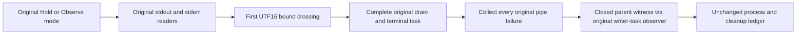

# Native Prepare child output provenance

Canonical slice: ClusterRouting scenario, linked shared DocumentStorage process infrastructure. Refines REQ/AC-CRS-NATIVE-COLD-STATE-001 and REQ/AC-MOVE-NATIVE-COMPLETED-FAULT-CLEANUP-001; ADR-117 owns native test execution and existing process ownership, ADR-039 owns closed safe diagnostics. This diagnostic is not a behavior or logging repair.

REQ-NATIVE-CHILD-OUTPUT-WITNESS-001 / AC-NATIVE-CHILD-OUTPUT-WITNESS-001: preserve the existing GenuineSixHostOriginalPrepareSurvivesKilledOwnerAndColdOutcomeObservationWithoutRedispatch Case, native UID, six owners, Hold→Observe flow, original fixed output character admission and complete stdout/stderr drain. Only the existing original reader may supply its admitted/drained UTF-16 count, first crossing count and limit; mode/pipe ordinals are closed and bound by the genuine caller/pipes owner. No raw character, line, message, path, credential, payload or supposed logging cause is emitted.

REQ-NATIVE-CHILD-OUTPUT-WITNESS-002 / AC-NATIVE-CHILD-OUTPUT-WITNESS-002: retain the exact first-crossing exception and separate terminal exception objects, original reader tasks and all existing primary/cleanup failures. The parent emits a bounded closed record only after original pipe errors are collected, through the actual ServerFailureObserver returning the original Console.Error writer task directly. Diagnostic setup/writer failures must follow every original pipe failure and must not mask or discard them. At most one record per original faulted pipe/task is attempted; no new timeout, retry, task wrapper, cancellation, pipe filtering or bound increase.

REQ-NATIVE-CHILD-OUTPUT-WITNESS-003 / AC-NATIVE-CHILD-OUTPUT-WITNESS-003: next actual Linux original TRX must retain mode, pipe ordinal, character limit/total/first crossing, original task ID/status and early/terminal reference-distinction flags, linked to the unchanged completed Case. Absence is UNKNOWN; a flag does not identify the emitting logger or justify suppressing output. Original healthy Prepare/kill/cold/no-redispatch/full-model/receipt controls and every original process/read/disposal join remain strict. No synthetic overflow fixture/new Test/UID is added.

Current exact Reader/Child/Trial, Pipes task/ledger and child producer originals are bound. Source diagnostic is authored only. Fresh existing native N/helper NF/creation boundary, compiler and actual runtime/Linux are OPEN.

The parent record uses closed mode0 Hold/mode1 Observe, pipe0 stdout/pipe1 stderr, exact limit/total/firstCrossing UTF-16 counts, original reader task ID/status and early/terminal/same reference flags. Each original reader atomically marks one reporting attempt. An absent terminal flag is not proof that the reader had no other failure; no logger cause is inferred. Existing native ServerFailureObserver receives every actual writer task directly, after all original pipe failures have been gathered. Public API, format, providers, SQL, performance and power-loss: N/A. ManagedCode owning defects, if later proved, retain their canonical repair/release obligation.

