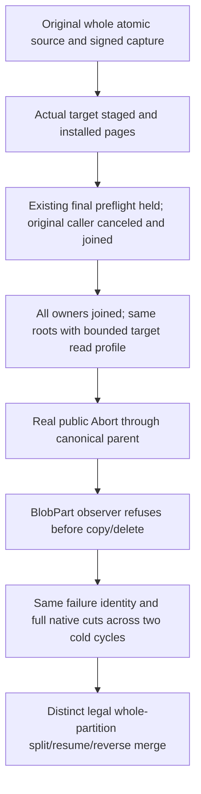

# Native bounded physical-generation cleanup

TASK-KL071-CLEANUP-READ-001 is a product/regression stage of whole KL071. Architecture KL071 and ADR-128 require complete atomic-partition copy/catch-up/cutover, generation readiness and restartable cleanup without changing atomic identity or unique/batch scope. This stage repairs one confirmed native cleanup read-admission gap; it does not reclassify the whole task or all persisted-stage crash gates as passed.

## Requirements and acceptance

- REQ-KL071-CLEANUP-READ-001 / AC-001: every native cleanup page charges actual matching baseline/staged/tombstone/lookahead work against the existing destination MaxQueryReadBytes BEFORE borrowed visitor/owned-buffer allocation. Retained key/value bytes are separately bounded by existing MaxBatchBytes before copying. Native metadata/mutation limits, closed cleanup families, role/owner/control/grant admission, order and receipt semantics remain unchanged. No cancellation is inserted into committed apply.
- REQ-KL071-CLEANUP-READ-002 / AC-002: real ZoneTree inclusive/one-under retained and examined bounds, actual one-result/two-row lookahead and full raw-image/position preservation after refusal; healthy exact owned page and two original native reopen cuts. This supporting reader test is not the complete native move.
- REQ-KL071-CLEANUP-READ-003 / AC-003: actual protected six-owner public parent installs original native pages only through existing signed grants and pauses at existing ParentFinalInstallPreflight. Cancel/join original producer, then stop/reconstruct same AppHost roots/ports/physical parameters with ONLY destination node4..6 read allowance lower than a genuine original BlobPart. Control retains its original allowance. Real SDK Abort must retain full canonical BudgetExceeded/no success value; official MCP must retain fixed safe full Problem. Stored original failed cleanup page, issuer/receiver scope/digest/nonce/expiry and BlobPart rows are independently joined. Earlier authorized Abort families and legitimate durable failure metadata are not falsely called no-effects.
- REQ-KL071-CLEANUP-READ-004 / AC-004: restore construction read allowance without changing original Move or phase command IDs; cached native failure remains failure via SDK/official MCP across two joined six-owner cold cuts. Full stopped originals equal on read-only replay. No failed phase is ACKed, no fabricated abort finalization or successful retry of a cached failure.
- REQ-KL071-CLEANUP-READ-005 / AC-005: distinct two original all-model atomic partitions subsequently execute existing real ordered whole-partition split, cancellation/disposal, original receipt resume, reverse merge, healthy SDK/official MCP/TSQL continuation and two original cold replay sequences under legal construction bounds. Existing complete literal models, unique/batch scopes, original receipts/owner/incarnation/directory/row epochs remain unchanged. The failed independent original remains fail-closed, not abandoned as an assumed success.

## Source contract and scope

Current DeleteMoveCleanupPage calls Scan (which allocates owned key/value copies) and only afterward compares retained bytes. It ignores the current query-read byte limit and matching lookahead/physical read work. The new reader uses the selected native VisitRange observer. Storage ReadBytes is logical key+value work, including overwritten baseline and selected staged work; native provider header/work ceilings remain distinct. Memory/RSS and speed claims require profiling and Linux evidence.

Public refusal proof lowers only destination construction MaxQueryReadBytes. It does not lower MaxBatchBytes or Control's original read budget, fabricate a new provider, mutate live IOptions.Value, or reset an operation budget. Existing Aspire-owned stop/join/original ports/parameter provider/restart is reused, with fresh official MCP reconnection. Same stopped images/controls/failed outcome persist; no stale caller role is trusted.

All existing Case declarations remain unchanged. New supporting Unit and RF3 declarations are explicit; UIDs require authentic discovery. Frontend N/A. Native backup, arbitrary physical-group creation, arbitrary crash-at-every-state, endurance, power loss, KL072 cross-log token translation and measured performance remain separate mandatory OPEN gates. SDK/official MCP and selected TSQL use actual existing movement/model APIs; no custom transport or lexical SQL fallback is added.

SourceN only. Current-source identities are STANDARD_SOURCE_READ and guarded; no native NF/N/creation/Y, compiler, runtime/deadline-fit or Linux pass is implied. Parked proposals are historical and are not silently rebased. Full task status remains in_progress until all canonical acceptance evidence is joined.

## Independent admission and whole-flow proof map

The stopped target input must contain exactly the original two BlobPart values: 65536 literal A bytes and four literal B bytes. Its independent key/value size selects one byte below the largest row, while the sum of all target rows outside BlobPart and retained TargetPageSpace must fit the selected allowance. This setup assertion alone does not prove per-operation admission. The decisive original retained Abort body must be Target role with BlobPart family, complete BudgetExceeded result (null Json and NativeValue, exact capacity detail), observation checkpoint and original receiver issuance; a startup, auth or parent metadata failure cannot satisfy it. Earlier successfully acknowledged target cleanup families are lawful changes. Source original models, receipts and source fence bytes remain preserved; an absent pre-install fence is legitimate and must not be invented as present.

The refused original is never claimed aborted or its failed grant ACKed. Its same-ID cached failure persists after construction-profile repair and through two actual all-six joined cuts. Two independent healthy sibling partitions reuse the unchanged current PhysicalShardPartitionMovementRf3Flow complete split/disposal/cancellation/resume/merge recipe; source and generation revisions are independently asserted by that existing whole-flow oracle. No arbitrary new physical group, sibling atomic partition subdivision or all-stage process-fault proof is claimed.

The explicit authored Calls.RefusalsAsync invocations are four (initial, repaired, two cold), each two actual public Abort calls and immediate original all-model/receipt verifiers. Existing seed setup, three reconnects plus cold reconnects, original healthy whole-flow calls, startup/readiness/tool discovery and shutdown are separate excluded work. Actual complete-count and deadline fit remain OPEN.
