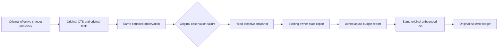

# Native cold-owner observation budget evidence
Parent: PartitionTransfer.md, REQ/AC-PMOVE-NATIVE-PREPARE-001 and REQ/AC-PMOVE-NATIVE-RETIRE-LIFETIME-001; ADR-016/017/125.
R54 Prepare UID c21cb9e2-d933-f9ad-71a7-2e4e9e0907f7 observed node0 stage2 task138 cancellation of the owner observation token, with caller token false; SAME original later succeeded. Application disposal stage6 behaved similarly. Why those observations exceeded their budget remains UNKNOWN. Default30s is not historical effective runtime evidence.
REQ-KL036-COLD-BUDGET-001: preserve the exact existing native observation deadline, original producer, cancellation tokens and unbounded SAME original join; record actual bounded primitive evidence on failure.
AC-KL036-COLD-BUDGET-001: capture the effective Runtime.ServerExecution.Value.ShutdownTimeout and resolved Clock exactly at original CTS setup. Pass unchanged timeout/clock to that same CTS; no reset, widening, new clock/timer/provider, retry, extra producer or changed original-token scope.
AC-KL036-COLD-BUDGET-002: only after a failed bounded observation, capture node/stage/original Task.Id, actual timeout ticks, actual TimestampFrequency, reference equality to canonical TimeProvider.System, owner elapsed and observation elapsed ticks on that SAME clock. No payload, credential, path, exception text or arbitrary CLR type name.
Sampling contract: guarded owner timestamp immediately precedes original CTS construction, so owner elapsed includes constructor overhead and is NOT an exact timer-expiry timestamp. Guarded observation timestamp follows original task creation and precedes existing ObserveAsync; reported span is observation work to the failure sample, not total producer duration. Canonical system-clock reference closes clock identity only when true; other clock identity remains explicitly unknown.
AC-KL036-COLD-BUDGET-003: snapshot immediately after original failed observation is recorded, before existing NodeStop owner-state output. Preserve original owner-state output order. Await actual async stderr report after original owner-state output under the same ledger before joining SAME original task. Capture/writer faults append after original observation errors; all original completion faults remain retained. No report on successful observations. Starting timestamp faults are retained in a separate diagnostic ledger under the existing Observer; append them only after the original observation vector, then clear that diagnostic ledger. Either missing start is explicitly flagged, with unknown elapsed rather than a fabricated zero. Neither start-capture failure can prevent calling the original observation/join helper. Report snapshot and writer faults remain guarded, and the SAME original unbounded join still runs.
AC-KL036-COLD-BUDGET-004: preserve complete original Prepare/Retire/HostLifetime declarations/UIDs, six-owner states/strict error/receipts/replay/no-effect/cold/healthy oracles. Source preview cannot qualify runtime fit, Linux RF3/endurance or whole KL036.

UI/API/persistence/format/provider migration: N/A, private native test diagnostics only. Compiler, native admission and runtime remain OPEN; source is preview only under Main freeze.
