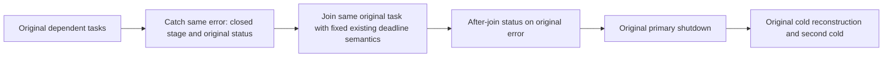

# Original native cold-shutdown cancellation attribution

Canonical slice: ClusterRouting. REQ/AC-CRS-NATIVE-SHUTDOWN-002 and original ControlledPartitionMovementNativePrepareTests.ActualNativePrepareRefusesInvalidProofThenRetainsMixedReceiptConflictAndTwoColdOwners remain unchanged.

| Requirement | Measurable acceptance |
|---|---|
| REQ-NATIVE-COLD-ATTRIBUTION-001 | AC-NATIVE-COLD-ATTRIBUTION-001: at the original task ledger capture (after the actual observer settles the same wait/original task), retain the same exception object and add only configured node ordinal, closed stage integer, original TaskStatus/task-present flag, and cancellation-requested/token-equality booleans. No message/stack/caller/entity/root/token value is copied into metadata. |
| REQ-NATIVE-COLD-ATTRIBUTION-002 | AC-NATIVE-COLD-ATTRIBUTION-002: a canceled bounded observation still records that first original failure, joins the same original task, then records its status on the original observation exception. Keep reference-based completion-error deduplication, dependent-before-primary order, all six owners, fixed deadlines and existing joined/discovery/storage guards. |
| REQ-NATIVE-COLD-ATTRIBUTION-003 | AC-NATIVE-COLD-ATTRIBUTION-003: the original complete Prepare Case retains seed/mixed/prepare/nonce/blob receipts and both cold loops/healthy continuation. Metadata failures are independently appended after original operation errors; no cancellation is filtered, suppressed, replaced, renewed or used to start an alternate task. |

CrashHost fixture diagnostics plus the exact native host Stop capture change. Closed primitive standard stderr witness lines accompany first catch and joined-task snapshots; Main retains original stderr. Standard local Exception.Data is supplementary private diagnostic metadata; it changes no public RPC/error/code/detail/status, storage format, trusted authority, clock, timeout or business operation. Configured node ordinal is supplied by the existing original list order before its shutdown starts; startup/direct-disposal paths without that group binding report −1 explicitly. Unknown node is not guessed from a physical owner or grain address. No hosted-service lifecycle selection or shutdown ordering changes. The native host Stop catch uses the same original task and native membership deadline; fixture ordinal is explicitly unknown there (−1), never guessed.

Each actual original task is returned DIRECTLY to ServerFailureObserver: its complete ordered terminal fault list and identities survive. An await/rethrow wrapper must not collapse sibling task faults. Each original captured error is diagnosed independently through the same actual observer; metadata/stderr failures follow all original errors. Stderr writes are awaited and protocol/numeric fields use named constants. Status/token-request flags are snapshots after the observer records terminal wait/task errors, not timing proof of the earliest native throw.

Attribution remains an observation, not a proven cause. Original R46 Prepare reaches RestartCoreAsync and reports TaskCanceled via ServerFailureObserver without stage/token provenance. Main must retain original runtime error metadata before declaring a specific deadline/native host/HTTP/disposal cause. Original task IDs are bounded scalar diagnostic identity, not authority or global temporal ordering. Native membership-stage output names only its actual existing token equality/requested state. R48 integrates this source and passes the complete Release compiler/formatter gates; its original Prepare flow still fails with retained cancellation evidence. The original TRX preserves case-local stderr separately from stdout. Linux and full RF3 qualification remain OPEN; diagnostic evidence alone does not repair or qualify shutdown.

ADR: N/A for this scoped diagnostic correction; [ADR-125](../../ADR/ADR-125-connection-owned-execution.md) retains the existing execution and cleanup boundary. No public, persisted or transport contract changes.

Canonical roles: CrashHost ClusterRouting/Diagnostics/ControlledNativeColdShutdownEvidence owns bounded primitive metadata; Fixtures/ControlledPartitionMovementNativeHost.Shutdown.cs owns original node stages and post-join snapshots; Fixtures/ControlledPartitionMovementNativeGroupShutdown.cs supplies original node ordinals and group task observation. Product/frontend/benchmark changes: N/A. Original Case declaration/Args/UID are unchanged; no synthetic test/provider/clock or alternate topology is introduced.

## R53 first original node-stop observation owner facts

R52 original Prepare c21cb9e2-d933-f9ad-71a7-2e4e9e0907f7 and Retire299b2d9e-318b-d59e-c34f-5edbefe179f8 preserve successful original node-stop/application-disposal tasks after canceled bounded observations. The exact caller token was not requested; these facts locate the observer failure and do not prove an initiating product defect or an exact elapsed duration. Every original exception, KEYLOAD_NATIVE_COLD line, deadline, same task join, six-owner order, receipt and two-cold assertion remains required.

REQ-NATIVE-COLD-ATTRIBUTION-004 maps to AC-NATIVE-COLD-ATTRIBUTION-004: only when the existing first NodeStopObservation records a failure, capture two actual readonly owner facts before joining that same original task: OrleansNode.HasJoinedRequestWork and whether OrleansNode.Discovery is present. Emit one bounded supplementary KEYLOAD_NATIVE_COLD_OWNER_STATE line with the same configured node ordinal/original task ID/status and those booleans; no messages, addresses, roots, user data, credentials or token values. Reads and output failures follow the original error through the existing observer ledger. No new production hook, owner state, timer, counter, provider, cache, task or retry is introduced.

HasJoinedRequestWork is the existing conjunction of requestWork, RemoteDocuments, Movement and GraphResources join states; it is not every preceding cleanup owner. Discovery resolves the existing live-host discovery service; absence reflects the cleared host reference, not a physical storage qualification. These independently read facts are not an atomic progress snapshot, and a true joined flag alone does not identify an exact blocking await. The same two original whole classes and current native/API/compiler/Linux gates must run before causal repair or shutdown qualification is claimed.
