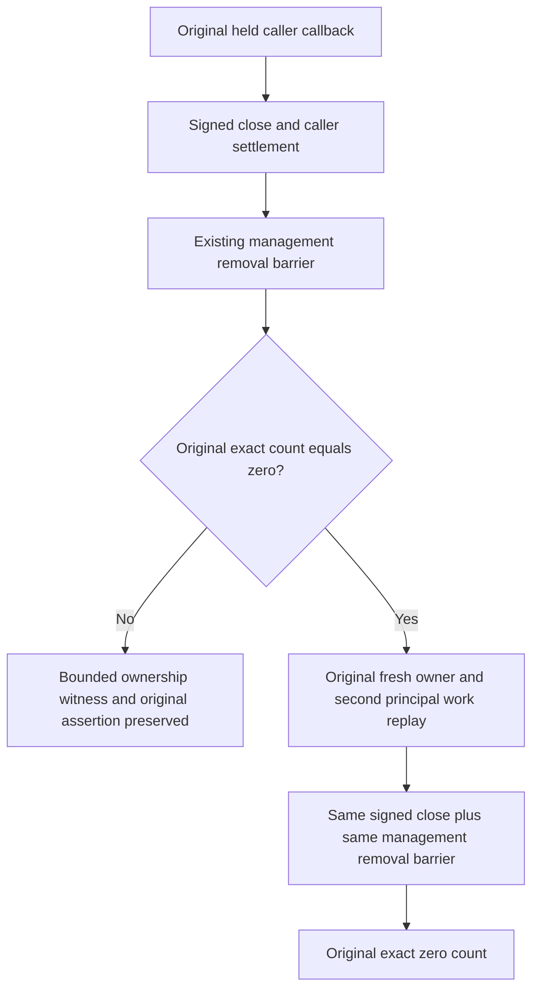

# Native connection close removal and exact count witness

Canonical parent: docs/Features/ClusterRouting.md. Applicable ADR-117 and ADR-125 retain native test entry, stable server-owned connection identity, per-operation authentication, call-local producers and joined close. This Source N candidate preserves both original 319c TUnit Case declarations and every original expected-count0 assertion.

REQ-CONNECTION-CLOSE-001 / AC-CONNECTION-CLOSE-001: every independently created native owner in the existing close continuations must use the same existing bounded management-removal barrier already used by the scenario's primary owner. Preserve original signed close verification, original cancellation token, existing PollInterval and completion/shutdown deadlines; add no fixed sleep, timer, retry, count filtering or relaxed expected0. The existing Case identities are AcCrs054ConnectionCloseJoinsOriginalCallerBeforeSignedNativeRemoval and SignedCloseRetainsOriginalCallbackLeaseThenFreshOwnerAndSecondPrincipalReplaySucceed.

REQ-CONNECTION-CLOSE-002 / AC-CONNECTION-CLOSE-002: when the original exact activation count assertion fails, preserve that same assertion exception and record one bounded native ownership witness identifying expected/actual count, whether the management set contains the scenario's server-owned connection GrainId, and whether primary close was joined. Do not disclose caller principal, credentials, document payload, signed envelope or arbitrary exception text. Diagnostic failures remain secondary to the original assertion through the existing failure observer. This witness distinguishes target-owner presence from another live owner; it does not infer callback charges or activation identity unavailable through the exact management set.

REQ-CONNECTION-CLOSE-003 / AC-CONNECTION-CLOSE-003: preserve original held callback charge, second-principal admission refusal, cancellation, store position/outcome absence, exact fresh-owner commands/replays and all primary/cleanup joins. Fix only the proved direct-freshClose→immediate count0 gap using existing barrier. Original 319c CloseAdmission failure occurred at RunAsync line37 BEFORE FreshOwnerAsync, after the primary barrier, so a fresh-owner barrier repair alone is not a proved explanation of that failure. Runtime ownership/reappearance cause remains unknown until exact diagnostic execution.

Ownership: existing ClusterRouting Unit fixture and the two existing close continuation helpers; owning product ConnectionGrain remains unchanged unless a separate source-proven cause is established. No new Case, Args, UID, public API, provider, topology, bounds, persistence format or dependency. SDK/MCP, UI, benchmarks and RF3 expansion: N/A, this is native close lifecycle regression/diagnostic conservation. Compiler/runtime/Linux/actual deadline fit remain OPEN; no 319c root-cause or passing-test claim.

Fresh native producer proof: ConnectionGrain.CloseAsync verifies the same signed owner, awaits operations.CloseAsync, then calls DeactivateOnIdle in finally. It does not await the management inventory removal. The current two fresh-owner continuations call this producer directly and immediately require exact zero. Reuse the primary scenario’s existing original bounded inventory barrier for those two independently signed owners, preserving every negative failure-bearing operation result, wrong-owner TokenInvalidated, held callback, no-effects, full receipt/replay and healthy follow-up. This closes the source-level missing fresh-owner settlement barrier; it does not explain the earlier primary-owner failure or qualify runtime.

The multiline source candidate uses a feature-local serializer responsibility for the same six closed diagnostic fields. Field expressions remain evaluated inside the original failure observer after strict activation-count assertions. Existing numeric helper, direct-dispose and mutable caller/publication sampling corrections are preserved. The current three native owning types and eight guard hashes were reconfirmed; new helper creation and existing patch admission remain pending Main after the SDK barrier.
