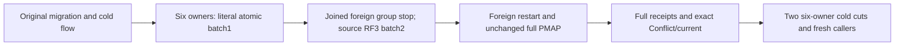

# KL069 native membership cardinality and logical atomic scope

REQ/AC-KL069-MEMBER-001..003; architecture KL069 and28.2; ADR001/016/024/036/101/117/125/128. Canonical ClusterRouting; UI N/A. Source preview only; native admission/compiler/runtime/ORIGINAL twelve-minute linked parent deadline fit/Linux qualification OPEN.

REQ-MEMBER-001: preserve the original NativeDatabaseMigrationRf3Tests Case/name/Test/Args/deadline and all original complete migration/cold statements first. Append a two-document atomic batch scoped by all four original PartitionRef fields; the independent expected mutation vector and fixed original placement/incarnation/epoch bind both outcomes. Initial literal value1/revision1 becomes value2/revision2. Original document remains originalJSON/revision3.

REQ-MEMBER-002: native Aspire/Docker Kill receipts join ONLY node4–6; node1–3 remain genuine original RF3. Second batch runs while three foreign processes are exited, then authentic BeginRestart/Restart returns the same six owned resources. Native NodeIds/incarnations/voter-counts and complete persisted PMAP are retained. This measures live physical process cardinality6→3→6; it does NOT claim exact active directory view cardinality3: the current health/membership-ready intentionally requires six, and local discovery only identifies one current silo. No forged membership or new diagnostic API.

REQ-MEMBER-003: both SDK/MCP replay original full outcomes and changed-content Conflict with full fixed SDK/MCP problems; each new response has full placement, both complete DocumentResults, original revision3 document and frozen full outbox. Native producer emits two outbox entries per two-mutation batch; independently Tail+2/records+2, unchanged firstAvailable/consumers, strictly positive byte delta admits the new whole head only after genuine success. No receipt/cold/refusal refresh. Two additional real six-owner cold cuts inspect second original outcome on source owners/absence on foreign owners, native locks and restart; fresh nested callers repeat complete receipts/current/refusal and dispose/join. Extra runtime work is explicit; no deadline increase.

AC-MEMBER-001: literal full two-document revision1 then2 and complete independent two-item receipt vector; same four components/atomic ID/placement through cardinality changes. AC-MEMBER-002: all Kill/Restart tasks joined under original ServerFailureObserver; restoration attempted for every successfully killed foreign owner even action fails; original and cleanup vector preserved. AC-MEMBER-003: strict full after-response/current and two joined cold outcomes. Directory range transfer is a separate runtime registration contract, never PMAP data authority.

The actual Microsoft.Orleans10.4 AddDistributedGrainDirectory uses versioned native DHT ranges/virtual nodes for grain registration; AddActivationRepartitioner can move activations. Existing KeyLoad KeyCodecV1+SHA256 four-component AtomicPartitionId and authoritative consensus PMAP are separate. Architecture28.2 explicitly maps buckets containing whole atomic partitions through consensus to physical shards; native directory partitioning alone does not prove that canonical data mapping or unsupported fragment acceptance. No invented4096 count, range format/API, hash%liveNodeCount, migration or fragment operation.

Primary official sources: [Grain directory](https://learn.microsoft.com/en-us/dotnet/orleans/host/grain-directory), [Directory implementation](https://learn.microsoft.com/en-us/dotnet/orleans/implementation/grain-directory). Runtime version and settings qualify only source selection, not execution.

