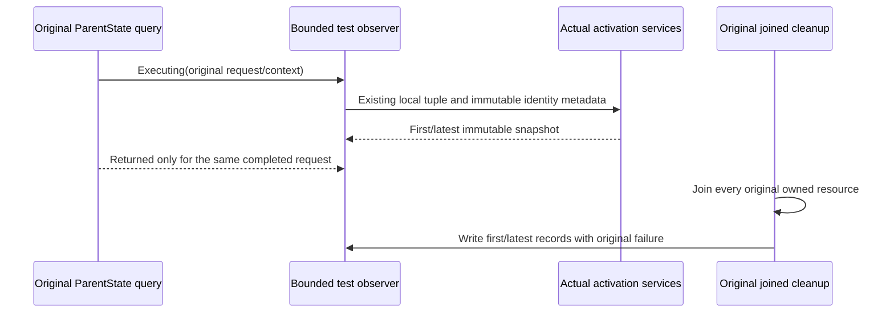

# Native movement activation owner evidence

REQ-MOVE-STATE-WITNESS-004 / AC-MOVE-STATE-WITNESS-004 preserve the existing first Executing/Returned pair and additionally retain only the latest Executing and its same-request Returned pair in the original BM25 movement and native Retire flows. Starting a newer request clears only its latest Returned slot; a delayed older return cannot be attached to that newer request. Four immutable stage snapshots are the fixed retention bound, regardless of query count.

Each stage uses the actual receiving Orleans IGrainContext and its ActivationServices. Resolve the native DatabaseEngine, registered PhysicalShardRecord and IOptions<ReplicaConfiguration> which OrleansSiloConfiguration.RegisterBorrowedServices actually registers. Record that configured activation-local physical shard, incarnation, configured initial placement epoch, ordered voter IDs, actual local replica ID and immutable store incarnation. Missing native services remain explicitly unobserved. The configured observer index stays separately labelled; neither that index nor the tuple is promoted to persisted ownership, a read-cut proof or a failed predicate.

Read only native DI/configuration and immutable identity metadata. Do not issue extra storage reads, commands, journal effects, admission changes or network operations. Retain no service provider, host, storage handle, principal, credentials, keys, user payload or signed envelope in the snapshots. Preserve all original assertions, signatures, deadlines, operations, cancellation and joined cleanup. Emit the bounded records only through the original failure reporting after joined cleanup.

AC-MOVE-STATE-WITNESS-004 is exercised by the unchanged whole cases ActualServerPublicationMovesExactNativeHeadAndStrictValidatorsRefuseWithoutEffects and OriginalNativeRetireCallerCancellationAndHostStopRetainAuthorityThenResumeReplayMixedModelsAndTwoColdOwners. A first successful ParentState read cannot establish that the last read or later movement guard succeeded. R32 original evidence records 15 passed and two distinct failures: BM25 movement OwnerMismatch and Retire startup Bootstrap/majority before movement. The first BM25 read completed; the failing predicate and full receiver input remain unobserved. This source extension supplies correlation evidence and does not repair or qualify those failures.

The native registered PhysicalShardRecord contains the configured initial placement epoch; it does not read the persisted current catalog. This distinction applies to every printed tuple field and the observer index.

Canonical slice map: UnitTests ClusterRouting/Observations/PartitionMovement/ParentOperations/NativeMovementParentStateEvidence.cs is the sole executable owner; existing Search and ClusterRouting trial helpers borrow it unchanged. Backend, SDK, MCP, frontend and infrastructure changes are N/A because this is a bounded test observer. Native compiler, original runtime and Linux/RF3/endurance qualification of this extension remain OPEN.

## R34 actual silo-service witness correction

REQ-MOVE-STATE-WITNESS-004 requires borrowing the actual registered silo services, rather than absent outer-server DI types. R34 original movement cases both reported first and latest ParentState Executing/Returned pairs with matching request and activation IDs on configured observer0, but ConfiguredActivationOwner was unobserved. Source confirms PartitionHost is not registered in the silo while DatabaseEngine, PhysicalShardRecord and replica configuration are. This scoped test-code correction changes only that immutable configured-owner observation; no new DI registration, storage read, exception interception, admission or authority is introduced.

AC-MOVE-STATE-WITNESS-004 retains both unchanged whole cases and every full original result, cancellation, cold and joined cleanup assertion. Fresh execution must show actual nonempty native tuple fields and immutable store identity from the receiving activation; observer indices remain separate. The original R34 two OwnershipLost failures happened after successful ParentState reads. Their failed movement predicate and original local phase input are still not established by those snapshots. This N-only correction does not claim the movement defect is repaired. Compilation, fresh actual wholecase execution, Linux RF3 and fault/endurance gates remain OPEN.
