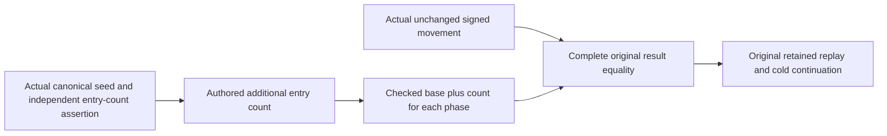

# Native movement receipts with independently authored additional seeds

Parent: [PartitionTransfer](PartitionTransfer.md), REQ/AC-PMOVE-001–003; ADR-016, ADR-017 and ADR-125.

REQ-PMOVE-SEED-RECEIPT-001: a genuine additional canonical seed shifts the source journal positions of all later movement phases. ACK, accepted Fence and retained SourceCut must use the same independently verified additional-entry count as Prepare, authorization, Fence and Capture.

AC-PMOVE-SEED-RECEIPT-001: preserve complete original result equality in ControlledPartitionMovementFenceSettlementFlow. Expected ACK is checked(14 + source.AdditionalSeedEntries), accepted Fence checked(15 + source.AdditionalSeedEntries), and SourceCut checked(13 + source.AdditionalSeedEntries). The count comes from the authored seed contract and its original actual journal-count assertion; it is never copied from the result under test. The zero-additional-entry original flow retains exactly 14/15/13.

AC-PMOVE-SEED-RECEIPT-002: preserve original operation IDs, grant/settlement/control/fence equality, deadlines, retained receipts, target placement, cold reopens and permission refusal assertions. Existing ExplicitCallerFenceRetainsOriginalSqlAndInsertsAtPublishedOwnerAcrossTwoColdStores and OriginalTypedInsertSurvivesRealRetirementCurrentPermissionFencesAndTwoColdOwners use SqlTypedInsertRetiredSeed, whose four source entries and one target entry are independently asserted before movement. Existing original movement cases retain their declarations and discovery identities.

The R55 failures reached complete ACK equality after original Prepare/authorization/Fence assertions passed. Source inspection confirms the omitted seed offset; a current rerun must establish whether any further defect remains. No product authority, storage format, caller protocol or lifecycle changes. UI and new public API: N/A, internal acceptance oracle only. Compiler, full local operation and exact-source Linux recovery/RF3 qualification remain pending.

