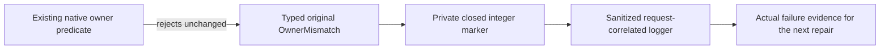

# Native movement owner guard diagnostics

REQ-MOVE-GUARD-005 preserves every current movement owner predicate, short-circuit evaluation order, original storage view, native binary comparison, clock evaluation, authorization and public OwnershipLost/OwnerMismatch detail/status. Only a rejected native predicate creates a private diagnostic marker on its original typed failure. No storage read, network call, native serialization, extra authority, deadline, retry or compatibility path is introduced. Successful execution remains unchanged.

The marker contains only one integer from the closed PartitionMoveOwnerGuard inventory. It is not authoritative, persistent state, a public DTO field or a new native payload contract. GrainFailureDiagnostics continues to emit the request identifier, closed Stage/Category/ErrorCode and a null exception; it adds only the sanitized closed MovementOwnerGuard value. No raw exception text, stack, phase payload, bytes, fingerprints, owner identity, principal, credentials, user data or provider text is emitted. A missing, invalid, differently typed or unrelated-domain marker is Unobserved; no arbitrary metadata text can become log content. A diagnostic identifies a rejected predicate and does not repair that predicate or prove why its inputs differ.

AC-MOVE-GUARD-005A requires exact source review of the four native Core files and five methods against their original bodies. Their Boolean acceptance set, evaluation order, errors, status, view/clock/native codec calls and original wholecase expectations remain identical. Tag-only failure metadata must not be mistaken for new admission, rollback, durability or recovery behavior.

AC-MOVE-GUARD-005B maps to PartitionMoveOwnerDiagnosticsTests.ClosedOwnerMarkersAndMalformedMetadataPreserveRepliesWithoutLoggingPrivateText. Actual existing EventSource logging must report each allowed guard with the unchanged public failure/status/problem and reject private-canary strings, unknown integers and unrelated domain metadata. Use the existing logging isolation key; do not widen the shared capture filter. These tests qualify only the sanitized diagnostic contract.

AC-MOVE-GUARD-005C maps to both unchanged whole movement cases OriginalNativeRetireCallerCancellationAndHostStopRetainAuthorityThenResumeReplayMixedModelsAndTwoColdOwners and ActualServerPublicationMovesExactNativeHeadAndStrictValidatorsRefuseWithoutEffects. Retain their full original receipts, cancellation, replay, exact native head, two cold owners and joined cleanup. The next genuine failure must bind the closed observed guard to the actual original request. R34 both first/latest ParentState reads returned; its two actual failed predicates remain UNPROVED. New logging, native preview or a build does not convert those failures to PASS or qualify Linux RF3, endurance or power-loss durability.

Canonical slice map: Core ClusterRouting/Contracts/PartitionMovement/Preparation/PartitionMoveOwnerGuard.cs and Diagnostics/PartitionMoveOwnerDiagnostic.cs own closed metadata; the existing Identity, Authorization, Validation and Commands files retain predicate ownership. Orleans Features/ClusterRouting/Diagnostics/GrainFailureDiagnostics.cs owns safe logging. UnitTests Features/ClusterRouting/Cases/PartitionMoveOwnerDiagnosticsTests.cs owns real logger regressions. Server, SDK, MCP, frontend, persistence format and AppHost are N/A: no execution, public API, payload or topology change belongs to this diagnostic scope. Existing receiving-silo DI witness remains independent.

The source changes are integrated and the complete local Release build passed at the R36 checkpoint. The original current-source logger regression passed in the R36 local cohort. Both unchanged movement operation cases failed and remain OPEN, as do Linux RF3, fault and endurance qualification. Diagnostic markers still identify a rejected predicate; they do not prove its original failure cause or a performance improvement.
