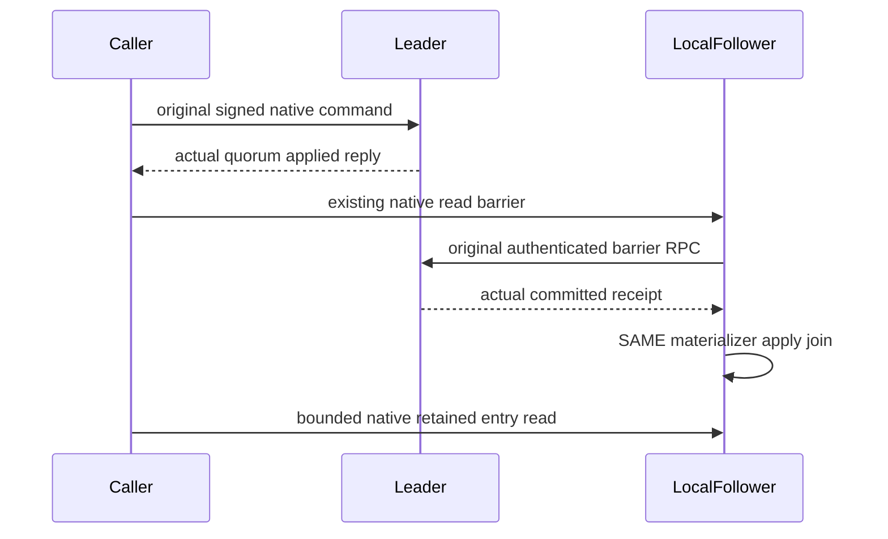

# Native movement process entry observation

Future preview only. Refines original process recovery flow without redispatch, alternate topology or snapshot-threshold changes.

REQ-MOVEMENT-PROCESS-ENTRY-001 / AC-MOVEMENT-PROCESS-ENTRY-001: original six-host native command replies do not imply every physical follower has applied the leader acknowledgement. Before node0 seed/blob/prepare/healthy journal observation, await its EXISTING actual Coordinator.ReadBarrierAsync under the original cancellation. Native follower barrier authenticates the leader receipt and directly joins SAME local Materializer.WaitForApplyAsync. Then acquire original Log.ProtocolGate, perform the unchanged bounded native retained-entry scan, and release in unconditional finally. No operation is resent and no outcome/entry is synthesized.

REQ-MOVEMENT-PROCESS-ENTRY-002 / AC-MOVEMENT-PROCESS-ENTRY-002: retain every original literal receipt/token/mutation/model/blob/phase/outcome/fullcut/cold and healthy assertion, original six hosts, real process termination, original deadline and joined cleanup. Missing or snapshot-covered entries remain failures. Published checkpoints legally make Log.ReadEntry(index<=Snapshot.Index) unavailable; a checkpoint image is NEVER called a retained tail entry.

Original R18 failure: GenuineSixHostOriginalPrepareSurvivesKilledOwnerAndColdOutcomeObservationWithoutRedispatch failed after15431.807ms with original Missing at ProcessEntry.Read35→SeedAsync25→WarmAsync73. Its original artifact does not record the local committed/snapshot cut; stale follower observation is source-proven possible, exact observed cause remains unproven until genuine rerun. Default SnapshotThreshold1024 unchanged. Existing ProcessCapture requires complete retained1..Committed history and independently refuses any legitimate checkpoint coverage; this limitation remains OPEN, not hidden by this narrower barrier repair.

Maps the SAME original existing TUnit case. Compiler, Linux process qualification and full cold/runtime gates remain OPEN. Native protocol gate does not freeze file-I/O snapshot publication; covered/missing evidence still refuses.

## Native prepared-intent identity graph

REQ-MOVEMENT-PROCESS-ENTRY-002 / AC-MOVEMENT-PROCESS-ENTRY-002 includes the v1 native serialized identity graph: the expected prepared intent must use the same PartitionRef instance as its SourcePlacement.Partition, after independently checking the complete literal partition value. ResolveRegisteredPlacement and PreparePartitionMove preserve this sharing in the actual control record; the returned control must preserve it too. The fixture must not replace this with a separately allocated equal-value record. Orleans v10.4.0 tracks references for these generated record classes, so different sharing produces different native bytes and SHA256 even when JSON values agree. Product identity construction, aliases, field IDs and digest algorithm remain unchanged.

Original R39 CanceledOriginalStopJoinsAllSixOwnersThenOriginalColdOutcomeAndHealthyReplayRemainExact failure first differed at ControlIntentDigest: fixture expected 7916e23e4e867ea0770bfb42d092e616a62709b851145c9d7fc2876cc9323b0c; actual reply contained 5730a6501ca08daf9901193c0b980e6576f8037c7e1ae8ca83a9d4634a43ff60. The fixture used its separately allocated Recovery literal PartitionRef while SourcePlacement used the CrashHost corpus instance. This source-proven fixture mismatch does not establish an Orleans serializer defect. Both original six-owner case IDs, typed identity checks, full reply JSON equality, process kills, replay, cold images, healthy continuation and joined cleanup remain required. The corrected expected digest and complete operation qualification require a genuine new execution; this source correction alone is not a pass.
