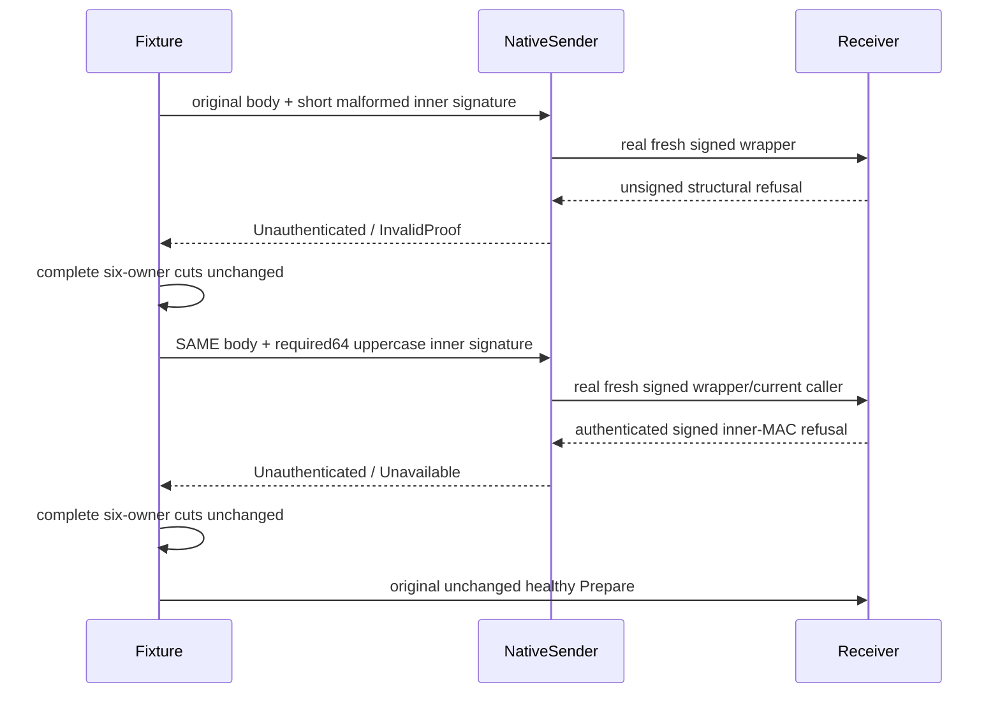

# Native movement process refusal

REQ-ROUTE-NATIVE-PROCESS-001 / AC-ROUTE-NATIVE-PROCESS-001 retain the genuine six-host signed outer request with an invalid inner MAC, followed by the unchanged healthy original Prepare. Native peer admission rejects the malformed inner signature before authenticating the request, so its outer failure remains unsigned. The original native sender must reject that unsigned response as `Unauthenticated` with `PartitionMovementProtocol.InvalidProof`. `Unavailable` belongs to a successfully verified signed failure and is not the expected result of this malformed request.

The same native process and canceled-stop cases compare complete six-owner raw images, canonical cuts and journals before and after the refusal. They must retain the original failure if any observation or joined shutdown also fails; no retry, replacement request, relaxed MAC check, accepted unsigned reply or deadline change is permitted. The original R18 refusal assertion and process-entry inspection failures are preserved as failures. This source correction does not qualify their subsequent healthy, kill, cold outcome, exact replay and joined-owner requirements.

REQ-ROUTE-NATIVE-PROCESS-002 / AC-ROUTE-NATIVE-PROCESS-002 separately exercise the authenticated failure layer through the SAME real native sender and six hosts. The original movement body/command/envelope is unchanged. A fresh outer native request carries an inner signature with the existing required64 length and uppercase hex. Outer structural validation and current-caller authentication succeed, but the ORIGINAL inner MAC requires lowercase ASCII hex and refuses before inner replay or database effects. Only this successfully authenticated failure is outer-signed and accepted as exact `Unauthenticated` / `PartitionMovementProtocol.Unavailable`. It is an additional negative layer, not a retry or replacement of the original movement operation.

Each of the two independent native refusals compares complete original six-owner cuts before and after its actual directly awaited RPC. The original healthy Prepare then proceeds unchanged into canceled-stop and killed-owner/cold-outcome/model/blob/replay/healthy flows, with original admissions, deadlines, cancellation, causes and joined resources. Product signatures, native outer authentication, safe error normalization and unsigned-reply rejection remain untouched. Compiler, actual Recovery process/lifetime and Linux RF3 acceptance remain OPEN.

Canonical slice map: the existing RecoveryTests ClusterRouting Assertions/ControlledPartitionMovementNativeProcessRefusal owns both negative layers. Existing WarmAsync and the two complete native process/lifetime cases retain all original operations and cleanup. This diagram records protocol control flow, not an executed RF3 receipt.
