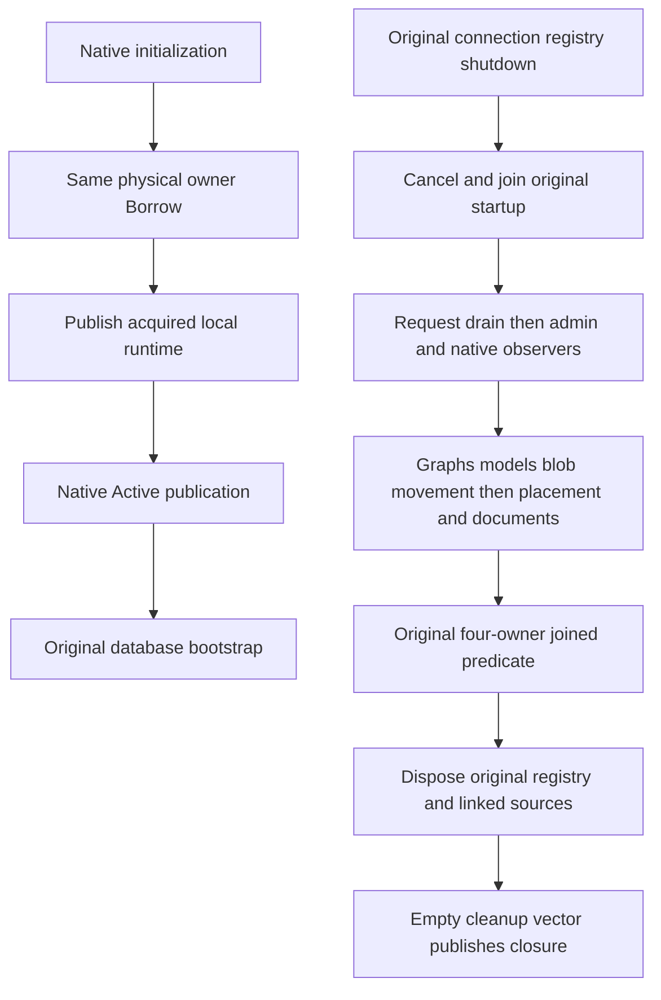

# Native node resource ownership

This correction implements REQ-FOUNDATION-003/009 lifecycle ownership under [ADR-136](../../ADR/ADR-136-native-orleans-partition-ownership.md). Source review does not establish compiler, runtime, RF3 or durability qualification.

REQ-NATIVE-NODE-RESOURCES-001: the same inert application node retains its original lifecycle lock, preparation, initialization, bootstrap and shutdown tasks. Only native initialization borrows the application-owned physical host. Neither resource owner resolves storage or services during construction.

REQ-NATIVE-NODE-RESOURCES-002: the request lifetime owns the actual request registry and both linked cancellation sources. The local runtime owns acquired documents, graphs, movement and placement, and captures native receivers immediately. A partial acquisition remains reachable before the next await or cancellation check.

REQ-NATIVE-NODE-RESOURCES-003: shutdown retains the original ordered startup and cleanup failure vectors. The existing registry-to-node-to-native-producers-to-transport-to-physical permit remains mandatory. Request work reporting joined does not erase a cancellation callback failure.

AC-NATIVE-NODE-RESOURCES-001: the original preparation and bootstrap tasks settle after both cancellation sources are cancelled. Drain starts before administration disposal; placement admission closes before graph/model/blob shutdown; movement joins before actual placement disposal; documents and physical registration join before the known-owner predicate.

AC-NATIVE-NODE-RESOURCES-002: only the unchanged four-owner predicate permits request-registry and linked-source disposal. Only an empty cleanup vector publishes the terminal closure permit. Node disposal may rejoin the same memoized owner disposal tasks after that permit; it cannot start another close or release unknown owners.

AC-NATIVE-NODE-RESOURCES-003: all original five OrleansNode partial files are guarded; the four remaining declarations must total at most 200 native numeric code lines (a margin below 190 is preferred). The obsolete work-completion helper has no remaining caller and is deleted. Main must compile the coherent sources and retain existing actual six-owner, process recovery, cold continuation, lock release, failed-init and generic-DI disposal regressions; this source packet executes none of those gates.

No physical PartitionHost is registered as a DI-owned borrowed result. The outer application storage owner remains solely responsible for actual physical disposal after every producer permit. Orleans membership and migration do not replace database RF3 replication or move node-local open handles.
