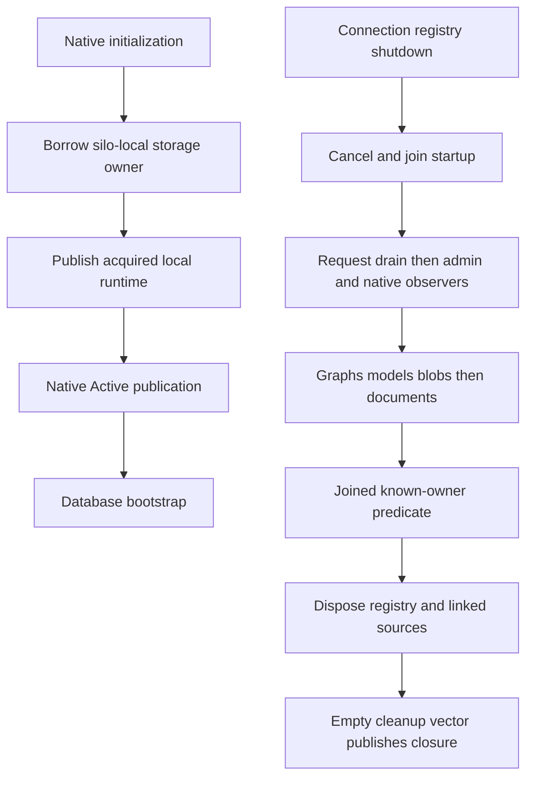

# Native node resource ownership

Lifecycle ownership of one silo's local resources under [ADR-136](../../ADR/ADR-136-native-orleans-partition-ownership.md). Parent: [ClusterRouting](../ClusterRouting.md).

REQ-NATIVE-NODE-RESOURCES-001: the inert application node retains its original lifecycle lock, preparation, initialization, bootstrap and shutdown tasks. Only native initialization borrows the application-owned storage host (the silo-local ZoneTree owner). Neither resource owner resolves storage or services during construction.

REQ-NATIVE-NODE-RESOURCES-002: the request lifetime owns the request registry and both linked cancellation sources. The local runtime owns acquired documents, graphs and models, and captures native receivers immediately. A partial acquisition remains reachable before the next await or cancellation check.

REQ-NATIVE-NODE-RESOURCES-003: shutdown retains the original ordered startup and cleanup failure vectors. The order registry, then node, then native producers, then storage services, then the storage owner's close permit is mandatory. Request work reporting joined does not erase a cancellation callback failure.

AC-NATIVE-NODE-RESOURCES-001: the preparation and bootstrap tasks settle after both cancellation sources are cancelled. Drain starts before administration disposal; graph, model and blob shutdown join before documents; documents join before the known-owner predicate.

AC-NATIVE-NODE-RESOURCES-002: only the joined known-owner predicate permits request-registry and linked-source disposal. Only an empty cleanup vector publishes the terminal closure permit. Node disposal may rejoin the same memoized owner disposal tasks after that permit; it cannot start another close or release unknown owners.

The storage host is not registered as a DI-owned borrowed result. The outer application storage owner alone performs the actual storage disposal after every producer permit. Orleans membership and activation migration never move node-local open handles; replication to ReplicaCount silos happens through ordinary Orleans calls to each silo's ZoneTree owner.
