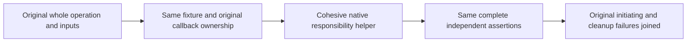

# Native ClusterRouting test responsibility tranche

REQ-CQ-006 / AC-CQ-008 and AC-CQ-MULTILINE-BLOCKS-001 preserve native file400/type200/unit64/nesting3 limits and multiline executable blocks. REQ/AC-ROUTE-008 and ADR-117/125 preserve actual caller authority, native test entry, original server-owned connection execution and joined shutdown.

REQ-ROUTING-NUMERIC-001 / AC-ROUTING-NUMERIC-001: repair only the actual matching numeric rows under the UnitTests and IntegrationTests ClusterRouting slices. Preserve every original Test/Arguments/UID, literal corpus, sample/order, full receipt/result/private image/read cut, refusal and healthy continuation. Source extraction adds no Test or weaker oracle. Scoped native diagnostics and Main canonical formatter/Release must close the original numeric limits without suppression or compression.

REQ-ROUTING-NUMERIC-002 / AC-ROUTING-NUMERIC-002: helpers own cohesive assertions, bounded diagnostic state or pure lifecycle preparation. Native dataflow must preserve actual reference identity, ref/out mutable state, callback captures, cancellation tokens, original awaited tasks, lock/apply owners and primary-before-cleanup errors. Do not capture a mutable field snapshot where the original re-reads it. New helpers remain feature-local, require exact native absence before exclusive creation, and retain complete before/post source and original native edit evidence.

REQ-ROUTING-NUMERIC-003 / AC-ROUTING-NUMERIC-003: retain all positive/negative/error lifecycle cases including failed returned results, held/canceled calls, native management close/removal, persisted revocation/no-effects, snapshot/ordered-tail and healthy replay/cold behavior. A failure witness does not replace a returned failure object or qualify a gate. Main alone executes SDK/Git/full original runtime gates; source-only/native numeric closure is not runtime/Linux acceptance.

UI/public API/dependency/provider/persistence/topology/performance changes: N/A. Only responsibility extraction is authorized. Full Unit/recovery/Docker Aspire SDK/official MCP operation qualification remains OPEN until Main executes it; no deadline or acceptance limit is raised.
