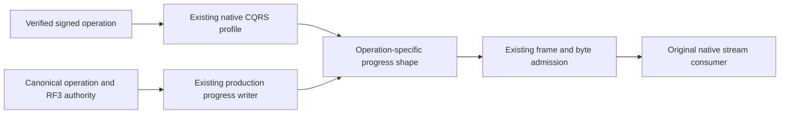

# Native online-text and placement-intent progress admission

Status: Source contract; compiler, native execution and Aspire RF3 qualification OPEN.

## Confirmed source defect and boundary

The existing native OnlineTextParentFlow and PlacementIntentParentExecution emit typed CQRS Progress frames after their real effects. NativeCqrsStreamPurpose does not classify these operations and NativeCqrsStreamAdmission handles only text, ANN and event-tail progress, so their first progress falls into terminal validation and is rejected. This is the same source boundary independently established for the actual R396 partition movement failure; online-text and placement-intent failures have not been observed in a runtime run in this repair stage. No dependency defect or ZoneTree issue is asserted.

## Requirements

- REQ-NATIVE-PROGRESS-ONLINE-001: Only an actual signed MaintainOnlineTextIndex operation may admit OnlineTextPhase progress. The exact production grammar is Captured, Seeded, CaughtUp, Validated, Published, RetirementMarked. OnlineTextReplay emits no separate replay progress. Request identity, native sequence, successful nonnull progress, exact fixed message/event type, absence of terminal data/event ID and absence of all other progress payloads are mandatory. Rejection must not advance the accepted shape.
- REQ-NATIVE-PROGRESS-ONLINE-002: ResolveOriginal may return its actual retained result without any progress. A successful stream is therefore either Started plus Completed, or the complete six-phase fresh grammar plus Completed. Partial fresh progress cannot masquerade as retained completion. Failure may occur after any accepted prefix. The shape validates protocol, never publication authority.
- REQ-NATIVE-PROGRESS-PLACEMENT-001: Only actual signed ApplyPlacementIntent may admit PlacementIntentProgressV1, bound to its original request IntentId and ExpectedRevision. Every progress has the exact native request/sequence/message/event shape, positive revision above the request expectation, 1..64 total moves, 1..total completed moves, nonempty unique original MoveId and actual Retired phase. The first progress may start after an already durable prefix on resume. Later progress keeps intent and total stable, advances completed moves by exactly one, and increases revision; a rejected frame changes no accepted state. The bounded distinct move-ID set has at most the existing canonical 64 moves.
- REQ-NATIVE-PROGRESS-PLACEMENT-002: A previously Completed intent or a zero-move plan can return without progress. If progress was emitted, successful terminal admission requires its final completed count to equal total. Failed terminals may follow any accepted prefix. The stream shape cannot grant movement, acknowledgement, placement or persisted authorization.
- REQ-NATIVE-PROGRESS-BOUNDS-001: Reuse the native CQRS stream, generated Orleans serialization, centrally validated MaximumTotalFrames, per-frame and aggregate byte limits, original cancellation, original producer joins and the connection owner. There is no alternate transport, unbounded buffering, synthetic final or timeout relaxation. Started frames must reject every optional progress payload, including PlacementIntent.

## Acceptance gates

- AC-NATIVE-PROGRESS-SOURCE-001: Review the complete future shared Purpose/Admission images and both shapes against actual production writers, native APIs and the preceding contracts. Retain exact before/new images, source guards and original diagnostic artifacts.
- AC-NATIVE-PROGRESS-UNIT-001: Actual native CQRS writers produce the complete online grammar and placement progress; ordinal identity, mixed payload, skipped phase, revision/count/total/intent/move corruption and post-refusal continuation are checked. Shared admission must admit only the bound operation profile and enforce frame/byte limits and partial-prefix terminal refusal. No standalone synthetic producer proves a real movement or publication effect.
- AC-NATIVE-PROGRESS-WHOLE-001: Main runs the original whole-operation gates through the intended Aspire-owned topology, including the actual SDK and official MCP where required, with persisted authority, canonical effects, RF3 receipts, cold recovery and joined shutdown. Source review and unit checks do not pass this gate.

