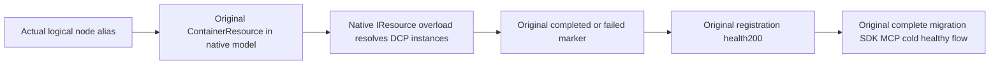

# Native owner-registration resource observation

R195 original NativeDatabaseMigrationRf3Tests.ActualIdleMigrationRejectsForeignTargetAndCancelledCallerThenStableSdkMcpColdHealthyContinuation; ClusterRouting physical owner registration and native activation-migration prerequisite. Preserve the full original declaration, genuine six Docker owners in two RF3 groups, persisted registration authority, native Orleans membership, SDK/official MCP flows, cold/replay/healthy assertions and original cancellation/cleanup bounds.

The original terminal failure is retained in `TestResults/stage61-native-join/root-r195-foundation-original-migration-rf3.completion.original.json`: exit2, outer timeout false,747.0166312078945 seconds, process joined and both output files closed. The actual test failed with OperationCanceledException at PhysicalOwnerRegistrationRf3Observation.WaitForCompletionAsync line39. NativeActivationMigrationRf3Scenario line19 was still waiting registration before it acquired an administrator or executed migration. This is an actual failed owning case, not proof any later migration negative path failed.

Original stdout independently records registration completed for node2 at10:56:52.1854370Z, node1 at10:56:52.1926765Z and node3 at10:56:52.2837023Z. All six initial `/health/ready` calls returned200. No registration-failed marker or `/health/physical-owner-registration` send observation appears in the retained stdout before the wait expired. Those readiness/worker observations establish the stage; they do not qualify the still-unexecuted migration, original session or cleanup acceptance gates.

REQ-NATIVE-REGISTRATION-OBSERVATION-001: get the existing ContainerResource from the actual DistributedApplicationModel using its logical node alias, and give that exact resource to the native ResourceLoggerService.WatchAsync(IResource) overload. Preserve all completed/failed marker checks and the subsequent actual registration health200 requirement; preserve the original token and await-foreach enumerator disposal. Do not reconstruct a Docker/DCP identifier, watch an invented logger, add a snapshot/live race, replace registration with a health-only check, or increase a timeout.

Pinned Aspire.Hosting13.6.1 metadata names source commit3751e615ad660621f2a7aa4c390ef48e08a0eed8. Its [ResourceLoggerService](https://github.com/microsoft/aspire/blob/3751e615ad660621f2a7aa4c390ef48e08a0eed8/src/Aspire.Hosting/ApplicationModel/ResourceLoggerService.cs) lines150–182 makes the IResource overload resolve native instance names; the string overload uses the string as the logger key. [ResourceExtensions](https://github.com/microsoft/aspire/blob/3751e615ad660621f2a7aa4c390ef48e08a0eed8/src/Aspire.Hosting/ApplicationModel/ResourceExtensions.cs) lines1176–1209 distinguishes display aliases from actual DCP instances. A displayed ILogger category ending `.Resources.node1` is not evidence the native stream key is `node1`; the observed Docker container name likewise is not a captured DCP logger ID. The correction delegates that resolution to the native API.

AC-NATIVE-REGISTRATION-OBSERVATION-001 remains the original complete migration declaration above. PhysicalOwnerRegistrationRf3Tests.AcOwnerRegister001To003RegistersConfiguredOwnersThenJoinsAllNodesAndReopensLiteralDirectory remains the genuine directory/registration sibling flow. Both existing declarations and every downstream operation assertion are unchanged. Re-run the original owning case through the existing native TUnit/Aspire selector after Root adopts the guarded source; no fake logger/container test or alternate topology substitutes for it.

The observed production source agrees with the original stage: PhysicalOwnerRegistrationRuntime uses actual native ISiloStatusOracle and persisted registration controller; the worker logs completion only after RegisterAsync returns; the controller sets Verified only after genuine registration, native barrier and directory equality; control-group DatabaseReady requires that Verified state. No production DI, Orleans, authority, provider, format or registration behavior changes are selected.

Only SourceN/native static numeric-nesting preparation is available here. Semantic compilation, original-case runtime rerun, all original directory/migration/session/SDK/MCP/cold gates and exact-source Linux qualification remain OPEN. The original747-second failure remains immutable evidence.
