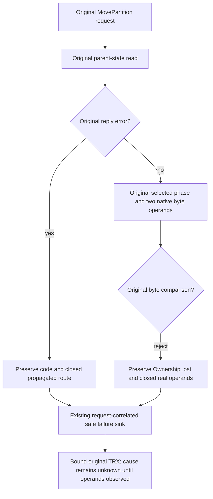

# KL036 original parent-outcome ownership operands

Canonical slice: ClusterRouting. Requirements frozen before source preview. Refines REQ/AC-ROUTE-005 and REQ/AC-MOVE-GUARD-005; ADR-016/017 retain physical placement/session authority, ADR-039 retains safe diagnostics, ADR-117 retains original native runner ownership. This is a diagnostic direction, not a proved movement behavior defect.

REQ-PARENT-OPERANDS-001 / AC-PARENT-OPERANDS-001: original BM25 and Retire whole cases, identities, request bodies, cancellation, full native model/head/receipts, replay, both cold boundaries and every original task/error remain unchanged. The R49 original case StdErr establishes MovePartition OwnershipLost while the public outcome is UnknownWriteOutcome; it does not establish the failed parent-state predicate. No elapsed-duration inference, deadline renewal, bound increase, retry or authority fallback is allowed.

REQ-PARENT-OPERANDS-002 / AC-PARENT-OPERANDS-002: distinguish the actual ReadParentOriginalOutcomeAsync local phase-byte rejection from ReadParentStateAsync propagated reply.Error before proposing a behavioral correction. Local failure observation must use the exact canonical and caller phase bytes already produced by the two existing native serialization calls, preserving their evaluation order, null guard, error code/detail/status and native result/read-grant ownership. Only safe closed route/equality/length/first-difference primitives may be recorded. No phase IDs, principal, payload bytes, MAC, paths, raw messages or stack may be emitted. The propagation route retains the original code/detail and records only a closed route/code; it must not pretend that a remote source guard was observed.

REQ-PARENT-OPERANDS-003 / AC-PARENT-OPERANDS-003: existing diagnostic owner must emit the primitive rejection witness on the original request correlation with a null logged exception. Exception metadata alone is insufficient. Actual emitted fields must be bound to the original case/result/StdErr and the exact compiled source/DLL/PDB. Unknown/malformed/unrelated metadata is unobserved, not a source cause. Successful operations gain no diagnostic storage/read/codec/network call. There is no new serializer contract or persistence format.

REQ-PARENT-OPERANDS-004 / AC-PARENT-OPERANDS-004: genuine published Linux Prepare child-output failure remains a separate original failure. Adopted child-output R2 preserves the original complete drain/fixed UTF16 character bound/early and terminal exceptions; next actual current-source Recovery TRX must retain its closed mode/pipe/count/task/reference flags. The read-only extractor binds original test definition/result/execution/source SHA and preserves duplicates. Missing witness is UNKNOWN. Pipe attribution does not identify an emitting logger or justify output filtering.

Actual three current native owners are bound. New private ephemeral Core diagnostic owns scalar witness metadata; ReceiverReads retains the original guard and two codec calls, and the existing single Orleans LoggerMessage gains only one closed sanitized field. No additional diagnostic log call or error/task ledger is introduced. Source N/NF/compiler/runtime/Linux remain OPEN. Existing logger privacy regressions and original BM25/Retire operation cases remain the qualification mapping; the actual current privacy-test body is bound and existing UnknownMetadataCannotInjectPrivateLogText is extended with same-error identity, real logger closed scalar fields, length-only mismatch, propagated route, equal/unobserved, malformed private-canary and unrelated-code controls. No new Case declaration or event-source capture owner is introduced. UI/SQL/public SDK/MCP/API/storage/provider/library/performance changes: N/A. No new Case or synthetic overflow fixture is required.

Closed witness: route1 is an observed rejected local comparison, route2 is propagated parent reply OwnershipLost. comparisonObserved=False on route2 means lengths/firstDifference=-1 and phaseEqual=False is unobserved, not a proved comparison. Route1 uses actual two preexisting native byte operands and only the failure path scans their bounded spans for the first differing offset. No bytes are retained. Unknown/malformed/wrong-type metadata yields unobserved. Source/helper compilation and actual emission remain pending.
