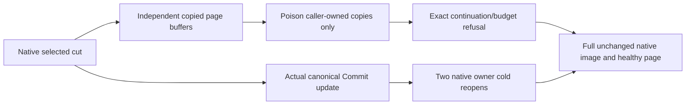

# Owned native partition-page cuts after canonical updates

Canonical parents: ClusterRouting/PartitionTransfer.md REQ/AC-PMOVE-001..003, ADR-016 and ADR-017. Complete KL036 fenced movement/authority/install/process/RF3 acceptance remains separate and OPEN.

REQ-PMOVE-OWNED-CUT-001 / AC-PMOVE-OWNED-CUT-001: strengthen SAME AcPmove001And003PagesPreserveRawBytesOrderCutAndFullScope declaration. Preserve every original row, within-one-view two-page assertion, byte/order/continuation ownership and budget oracle. AFTER original view joins, capture a fresh limited page; execute a genuine native Commit replacing b value and adding a same-family foreign-tenant record. This is a canonical native image UPDATE, not whole-snapshot replacement or destination installation. Retained a/b raw key/value and continuation bytes remain original after commit, before deliberate caller-buffer poisoning. The unaffected retained second b key/value are independently checked after both actual native owner reopens even though current b stores different bytes.

REQ-PMOVE-OWNED-CUT-002 / AC-PMOVE-OWNED-CUT-002: returned key, value and continuation have three distinct independently owned buffers. Poison only those returned buffers after the producing native view returns. Canonical full four-record image, exact store position and every expected key/value byte remain unchanged. The poisoned continuation refuses exact Validation/foreign-continuation detail; an actual correct same-family FOREIGN-tenant key independently refuses. Each refusal preserves entire bounded native fixture image/position and is followed by literal full selected-family read. No fake store/view, fabricated failure or canonical key damage.

REQ-PMOVE-OWNED-CUT-003 / AC-PMOVE-OWNED-CUT-003: derive exact retained/examined bytes from literal actual encoded rows. Fresh max2 page admits exact retained records plus independent continuation and genuine third-row lookahead. One byte under retained continuation and examined lookahead each refuses exact BudgetExceeded details, no returned partial page, full live image/position unchanged, healthy inclusive full page follows. Preserve original83-family inventory/independent caps/malformed/cancellation oracles; add no product limit/deadline/scalar mode.

REQ-PMOVE-OWNED-CUT-004 / AC-PMOVE-OWNED-CUT-004: two ordinal native cold cuts use existing PartitionRecordNativeFixture.Reopen only after joined synchronous view/Commit/read work. Preserve exact generated native identity as boolean equality, exact updated position and complete four-record fixture image, selected three rows and independent foreign row through both. Held old a/b value buffers still own originals except deliberately poisoned first record; retained second record and original continuation comparison occurs before poisoning. Reopen is native file close/open, NOT process-kill/power-loss/Aspire RF3.

Full image oracle uses native VisitRange with maximum5 records and4096 examined bytes, fails on HasMore/StoppedByVisitor/inconsistent count, copies fixture-owned bytes only after real examined-byte observer admission. Four literal rows are independently byte-ordered; raw payloads are not decoded or logged. Errors compare Code and exact literal Message, full image predicates boolean, no credentials/private runtime inputs.

SourceN owned paths: existing Unit ClusterRouting PartitionRecordPageTests targetmethod only, new Helpers/PartitionRecordOwnedCutContinuation and Assertions/PartitionRecordOwnedCutAssertions plus this spec. Root Core validators/production, A native Prepare/Retire/CrashHost and B public fixtures unchanged. No Case/UID/Args changes. Public SDK/MCP N/A for this internal native page helper; those complete KL036 real operations remain mandatory in B's separate strand, not satisfied by this regression. No new transport/provider/API/compatibility/migration.

Compiler/native admission/current runtime/Linux/endurance/resource qualification OPEN; source/golden arithmetic is not PASS. Main alone owns SourceY/SDK/Git and final coherent gates. Rollback removes only additive helper call/roles/spec, preserving original tests and immutable originals.

