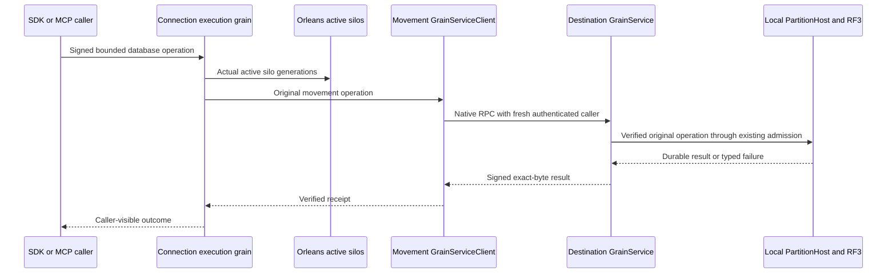

# Native Orleans partition movement

Parent specification: [ClusterRouting](../ClusterRouting.md). Decision: [ADR-106](../../ADR/ADR-106-partition-owner-movement.md), owner correction 2026-10-11. Status: Accepted; implementation and exact-source Linux qualification pending. This transport replaces the custom peer HTTP/TCP path; public SDK/SQL/MCP client protocols retain their defined contracts.

## Purpose and boundaries

A movement coordinates existing control and destination physical RF3 groups inside one Orleans cluster. Each server is a silo. Orleans owns native membership, failure detection, routing and transport; a directed GrainService instance invokes the already-owned silo-local receiver and PartitionHost. Storage handles and physical placement do not migrate with activations. Native membership needs a configured clustering provider; a designated-primary development provider cannot qualify production membership. The owner explicitly selected native Orleans localhost or Azure Storage membership for Aspire on 2026-10-11. The real Aspire RF3 topology uses AppHost-owned Azurite and native Azure Table clustering; Orleans silos join that provider. The product-wide custom Authority/Proxy membership transport and HTTP replica discovery must be retired under the coordinated authority scope before the complete owner correction is satisfied. Localhost clustering is confined to its intended local topology and does not become a production RF3 qualification shortcut.

The two physical RF3 groups remain distinct from logical partition identity and native silo membership. Original inner movement bytes, their purpose-specific MACs, grant tuples, journal identity, persisted authorization and ordered RF3 acknowledgement barriers remain authoritative. No compatibility HTTP transport, fake journal dispatcher or alternate test cluster is permitted.

## Frozen requirements and acceptance

| Requirement | Acceptance and automated complete flow |
|---|---|
| REQ-CR-NP-001: Every movement phase, outcome, receiver issue, retire cancellation and transfer-data call uses native Orleans GrainService RPC. | AC-CR-NP-001: Existing full SDK/official MCP movement reaches durable terminal receipts in the real Aspire-owned six-silo topology; no custom peer HTTP/TCP listener/client, endpoint or address-pin helper remains reachable. Native call/discovery failures remain failures. Existing PartitionMovementPublicParentRf3Scenario plus static exclusive-helper/reference inventory. |
| REQ-CR-NP-002: Resolve configured physical voters only from actual Active native full SiloAddress values including generation; authenticate a fresh directed discovery nonce and the exact addressed identity, incarnation, cluster and journal/protocol cohort. | AC-CR-NP-002: Real silo restart discovers a different generation and completes a subsequent operation; missing, ambiguous, stale, foreign or unauthenticated candidates never produce effects. No HTTP-origin DNS or fixed-port inference. Native movement restart and refused-native-call complete-flow regressions. |
| REQ-CR-NP-003: Distinguish current transport identity from immutable historical operation identity. | AC-CR-NP-003: Persist an original pending receiverIssue/cancellation packet, restart actual silos, invoke the actual permitted native dispatch/query via fresh authenticated current sender and prove original payload/signature/GUID/receipt bytes remain equal despite historical CallerSiloAddress. An unknown pre-dispatch packet without genuine ACK evidence must retain RecoveryRequired/grants and unchanged effects; do not invent resubmission semantics to force completion. A known post-ACK proof must recover its exact outcome. A different currently authenticated configured control voter may deliver the original packet. Pending-stage cold-replay regression; terminal short-circuit replay alone does not satisfy this criterion. |
| REQ-CR-NP-004: Bound fresh native envelope admission, replay, expiry, metadata, payload, discovery fan-out and runtime concurrency. | AC-CR-NP-004: Rejected MAC/target/expiry/nonce/channel/query/budget calls return bounded failure and preserve original durable model/journal cuts; duplicate/non-dispatched requests do not become success. Cancellation joins real dispatched work; shutdown joins operations before native silo stop. Existing runtime admission plus genuine native refused-call flows; resource/coverage gate remains pending until measured. |
| REQ-CR-NP-005: Keep node-local storage authority, typed persistence fingerprints and RF3 acknowledgement unchanged. | AC-CR-NP-005: Complete native movement duplicate-entry regression verifies all six raw canonical/replica images, rejects three changed GUIDs without effects across cold opens, accepts exact original append physical+1, and verifies durable receipts/models through SDK/MCP/SQL after two real restarts. PartitionWriterOrleansReplayTests.ActualOrleansTwoRf3MovementRetainedEntryRefusesChangedIdentityThenReplaysOriginalAfterColdRestart. |
| REQ-CR-NP-006: Retire the replaced implementation in the same coherent delivery and keep qualification evidence truthful. | AC-CR-NP-006: Build/format/analyzers/governance, relevant TUnit unit/process/RF3 flows, original Linux reports and coverage satisfy repository gates. Delete replaced movement-only HTTP/pins/manual-loopback/direct-submit helpers and update active inventory references. Original SocketException and other previous failures remain immutable history; no renamed or unexecuted test becomes a pass. |

## Native serialization contract

All new types use generated Orleans binary serializers and stable aliases/IDs. Interface alias `keyload.partition-movement-grain-service.v1`, version 1; methods `exchange` and `discover`. Channel alias `keyload.partition-movement-grain-service-channel.v1`: Phase=0, Outcome=1, ReceiverIssue=2, RetireCancellation=3, TransferData=4. Canonical Query is false for Phase, true for Outcome and TransferData, and the original command/query bit for ReceiverIssue and RetireCancellation. Every other channel/bit combination is rejected before dispatch.

Request alias `keyload.partition-movement-grain-service-request.v1`: IDs 0 Channel, 1 Query, 2 Payload, 3 Signature (original inner MAC), 4 CallerVoter (current), 5 CallerSiloAddress (current full generation), 6 DestinationVoter, 7 DestinationSiloAddress, 8 Nonce, 9 ExpiresAt, 10 SenderSignature. A fresh caller proof signs generated native bytes with SenderSignature blank using the existing HMAC-SHA256 primitive under its separate native request purpose. Exact original Payload and Signature are never rewritten.

Reply alias `keyload.partition-movement-grain-service-reply.v1`: IDs 0 Payload, 1 Signature (original inner reply MAC), 2 Error, 3 SafeDetail, 4 Nonce, 5 SenderSignature. A valid admitted outer request yields a reply bound to its nonce; the existing control credential signs native reply bytes with SenderSignature blank under a separate reply purpose. Before interpreting any reply error or inner data, the client verifies its nonce and outer proof. An unauthenticated malformed request cannot obtain a signed receipt. Success and failure fields must be mutually consistent; errors use fixed bounded safe details without arbitrary exception text. Original authenticated operation replies keep their native errors and exact bytes.

Discovery alias `keyload.partition-movement-grain-service-discovery.v1`: IDs 0 Payload, 1 Signature. The payload is the actual existing ReplicaSiloDiscovery, authenticated with its unchanged fresh-nonce discovery MAC. Current membership is a routing observation, never authorization; accepted control credentials, configured voter tuples, persisted authorization and receiver grants still gate effects.

Outer payload budget stays equal to the existing MaxBatchBytes; serialized proof metadata is additionally bounded by ReplicaTransportProtocol.MaximumEnvelopeOverheadBytes. Original exact-bound operations cannot silently lose capacity. Native Orleans message policy must admit this bounded envelope. Fresh transport nonce admission is separate from the inner operation nonce/replay pools. TimeProvider and validated IOptions supply lifetimes/capacities. Discovery snapshots respect OrleansMembershipOptions.MaximumRows, run bounded sequential probes and original cancellation; no unbounded retry/fan-out.

## Source map and execution

Server `Features/ClusterRouting/Contracts`, `GrainServices`, `Authentication`, `Transport` and `Hosting` own native movement. Core `Features/InternalSerialization/Execution` owns the corrected typed mutation fingerprint. Full duplicate-entry IntegrationTests use canonical `Features/ClusterReplication/{Cases,Helpers,Assertions,Contracts,Models}`; movement native admission/replay tests use `Features/ClusterRouting`. Public API, .NET and official MCP clients retain their owning slices. Frontend: N/A, no new visual flow. Public contract: N/A, no new client operation. Persistent inner format: unchanged; this prerelease peer transport has one native path and no HTTP rollback fallback.

Root owns this specification, shared DTOs/MAC and the coherent packet review; client agent owns native resolution/sender, receiver agent owns native service/admission/composition/removal, regression agent owns real Aspire fixtures/refused-operation/cold replay and old manual helper retirement. Main owns shared integration, all SDK writers, commits/pushes and Linux qualification. Each packet keeps guarded preimages; do not overwrite concurrent work.

Order: (1) freeze this acceptance contract and original failures; (2) author generated contracts and complete regression; (3) replace sender+receiver+exclusive helpers together; (4) code-review invariant/error/lifecycle/ownership and join packets; (5) build before native TUnit, correct failures, run canonical formatter then required checks; (6) run exact-source Linux RF3/process/coverage gates and record actual receipts. Native entry: `node scripts/Features/TestInfrastructure/run-tests.mjs` with the repository's suite arguments, as defined by ADR-117; C# fixtures own Aspire readiness/resources/cleanup. Build: `dotnet build KeyLoad.slnx --no-restore --configuration Release`; repository governance: `node scripts/Features/RepositoryGovernance/verify.mjs`. Use canonical Main formatter/analyzer/coverage commands without concurrent SDK writers. Source review does not close runtime/coverage gates.

Baseline: Stage58 f0d869c0 solution Release+format passed; original Unit150 had 146 pass/4 fail; recovery8 passed; previous custom-loopback movement regression failed during listener setup with SocketException before a database flow. These original results remain historical; new native regression has not executed. Pending cold-five-channel, replay refusal, measured bounds/coverage and Linux acceptance are open. Completion requires every AC above; packets and successful compilation alone do not establish delivery.

Official design evidence: [Orleans cluster management](https://learn.microsoft.com/en-us/dotnet/orleans/implementation/cluster-management), [Grain services](https://learn.microsoft.com/en-us/dotnet/orleans/grains/grainservices), [provider and Aspire configurations](https://learn.microsoft.com/en-us/dotnet/orleans/host/configuration-guide/typical-configurations). Orleans registers silos, probes and orders native membership; directed GrainServiceClient routing to a SiloAddress is a documented API. Primary-only development clustering is expressly not the production choice.

Fresh reply completion contract: server checks the outer deadline before effects. The client directly awaits the original native RPC and accepts its bounded valid same-nonce signed cancellation/unknown result after expiry-driven joined cleanup; elapsed outer expiry alone cannot rewrite that result to Unauthenticated. There is no cached/reused reply admission. Historical inner grant/envelope expiry and original purpose/target checks remain unchanged.
