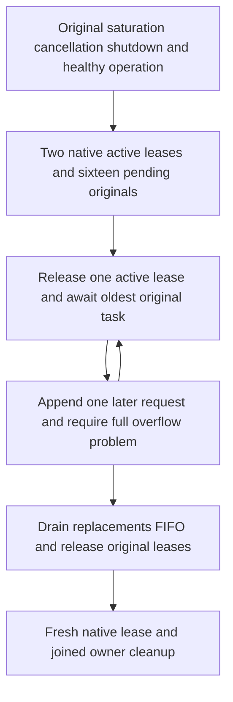

# Native placement admission FIFO

Source authored; compiler, runtime and Linux qualification OPEN. Canonical slice ClusterRouting; KL070 bounded owner admission, not per-tenant fairness.

| Requirement | Measurable acceptance |
|---|---|
| REQ-CAPFIFO-001 | AC-CAPFIFO-001: existing original case retains its saturation/cancellation/shutdown/healthy operation, then two genuine held native leases and sixteen pending originals are followed by sixteen replacement arrivals. Every oldest original succeeds before every later pending task. |
| REQ-CAPFIFO-002 | AC-CAPFIFO-002: each refill restores the sixteen-pending bound and an additional call returns the complete original ResourceExhausted problem. Drain every replacement FIFO, release both active permits, then admit a genuine fresh healthy lease. Existing caller/lease/Task ownership joins all cleanup and preserves original errors. |
| REQ-CAPFIFO-003 | AC-CAPFIFO-003: no timers, synthetic task/tenant/context, changed policy/queue/permit/deadline or new Case. Native ConcurrencyLimiter OldestFirst remains the owner contract. |

Regression mapping: `PlacementCapacityAdmissionTests.OriginalControlAdmissionBoundsCancellationAndJoinedShutdownPreserveHealthyContinuation` -> existing Flow -> `PlacementCapacityAdmissionFairness.RunAsync`. The original operation first verifies cancellation of the oldest task and promotion of its successor. This continuation tests complete FIFO progress under continuous late arrivals, not merely the first dequeue. Await actual completion of any retained pending original task, then require reference identity with the expected oldest before awaiting that oldest. A LIFO promotion thus fails the identity assertion immediately; existing owner disposal can close and join every admitted/pending task without waiting forever for an unpromoted oldest. No timer or replacement deadline is added.

This packet coherently supersedes the original-shutdown SourceN packet: its product implementation and original shutdown doc are byte-exact; only the Flow adds the final FIFO operation and this responsibility-based helper/spec. No current-file repinning or product fairness promise is implied.

SDK/MCP/frontend N/A for the native silo-local admission primitive test. Existing six-owner placement operations, tenant isolation, resource/fault/endurance and Linux gates remain mandatory. Read [capacity placement](CapacityAwarePlacement.md), [ADR129](../../ADR/ADR-129-capacity-aware-tenant-placement.md) and [ADR117](../../ADR/ADR-117-native-tunit-ci-entry.md).

