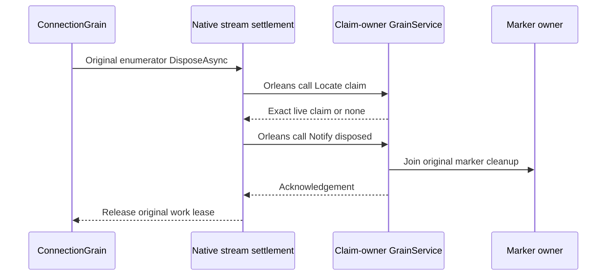

# Native original producer disposal

This supplement belongs to the canonical [ClusterRouting](../ClusterRouting.md) slice and the connection-owned execution contract in [ADR-125](../../ADR/ADR-125-connection-owned-execution.md). The original `AuthorityProducerDisposedMarkerWait` failure remains evidence, not an acceptance result.

The connection grain's producer can run on a different silo from the retained diagnostic claim. A node-local lookup at ingress cannot establish that the claim owner observed disposal. The fixture-enabled native diagnostic Grain Service is reached through ordinary Orleans Grain Service calls; it joins the actual stream disposal and the original claim without creating a database command or a durability receipt.

## Requirements and acceptance

| Requirement | Contract | Acceptance |
| --- | --- | --- |
| REQ-PROBE-DISPOSE-001 | Await the native producer enumerator disposal before the optional notification, and retain the original work lease until the notification settles. Preserve primary, fatal, disposal, notification and lease-release failure evidence. | AC-PROBE-DISPOSE-001: real native stream/owner tests show producer disposal precedes the callback, a held callback prevents lease return and drain completion, and cleanup failures remain identifiable. The original SDK and official MCP revocation flows observe the disposal marker. |
| REQ-PROBE-DISPOSE-002 | Bind the ConnectionGrain primary key to its verified ConnectionId. Match the immutable original request, command, principal, kind, expiry, connection and claim. Address the claim owner only through native Orleans Grain Service addressing; public HTTP endpoints and fixed ports never select a silo. | AC-PROBE-DISPOSE-002: a changed identity, connection or claim cannot create a disposal acknowledgement; missing or removed claims cannot be acknowledged as live claims. |
| REQ-PROBE-DISPOSE-004 | Bound typed fields, encoded bytes, admission, replay and execution lifetime. Recheck cancellation and expiry after each awaited call. | AC-PROBE-DISPOSE-004: bounded admission/replay tests and native cancellation/refusal flows preserve original failures and joined cleanup; expired or cancelled terminal replies cannot become accepted acknowledgements. |
| REQ-PROBE-DISPOSE-005 | Drain original request work, join the same notification path, dispose the observer, then stop the silo. Register one service and one observer. | AC-PROBE-DISPOSE-005: stopping rejects new work and joins admitted calls before observer state or silo services are released. Concurrent stop/disposal joins the same shutdown. |

## Native contract

`IRequestCqrsProbeGrainService` has version 1 and alias `keyload.request-cqrs-probe-grain-service.v1`. `LocateProducerClaimAsync` is readonly; `NotifyProducerDisposedAsync` revalidates the live claim before the original `WriteClaimedProducerDisposed` and adjunct cleanup. Both use generated Orleans serialization with stable aliases and field IDs. No exception object or caller payload is diagnostic content.

The service is enabled only with the existing request-probe test fixture. It does not change persisted authorization, ordered apply, journals, public .NET/MCP contracts or replica acknowledgement.

## Source map and evidence

| Surface | Paths and tests |
| --- | --- |
| Orleans execution | `src/KeyLoad.Clustering/ClusterRouting/Grains/ConnectionGrain.cs`, `Streaming/`, `Identity/`; the awaited notification runs between original disposal and lease release. |
| Unit operation tests | `RequestCqrsProducerNotificationSettlementTests` uses the real native work owner and lease. `ConnectionAwaitedSettlementTests` reuses the actual connection for success, cancellation, early disposal, awaited callback failure and healthy following work. `ConnectionNativeProducerCleanupTests` requires the producer `finally` before notification and retains the primary plus both cleanup failures. |
| Public whole flows | `RequestCqrsAuthorityFaultTests.SdkWriteHeldAcrossPersistedRevocationIsUnauthorizedWithoutEffects` and `OfficialMcpWriteHeldAcrossPersistedRevocationIsUnauthorizedWithoutEffects`. |
| Frontend/public API | N/A: internal fixture diagnostics add no UI, client operation, tool, prompt or public transport. |

The [native scheduling supplement](NativeRegressionScheduling.md) keeps the shared fixture collision domain while letting independent fixtures overlap. Task completion alone is not evidence of disposal. The current diagnostic service still uses KeyLoad-owned peer MAC authentication; that is source debt to remove (see `sourceDebt` in [status.json](../../implementation/status.json)).
