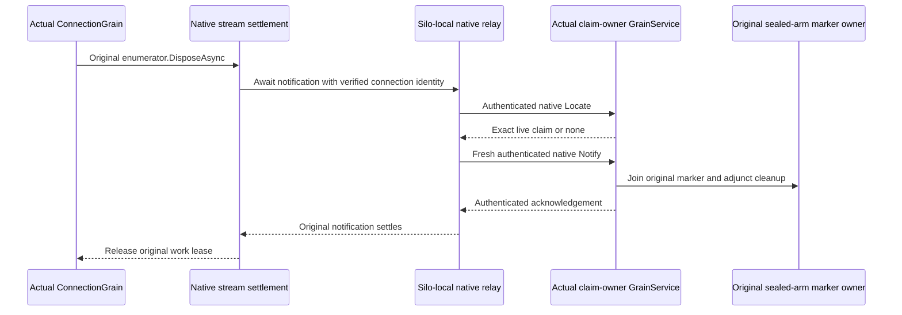

# Native original producer disposal

This supplement belongs to the canonical `ClusterRouting` slice and the current connection-owned execution contract. Its implementation is prepared in KL015 source r1; integrated compilation and operation qualification are open. The original `AuthorityProducerDisposedMarkerWait` failure remains evidence, not an acceptance result.

The actual connection producer can run on a different silo from the retained authorization claim. A node-local lookup at ingress cannot establish that the claim owner observed disposal. The fixture-enabled native diagnostic service joins the actual stream disposal and the original remote claim without creating a database command or a durability receipt.

## Requirements and acceptance

| Requirement | Contract | Acceptance |
| --- | --- | --- |
| REQ-PROBE-DISPOSE-001 | Await the original native producer enumerator disposal before the optional notification, and retain its original work lease until notification settles. Preserve primary, fatal, disposal, notification and lease-release failure evidence. | AC-PROBE-DISPOSE-001: real native stream/owner tests show producer disposal precedes the callback, a held callback prevents lease return and drain completion, and cleanup failures remain identifiable. The actual original SDK and official MCP revocation flows observe the disposal marker. |
| REQ-PROBE-DISPOSE-002 | Bind the actual ConnectionGrain primary key to its verified ConnectionId and actual `IGrainContext.Address.SiloAddress`. Match the immutable original request, command, principal, kind, original expiry, connection, sealed session/arm digest and live remote owner. | AC-PROBE-DISPOSE-002: changed identity, connection, session, arm, digest, owner tuple, voter, generation, nonce, purpose or MAC cannot create a disposal acknowledgement; missing or removed claims cannot be acknowledged as live claims. |
| REQ-PROBE-DISPOSE-003 | Use the directly addressed native GrainService and actual current Orleans membership. Local RF3 works with disabled physical cross-group trust; configured Control/Destination roles admit only their exact other RF3 tuple. Select credentials only after exact configured tuple matching. | AC-PROBE-DISPOSE-003: actual Aspire RF3 tests exercise same-group and applicable cross-group claim ownership, restart/current-generation refusal and healthy subsequent work. Public HTTP endpoints and fixed ports never select the silo address. |
| REQ-PROBE-DISPOSE-004 | Bound typed fields, encoded bytes, incoming/outgoing admission, peer enumeration, nonce replay and execution lifetime. Recheck cancellation, expiry and both current native generations after each original awaited RPC. | AC-PROBE-DISPOSE-004: bounded admission/replay tests and actual native cancellation/refusal flows preserve original failures and joined cleanup; expired or cancelled terminal replies cannot become accepted acknowledgements. |
| REQ-PROBE-DISPOSE-005 | Drain original native request work, join the same relay, dispose the observer, then stop the silo and release MAC owners. Register one relay, service and observer; attach the relay exactly once in service Init. | AC-PROBE-DISPOSE-005: stopping rejects new work and joins admitted original calls before credentials, observer state or silo services are released. Concurrent stop/disposal joins the same shutdown. |

## Frozen native contracts

`IRequestCqrsProbeGrainService` has version 1 and alias `keyload.request-cqrs-probe-grain-service.v1`. `LocateProducerClaimAsync` is readonly discovery; `NotifyProducerDisposedAsync` joins the original retained claim cleanup. Both use generated Orleans typed serialization with stable aliases and field IDs. Their MAC purposes are exactly `keyload.request-cqrs-probe-native-request.v1` and `keyload.request-cqrs-probe-native-reply.v1`, using the existing `PartitionMovementMac` native digest and verification primitive.

The original identity and the current native routing identity have separate jobs. The original identity locates the live sealed claim. The authenticated current caller, target owner, voter and full generation select and validate the native call. A readonly Locate response does not write the disposal marker. Notify revalidates the live claim and sealed arm before the original `WriteClaimedProducerDisposed` and adjunct cleanup. Unadmitted failures are unsigned refusals; admitted failures are bounded signed typed errors. No exception object or caller payload is diagnostic content.

The service is enabled only with the existing request-probe fixture. It does not depend on partition movement enablement, physical registration or database readability. It does not change persisted authorization, canonical apply ownership, replication journals, public .NET/MCP contracts or RF3 acknowledgement barriers.

## Source map and evidence

| Surface | Owned paths and evidence |
| --- | --- |
| Orleans execution | `src/KeyLoad.Clustering/Features/ClusterRouting/Grains/ConnectionGrain.cs`, `Streaming/`, `Identity/` and `Contracts/IGrainRequestProducerDisposedObserver.cs`; awaited notification runs between original disposal and lease release. |
| Server diagnostic owner | `src/KeyLoad.Server/Features/ClusterRouting/{Authentication,Contracts,Execution,GrainServices,Identity,Models}/`; node-local claims and original marker ownership remain authoritative. |
| Unit operation tests | `RequestCqrsProducerNotificationSettlementTests` uses the real native work owner and lease. `RequestCqrsProbeNative*Tests` pins generated bytes, aliases/IDs, purpose separation and tamper/refusal boundaries. `ConnectionAwaitedSettlementTests` reuses the actual connection for success, cancellation, early disposal, awaited callback failure and healthy following work, preserving principal/context, lease and committed-record oracles. `ConnectionNativeProducerCleanupTests` requires the actual producer finally before notification and retains the native primary plus both original cleanup failures. These tests are source-only until executed. |
| Public whole flows | `RequestCqrsAuthorityFaultTests.SdkWriteHeldAcrossPersistedRevocationIsUnauthorizedWithoutEffects` and `OfficialMcpWriteHeldAcrossPersistedRevocationIsUnauthorizedWithoutEffects`; disposal assertions require the original session, arm, voter, full address, entry index and term. Both original flows remain unrun for this source. |
| Frontend/public API | N/A: internal fixture diagnostics introduce no UI, client operation family, tool, prompt or public transport. |

Main must join node registration and lifecycle changes with this source before verification. Linux Build and Tests must retain the complete mandatory solution, TUnit, process-recovery, actual Aspire RF3 .NET SDK/official MCP and coverage gates. Private source application, hashes and primitive tests do not qualify a whole RF3 flow, task acceptance, endurance, power-loss durability or production readiness.

The connection cleanup supplement maps its reused-connection operation flow to AC-PROBE-DISPOSE-001/002/004 and its actual producer-finally/error-aggregation flow to AC-PROBE-DISPOSE-001/005. Both use genuine original native fixtures and operation identities; their one-silo Unit topology cannot qualify remote RF3 claim settlement. The [native scheduling supplement](NativeRegressionScheduling.md) preserves the shared fixture collision domain while permitting independent fixtures to overlap. Actual original disposal and notification must finish before the work lease returns; task completion alone is not evidence of disposal.
