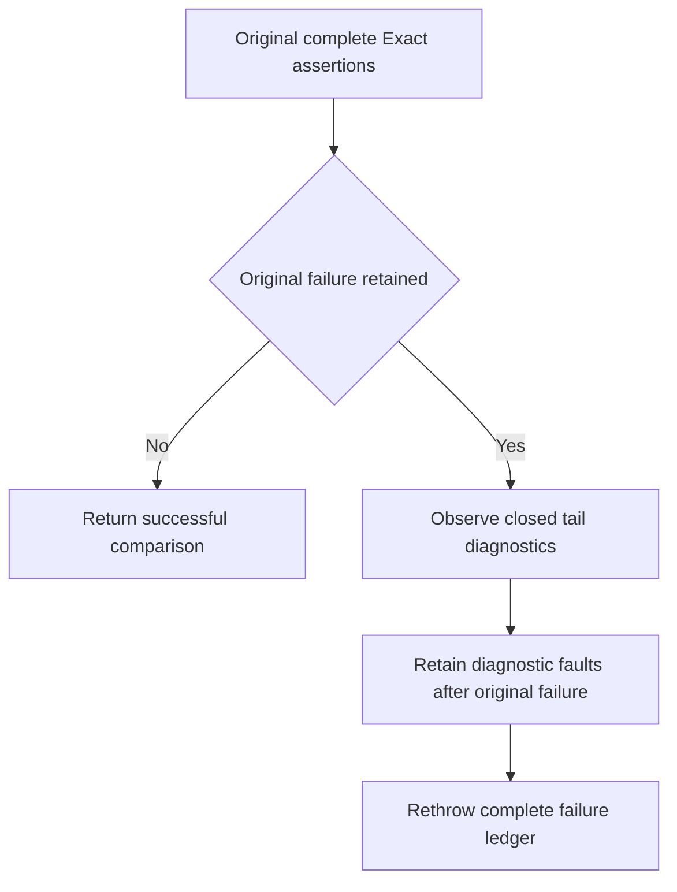

# Original native Recovery exact-tail witness

Canonical slice: ClusterRouting. Applicable decisions: [ADR-117 native TUnit entry](../../ADR/ADR-117-native-tunit-ci-entry.md), [ADR-125 connection-owned execution](../../ADR/ADR-125-connection-owned-execution.md), and the [canonical ClusterRouting requirements](../ClusterRouting.md). Existing ControlledPartitionMovementNativeHostLifetimeTests.CanceledOriginalStopJoinsAllSixOwnersThenOriginalColdOutcomeAndHealthyReplayRemainExact and full Cold/Exact invariants remain unchanged.

REQ-NATIVE-TAIL-WITNESS-001 / AC-NATIVE-TAIL-WITNESS-001: run the original complete Exact assertions first, retain every original error through existing ServerFailureObserver, then only for a failed comparison emit bounded owner/tail/term/position and added-entry enum/authority/payload equality booleans. No rows, payloads, keys, paths, principals, GUIDs or exception text are emitted.

REQ-NATIVE-TAIL-WITNESS-002 / AC-NATIVE-TAIL-WITNESS-002: all original state, rows, entries, identity, term and committed-index assertions retain exact expected values; no new startup exception, timeout, replay or retry is introduced. Diagnostic setup, filter, enumeration and writer task faults follow all original assertion errors and are rethrown together.

REQ-NATIVE-TAIL-WITNESS-003 / AC-NATIVE-TAIL-WITNESS-003: the original same genuine six-host canceled-stop/lock/cold outcome/seed/blob/model/healthy replay flow supplies the witness. Native process-recovery original evidence identifies which actual log extensions caused 25 versus27; code and elapsed duration do not establish that cause. Exact-source Linux recovery remains required; no power-loss claim.

Roles: existing RecoveryTests ClusterRouting/Assertions/ControlledPartitionMovementNativeProcessColdAssertions owns the original full assertions and closed diagnostic projection; its original Case and Processes owner remain unchanged. Product/UI/storage/public API/benchmark: N/A. No new test declaration or native UID. Source preview, native admission, compiler and runtime remain separate.

