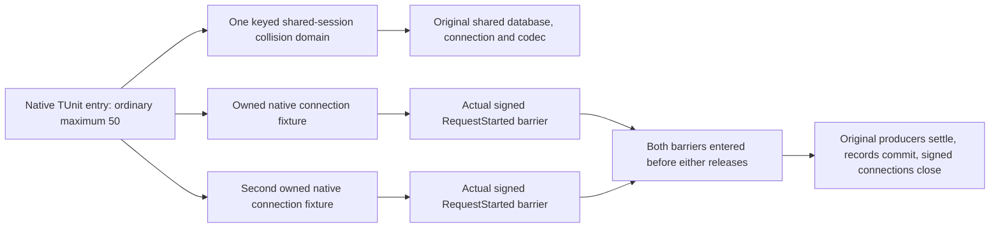

# Native regression scheduling

This supplement belongs to `ClusterRouting`, ADR-117's native TUnit entry and ADR-125's connection execution. Prepared source uses the original test fixtures and native TUnit scheduling. Compilation, ordinary-cohort execution and resource measurements remain open.

The ordinary maximum is 50. A shared mutable fixture needs one collision domain; an independently owned fixture has its own lifecycle. Scheduling must reflect actual ownership without weakening substantive assertions or heavy/Aspire RF3 isolation.

## Requirements and acceptance

| Requirement | Contract | Acceptance and source mapping |
| --- | --- | --- |
| REQ-NATIVE-SCHEDULE-001 | Preserve ordinary maximum 50 and existing heavy/RF3 ownership. Use native keyed `NotInParallel` for the default `RequestCqrsDataSource`'s mutable `PerTestSession` fixture. | AC-NATIVE-SCHEDULE-001: `RequestCqrsFixtureScheduling.SharedSession` identifies the same collision domain in `RequestCqrsBoundaryTests`, `RequestCqrsFatalSettlementTests`, `RequestCqrsRoutingTests`, `MultiLaneReceiveWholeFlowTests` and `ConnectionNativeProducerCleanupTests`. Existing methods and arguments remain unchanged; execute the original ordinary cohort. |
| REQ-NATIVE-SCHEDULE-002 | Permit independent ANN, text and connection fixtures to overlap unrelated work while retaining original cancellation and joined shutdown. Shared serialization uses its existing concurrent provider registry and per-call native serializer sessions. | AC-NATIVE-SCHEDULE-002: `RequestCqrsAnnMaintenanceTests`, `RequestCqrsTextMaintenanceTests`, `ConnectionAwaitedSettlementTests`, `RequestCqrsAnnEnrollmentAckTests` and `RequestCqrsAnnAckUncertaintyTests` have no blanket exclusion. Their actual owned factory or explicit constructor creates their database/runtime fixture. Run these original operation cases alongside the ordinary cohort. |
| REQ-NATIVE-SCHEDULE-003 | Prove independent native fixture overlap with observable original operation barriers, distinct ownership and substantive stored results. | AC-NATIVE-SCHEDULE-003: `ConnectionFixtureConcurrencyTests.IndependentlyOwnedNativeConnectionsReachBothOriginalBarriersAndSettle` starts two original `ConnectionNativeScenario` fixtures. Both actual signed commands reach `RequestStarted` before either releases. Distinct directories, connection IDs, work owners and grain identities, persisted principal binding, producer disposal, both committed records and signed close are asserted. |
| REQ-NATIVE-SCHEDULE-004 | Preserve actual global-resource exclusion until that resource's owner supplies a qualified narrower contract. Do not infer isolation from fixture names. | AC-NATIVE-SCHEDULE-004: `OrleansRuntimeTelemetryTests` retains its existing blanket exclusion because process-wide OpenTelemetry capture observes native activity and meters through bounded exporters. The scheduling packet does not modify telemetry capture, runner settings or any heavy/RF3 policy. |

## Source map and evidence

The implementation paths are `tests/KeyLoad.UnitTests/ClusterRouting/{Cases,Fixtures,Helpers}/` and the existing `Features/Messaging/Cases/MultiLaneReceiveWholeFlowTests.cs`. Changes comprise the native shared-session key, guarded attribute changes and the genuine two-fixture whole operation case. Frontend, public SDK/MCP operations and server database execution are N/A: this work changes test scheduling and adds original-fixture evidence.

SOURCE11 applies after the genuine connection cleanup SOURCE9. The ANN scheduling supplement applies after Parent R4 ACK SOURCE3 and original ACK uncertainty SOURCE5. Private patch validation verifies source composition only. It does not establish successful generated compilation, test execution, measured throughput, memory bounds, RF3 acceptance or production readiness.

Integration must execute the focused new cases and original ordinary cohort with maximum 50 through the current native TUnit entry, retaining original failures, source identity and reports. Linux solution build, process recovery and actual fixture-owned Aspire RF3 .NET SDK/official MCP gates remain mandatory. A failed or missing gate remains open.
