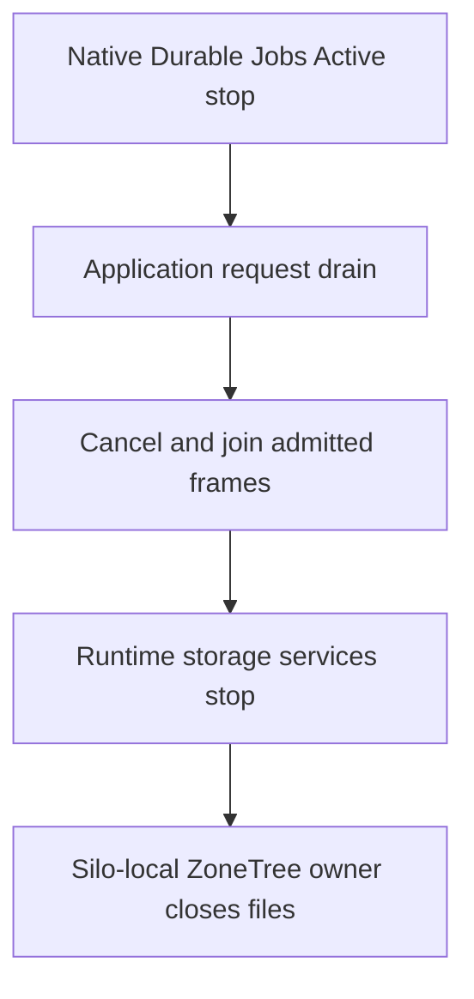

# Native application request drain

Decision: [ADR-136](../../ADR/ADR-136-native-orleans-partition-ownership.md). Parent: [ClusterRouting](../ClusterRouting.md).

REQ-NATIVE-REQUEST-DRAIN-001: native Durable Jobs keeps its own Active-stage scheduling admission and worker shutdown. KeyLoad must not reflect, remove or decorate that native participant. An independent lifecycle participant subscribes at native ApplicationServices and returns the same original `NativeRequestWorkOwner.DrainAsync` task. It performs no startup acquisition and does not skip joining when the native stop token is cancelled.

AC-NATIVE-REQUEST-DRAIN-001 maps to all three argument variants of `NativeRequestDrainLifecycleTests.AcNativeRequestDrain001JoinsOriginalProducerBeforeLowerStorageStageAndRetainsCanonicalOperation`. The whole operation uses the real Orleans `SiloLifecycleSubject`, the production DI registration and the actual request owner, plus a real ZoneTree test database write/read, original receipt replay, no-effects and a healthy revision update. Both the original and the healthy continuation reads use their actual receipt; no synthetic watermark or token-validation bypass is allowed. This local fixture does not claim replicated-cluster majority acknowledgement or Docker/Aspire qualification.

An admitted producer retains its original capability until cancellation and canonical verification settle. Stop cannot reach the lower storage observer until that lease releases. The normal and already-cancelled stop-token variants both preserve that join. A third shutdown-token callback throws one bounded exception while both frames remain held; the drain stays pending until release, then `IsJoined` is true while its memoized task retains the exact callback failure. Native lifecycle still reaches the lower observer; completion alone is not a successful drain. Expected drain/disposal causes are checked separately and every additional cause fails the test before healthy continuation. No fake lifecycle or job provider is introduced.

The test's Active and storage observers observe real lifecycle ordering; they do not implement or simulate native jobs. Native lifecycle stops stages in descending order, runs same-stage callbacks concurrently and continues after errors. Therefore the silo-local storage owner's close callback must join the original drain task and verify `IsJoined` before closing files. Registration alone and native lifecycle completion do not prove joinedness.

`NativeRequestDrainRegistration.Register` is called after `UseJournaledDurableJobs`; there is no descriptor decoration, fallback jobs wrapper, extra provider, scheduler, option or format.
