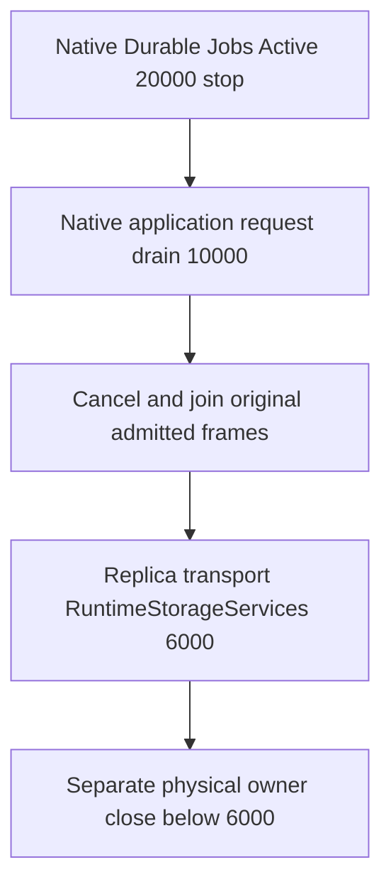

# Native application request drain

ADR-136 / REQ-FOUNDATION-009 / REQ-NATIVE-REQUEST-DRAIN-001:
native Durable Jobs keeps its own Active-stage scheduling admission and worker
shutdown. KeyLoad must not reflect, remove or decorate that native participant.
An independent participant subscribes at native ApplicationServices and returns
the same original NativeRequestWorkOwner.DrainAsync task. It performs no startup
acquisition and does not skip joining when the native stop token is canceled.

AC-NATIVE-REQUEST-DRAIN-001 maps to all three argument variants of
NativeRequestDrainLifecycleTests.AcNativeRequestDrain001JoinsOriginalProducerBeforeLowerStorageStageAndRetainsCanonicalOperation.
The whole operation uses the real Orleans SiloLifecycleSubject, real production
DI registration and actual request owner, plus a real ZoneTree TestDatabase
write/read, original receipt replay, no-effects and a healthy revision update.
The fixture uses its existing native replica-admission path: the actual durable
replica log append, committed cut and joined ReplicaMaterializer apply publish
the canonical session-token watermark. Expected full ProcessDurable fixture
receipts use the independently captured pre-operation replica index plus one;
the retained original entry, committed cut and Database.LastApplied must match.
Store.Position remains a separate physical no-effects observation. Both original
and healthy continuation reads require their actual receipt minimumToken; no
synthetic watermark or token-validation bypass is allowed. This local fixture
path does not claim RF3 quorum or Docker/Aspire qualification.
An admitted producer retains its original capability until cancellation and
canonical verification settle. Stop cannot reach the lower storage observer
until that lease releases. The normal and already-canceled stop-token variants
must both preserve that actual join. A third real shutdown-token callback throws
one original bounded exception while both frames remain held. The original
drain stays pending until release, then IsJoined is true while its memoized task
retains the exact callback failure. Native lifecycle still reaches the lower
observer; completion alone is not a successful drain. Expected drain/disposal
causes are checked separately, and every additional cause fails the test before
healthy continuation. No fake lifecycle or job provider is introduced.

The test's Active and storage observers observe real lifecycle ordering; they do
not implement or simulate native jobs or replica transport. Native lifecycle
stops stages in descending order, runs same-stage callbacks concurrently and
continues after errors. Therefore the separately owned physical-close callback
must join the original drain task and verify IsJoined before closing files.
Registration alone and native lifecycle completion do not prove joinedness.

The integration owner removes the old descriptor snapshot/Decorate calls and
calls NativeRequestDrainRegistration.Register after UseJournaledDurableJobs.
No aliases, fallback jobs wrapper, provider, scheduler, options or formats remain.
Build/analyzers/formatter, actual test execution, full-host constructor-cycle,
real native Jobs shutdown, public SDK/MCP RF3 and Linux gates remain OPEN.
