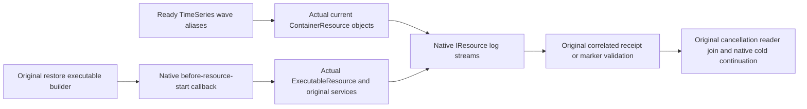

# Native Aspire resource log bindings

Follow-up to the retained original R195 migration failure and its independently reviewed native-resource observation correction. This batch repairs the same source-confirmed API misuse in the existing TimeSeries and BackupRestore whole-operation fixtures. No new workload, provider, parser, role, transport, timeout, clock or infrastructure is introduced.

REQ-NATIVE-RESOURCE-LOG-001: bind a known logical model alias to the actual resource object, then use native ResourceLoggerService.WatchAsync(IResource). Never guess a Docker name, reconstruct a DCP name or substitute an ILogger display category for a log-stream identity. The pinned Aspire.Hosting13.6.1 native overload resolves DCP instance names; the string overload uses its input as the logger key. See [ResourceLoggerService150–182](https://github.com/microsoft/aspire/blob/3751e615ad660621f2a7aa4c390ef48e08a0eed8/src/Aspire.Hosting/ApplicationModel/ResourceLoggerService.cs) and [native name resolution1309–1318 (TryGetInstances1292–1301)](https://github.com/microsoft/aspire/blob/3751e615ad660621f2a7aa4c390ef48e08a0eed8/src/Aspire.Hosting/ApplicationModel/ResourceExtensions.cs).

REQ-NATIVE-RESOURCE-LOG-002: SampleChunkNativeJobRf3Log resolves exactly the original six TwoRf3MembershipProtocol.Nodes into actual ContainerResource objects from the current application model. SampleChunkPendingRf3Log resolves exactly the original three RequestCqrsProbeFixtureProtocol.Nodes. Complete that finite resolution before allocating the owned cancellation source or starting any readers, so missing model binding cannot leave a partially started set. Preserve original command IDs, returned-versus-executing job receipt equality, strict pending-refusal text/UTF8 bound, Task.WhenAny/caller cancellation, cancellation of siblings, original Task.WhenAll joins, enumerator disposal, failures and output. Re-resolve the actual current application after every existing cold restart; do not retain prior-wave resource objects.

REQ-NATIVE-RESOURCE-LOG-003: the restore operator and held-stage observers receive the actual original ExecutableResource. Their fixture originally creates readers before application.StartAsync, so passing a model object there alone still resolves too early. Use the existing native cli.OnBeforeResourceStarted callback to create both original readers through the event's actual Services and original captured cancellation token. Native DCP object preparation and instance annotation precede this event; the awaited event precedes creation/start of the actual executable. Both original subscriptions therefore attach to the real instance before its first output. See [pinned DcpExecutor PrepareObjects170–184 and awaited OnResourceStarting1041–1050](https://github.com/microsoft/aspire/blob/3751e615ad660621f2a7aa4c390ef48e08a0eed8/src/Aspire.Hosting/Dcp/DcpExecutor.cs), the [ApplicationOrchestrator236–283 event bridge](https://github.com/microsoft/aspire/blob/3751e615ad660621f2a7aa4c390ef48e08a0eed8/src/Aspire.Hosting/Orchestrator/ApplicationOrchestrator.cs), and the [ExecutableCreator309–328 actual DCP instance requirement](https://github.com/microsoft/aspire/blob/3751e615ad660621f2a7aa4c390ef48e08a0eed8/src/Aspire.Hosting/Dcp/ExecutableCreator.cs). A construction-only feature helper keeps the owning fixture within the existing type bound; the fixture retains the callback, both fields, history registration and original conditional held-stage assignment. The callback creates original feature-owned observations; it introduces no additional producer, detached observer, snapshot/live handoff or guessed stream ID.

AC-NATIVE-RESOURCE-LOG-001 keeps every original SampleChunkSchedulingRf3Tests declaration: AcChunk009012ActualProviderReturnedBeforeAdmissionAcknowledgementJoinsColdAndOriginalMerge; AcChunk009012ActualThirtyTwoChargedAdmissionsColdRefusalManualSettlementThenFreshHealthy; AcChunk009012OriginalReturnedProviderAllSixSigkillNativeJobIdentityColdAndFreshHealthy. Preserve genuine native job identity, returned/admission/merge marker relationship, original32 charged admissions/refusal/manual settlement, real all-six SIGKILL or joined stop and original healthy SDK/official MCP continuation across the existing cold cycles.

AC-NATIVE-RESOURCE-LOG-002 keeps all original ClusterRestoreRf3Tests declarations and bodies, ClusterRestoreRf3ResumeTests.ActualOwnedProcessCutResumesOriginalPlanAndNativeSlotsThenWholeRf3CallersContinueCold for all seven original cut arguments, and ClusterRestoreMixedRetentionRf3Tests.MixedRetainedStateRestoresPausedThenCurrentAuthorizationContinuesAndAllSixOwnersReopenCold for all four original routes. Preserve single original operator receipt/error count and full literal shapes, maximum retained characters, exact operation ID/stage/PID/duplicate checks, original process kill/exit observations, parent and read cancellation, disposal of original enumerators, original reader joins, native owner lock checks, same-plan resumption and six-owner SDK/MCP/current-policy/replay/healthy flows. These actual declarations are owning regressions; no mock log emitter or alternate microcase substitutes for them.

The R195 terminal747-second failure remains immutable. Its exact DCP logger key spelling was not observed; this batch makes no claim otherwise and does not claim those four consumers executed in R195. These four source-confirmed logical-alias consumers are repaired from their actual call paths and pinned native APIs. Independent full source peer, semantic build, complete original owning RF3 declarations, original process recovery and exact-source Linux qualification remain OPEN. Code review/static parse is not native runtime, benchmark, power-loss or acceptance evidence.
