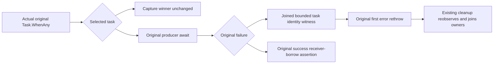

# Native Retire original-producer selection before cleanup
Parent: docs/Features/ClusterRouting/PartitionTransfer.md; ADR-016/017/125.

The [Aspire Retire migration](RetireAspireOwnership.md) intentionally moves the complete original operation from Unit direct-host composition to Integration native TUnit/Aspire. It preserves the original-producer-first attribution and all operation invariants through the actual typed SDK producer and native marker task; native discovery must assign its new assembly/namespace UID. Earlier UID/declaration-preservation statements below describe the original source cohort and do not authorize retaining a substitute cluster. Original R54 failure evidence remains historical and unresolved by a source migration.
REQ/AC-PMOVE-NATIVE-RETIRE-LIFETIME-001 retains actual MovePartition, receiver borrow, selected cancellation, exact UnknownWriteOutcome, every six-owner image/receipt and two original cold cuts.
REQ-KL036-ORIGINAL-SELECTION-001: a failure of the exact producer selected by Task.WhenAny must retain bounded evidence before cleanup reobserves that same task.
AC-KL036-ORIGINAL-SELECTION-001: only original-winner failure emits selected=original plus real process-local original/capture Task.Id and eight closed task/cancellation booleans. This names actual task references. The selected=original branch is the actual WhenAny winner; completion/cancellation flags are observed AFTER the original task is joined and BEFORE cleanup, not an atomic snapshot at selection. IDs are not public command IDs, globally stable identities or receiver admission proof. No payload, credential, storage root or exception detail is printed.
AC-KL036-ORIGINAL-SELECTION-002: await the SAME original producer first under existing ServerFailureObserver. Await actual Console.Error.WriteLineAsync under that same failure list; original error remains first and writer failure follows. No pending write survives the branch. Original successful-first branch still throws the exact existing receiver-borrow absence assertion.
AC-KL036-ORIGINAL-SELECTION-003: preserve every original declaration/UID, signed request, expiry, configured deadline, task join, mixed-model golden, exact error, Resume/replay and two cold flows. Before Capture cancellation and capture-winner behavior stay byte-exact.
The R54 original first OwnershipLost guard remains UNKNOWN. This is a source-proven attribution gap closure, not a behavioral movement fix or whole KL036 acceptance.

UI N/A: native fixture diagnostics. Product schema/storage/API/provider N/A: unchanged.
Qualification: reviewed source adopted; native preview and write completed. Compiler/runtime, real process/Linux RF3 and whole KL036 remain OPEN.
