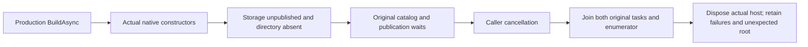

# Native runtime constructors before storage publication

ADR-136 and FoundationDelivery REQ-FOUNDATION-009 require the actual Generic Host
and native Orleans providers to construct without borrowing unpublished physical
storage. This contract uses production ServerConfiguration.BuildAsync, not copied
composition, a mock resolver, manually opened database or simulated lifecycle.

REQ-NATIVE-CONSTRUCTOR-001 / AC-NATIVE-CONSTRUCTOR-001: before Start, resolve the
real hosted services, native ILocalDurableJobManager and named journal provider
and catalog. Both native journal interfaces identify the same provider. The
configured three-voter production topology remains unchanged and its fresh data
directory must remain absent. Constructors do not prove native Active or Ready.

REQ-NATIVE-CONSTRUCTOR-002 / AC-NATIVE-CONSTRUCTOR-002: the actual named catalog
enumeration and same-owner storage publication wait remain pending while native
admission/publication are closed. Cancel their real caller-linked token; settle
BOTH original tasks, then the actual enumerator, then the original production
host. Retain every unexpected fault and cleanup error. Any unexpected data root
is retained, never deleted to make the test pass. Cancellation does not open
admission, start storage, replace tasks or prove an unstarted physical opening.

Both criteria map to NativeRuntimeConstructorCycleTests.
ProductionConstructorsAndPendingNativeCatalogCancelBeforePhysicalPublication.
The separate [native job public operation](../Messaging/NativeRuntimeJobPublication.md)
exercises genuine SDK/MCP RF3 results. Existing RuntimeJournalNativeStorageTests,
RuntimeJournalGraphCallerTests and NativeSagaTimeoutRestartTests remain mandatory
regressions. Their preopened native fixtures are not constructor-publication proof.

The pinned [native LocalDurableJobManager.Start](https://raw.githubusercontent.com/dotnet/orleans/d114d7522a53b8cce4c6b97d44293e5c7273d766/src/Orleans.DurableJobs/LocalDurableJobManager.cs) launches background loops and
returns Task.CompletedTask at Active. It does not await initial catalog recovery
inside that callback. Closed database admission may suspend the background read;
native shutdown must cancel and join that original work. This source fact does
not replace actual startup, shutdown or RF3 qualification.

Compiler, native constructor test, recovery, Docker/Aspire SDK/official MCP and
exact-source Linux gates remain OPEN. Public schema, UI and performance are N/A.
No package, format, timeout or quota changes are introduced.

